# Bettacraft features

Everything Bettacraft does, in detail and with pictures. The short version is in the [README](README.md#features); the
handbook in the game (GuideME, Patchouli or Modonomicon) has a page for every animal, plant, coral and device. Every
picture and animation here is a real capture of the game, taken automatically in the showcase world (see "Building from
source" in the README); the ones marked "shaders" use Complementary Reimagined, all others are without shaders. Every
feature is on every Minecraft version and loader unless the README's "What is missing where" says otherwise.

- [Bettas and genetics](#bettas-and-genetics)
- [Aquariums and the interior](#aquariums-and-the-interior)
- [Plants and corals](#plants-and-corals)
- [Tankmates and small animals](#tankmates-and-small-animals)
- [Reef tanks and seahorses](#reef-tanks-and-seahorses)
- [Brackish water and mangroves](#brackish-water-and-mangroves)
- [Big tanks and big animals](#big-tanks-and-big-animals)
- [Terraria, paludaria and their plants](#terraria-paludaria-and-their-plants)
- [Turtles, frogs, geckos and snakes](#turtles-frogs-geckos-and-snakes)
- [Guests: pets, animals of other mods and mobs in glass](#guests-pets-animals-of-other-mods-and-mobs-in-glass)
- [Equipment and water](#equipment-and-water)
- [Monitors, maps and waypoints](#monitors-maps-and-waypoints)
- [Food and live food](#food-and-live-food)
- [The aquarist villager and the hired aquarist](#the-aquarist-villager-and-the-hired-aquarist)
- [Handbook, progression, switches](#handbook-progression-switches)
- [Debug log and bug reports](#debug-log-and-bug-reports)

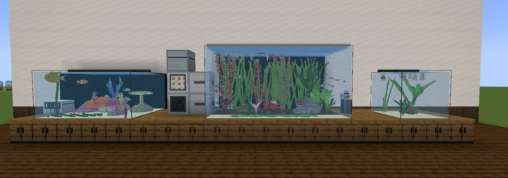

## Bettas and genetics

- **Wild bettas** spawn in swamps (also those of biome mods); catch them with a water bucket or a fish bag, the fish keeps
  all its genes. A **magnifier** (or the aquarium) analyses the hidden genes of a new animal. Some wild bettas are
  *Betta imbellis* or *Betta smaragdina*: they cross with *B. splendens* into fertile hybrids.
- **Mendel genetics:** nine loci with two alleles each (tail shape, fin length, pectorals, body colour, fin colour,
  pattern, pattern colour, iridescence and its colour), dominance, carriers and mutations: 8 tail shapes, short and
  long fins, dumbo ears, 43 colours, 12 patterns and 16 named varieties (Koi Galaxy, Nemo, Black Orchid, Mustard Gas
  ...), all data-driven and changeable with datapacks.
- **Breeding:** conditioning with live food, bubble nest under floating plants, spawning, eggs, larvae and six life
  stages; fry need infusoria and artemia that you culture yourself (larva tub, artemia hatchery). The breeding tab of the
  tank menu shows Punnett squares. Two adult males fight (they flare first, also at a mirror stick).
- **Two sizes:** bettas are drawn at **Normal** size (the default since 1.28, about halfway between the old size and the
  bettas of other mods) or **Large** (the size before 1.28); the server sets it for everyone (`sizes.betta`), the hitbox
  follows the look, nothing else changes.
- **Lively swimming:** bettas dart off now and then, rest more at night and flare at rivals; a betta that waits holds its
  height.

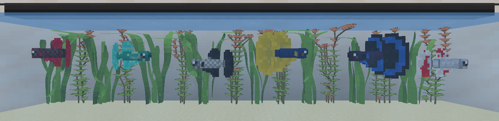

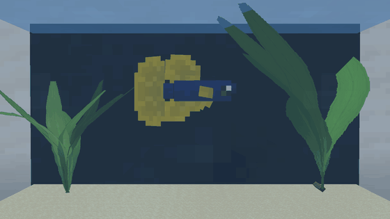

## Aquariums and the interior

- **Multiblock tanks** of any glass and any connected shape (box, L, T, steps ...), up to 16x16x16 (configurable to
  64; big tanks up to 32x16x32), with the connected texture of the glass or perfectly clear. Real vanilla water, filled
  bucket by bucket, rendered clear (also with Sodium and Iris). The animals are real entities.
- **Interior:** sneak and right-click with an empty hand to step inside a pocket dimension at 16 blocks per tank block
  and build with any block: substrates, equipment and 29 decorations (castle, wrecks, skull, aquascaping stones such
  as Seiryu, dragon stone and holey rock, roots, mangrove stilt roots, clay tubes that are spawning caves, a diving helmet,
  a treasure chest that bubbles from the air pump ...). Almond leaves and alder cones on the floor lower the pH and feed
  the shrimp. The aquarium shows the result as a live miniature; several players can build at once. The interiors of
  removed tanks are cleaned up on the disk (`/bettacraft interior cleanup` shows what they take).
- **Care:** temperature from biome and time of day, heaters and coolers, hunger, overcrowding, water quality, oxygen,
  sickness and recovery; a tank log tells you what happened. Tank menu with overview, inhabitants and their genotype,
  breeding tab with Punnett squares, water, devices, plants, users and log; name sign, owner lock and a break protection.
  The menu grows with the screen where the GUI scale leaves room (longer lists, full-size labels, all warnings at once,
  long names in full under the mouse); a shoal that is too small is named with its fish and minimum ("Neon Tetra: 3 of
  6") in the overview, the breeding tab and the info overlays.
- **Tank users:** the users tab lists other players as **caretakers** (they may do everything the owner may) or
  **viewers** (they see the menu and change nothing); everybody else is ruled by the lock, the owner's FTB Teams party
  counts as caretakers. Every user switches his own alarm waypoint of the tank there. A gear button in the overview opens
  Bettacraft's client settings.

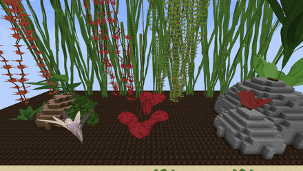

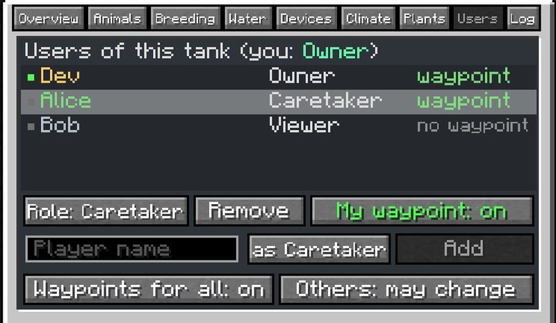

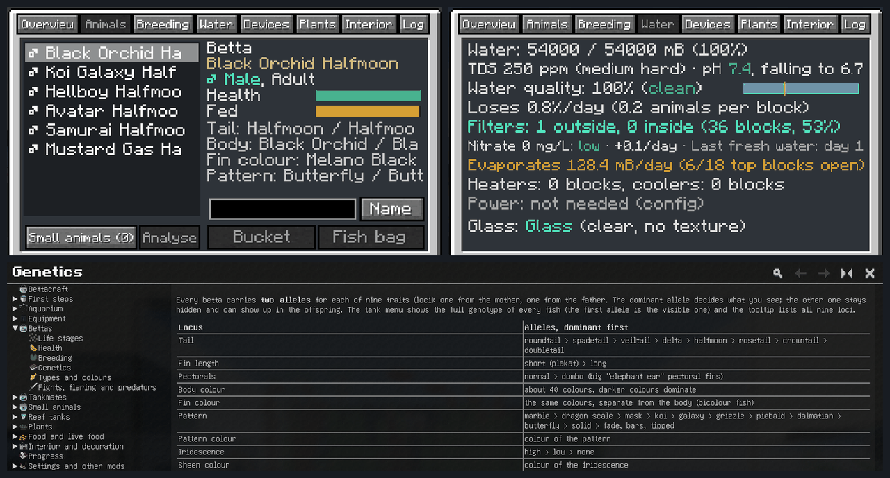

## Plants and corals

- **49 aquarium plants** (Java fern, six Anubias, ten Bucephalandras, Java, Christmas and flame moss, Riccia,
  Cryptocorynes, Amazon sword and Echinodorus 'Red Diamond', Rotalas, Ludwigias and other stem plants, carpets such as
  Monte Carlo, HC 'Cuba', hairgrass and Marsilea, Vallisneria, Sagittaria, Aponogeton, tiger lotus ...) grow over the
  days from a cutting into plants of many blocks, get redder (or white) in strong light, some need CO2 or soft water,
  are trimmed with shears and clean the water. The **Marimo** ball rolls with the current. **Floating plants**
  (duckweed, frogbit, salvinia, red root floater, water lettuce, hornwort, Riccia) drift on the surface, grow and
  spread; lily pads stay put.
- **Plants of Minecraft and other mods work too:** kelp, seagrass, lily pads and corals, and the water plants of
  Fintastic, Regions Unexplored, Twilight Forest and Alex's Caves in the interior lower the nitrate and count for
  breeding like a full-grown plant of ours (a little less), without growing and without needs; Fintastic's live rock
  filters salt water. Modpacks add more with profiles.
- **Liquid fertilizer** makes them grow up to half as fast again; the plants use it up, too much feeds the algae. A
  **fertilizer maker** mixes it from kelp meal, nutrient salt and water and pipes it into the tank; the dosing pump doses
  it too.
- **Every plant grows wild** in the waters of its origin: Anubias and Bucephalandra on stones in jungle water, stem
  plants in swamps, Vallisneria in rivers, Marimo balls in cold lakes, floating plants on calm water. The wild carpets
  are fine sprigs standing apart on loose leaves (each species with its own leaf form), the wild mosses round cushions of
  leafy discs, the Marimo round balls. Shears cut a cutting, the plant grows back.
- Every plant and coral has **real leaves, polyps and tentacles that sway** in the water, inside and in the miniature
  outside; zoanthids and star polyps close when a fish swims by. Kelp and seagrass sway too.

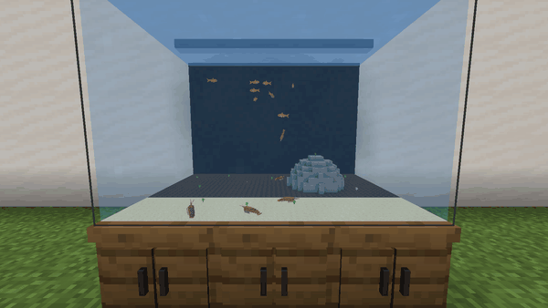

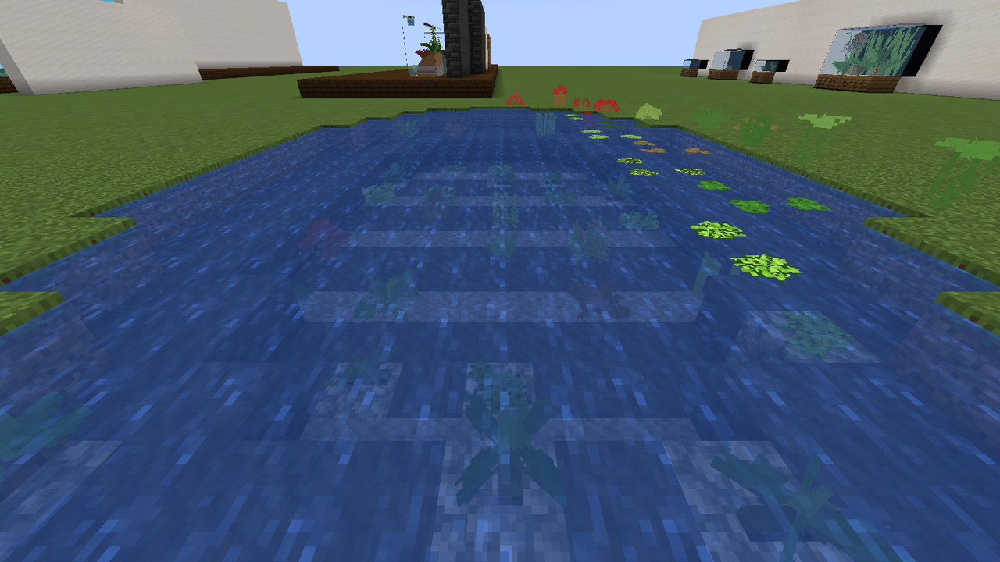

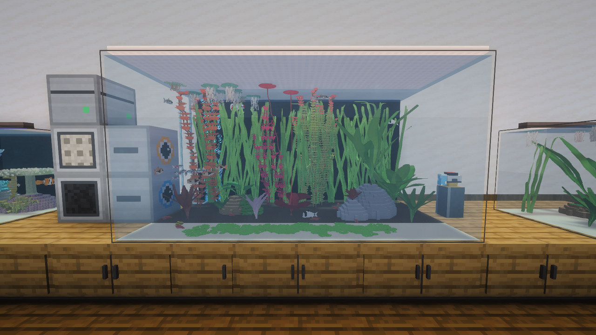

## Tankmates and small animals

- **50 freshwater tankmates** with their own models and behaviour: tetras (neons also Diamond, Gold and Albino, gold
  cardinals, albino glowlights), rasboras and danios, rainbowfish, corydoras (albino and longfin panda, albino sterbai, the
  bronze cory with Albino and Gold Laser), plecos, otocinclus, loaches, the garra and the panda garra, barbs, guppies and
  endlers (own genetics with 28 strains), platys, mollies and swordtails, gouramis, **cichlids** (rams in six forms with
  Black and German Blue, Apistogramma, angelfish, discus) and **puffers**. Shoals, water ranges, predators and prey, fin
  nippers, snail eaters, and a breeding style per species (glued eggs, caves, egg scatterers, livebearers, foam nests,
  open and cave brooders that guard their young, a mouthbrooder). Small fish dart off now and then and the shoal follows
  its leader, bottom fish scoot, fish that are active by day rest more at night. **In the wild** (and once you let them
  go) a shoal swims as a school behind its leader too.
- **Small animals:** Neocaridina in eleven colours with selection grades, bee shrimp (Crystal Red/Black S to SSS, Blue
  Bolt, Wine Red, Tiger), Sulawesi shrimp and snails, dwarf crayfish, nerites, apple snails, ramshorns and more crawl
  over floor, plants and glass; algae grow and the cleaning crew eats them. Crayfish stay in their hides by day and come
  out at night. **Dwarf clawed frogs** breed like in nature: a cool water change sets a pair off (amplexus), the spawn
  floats at the surface (fish eat it, floating plants hide it), the tadpoles need infusoria and become froglets. **Big
  crayfish** (the Florida crayfish in blue and orange, the all-female marbled crayfish) eat plants, dig them up and catch
  slow fish.
- **Every animal has its own icon** in its bucket, fish bag or transport tub (and every amphibian and reptile in its box):
  you see which fish, shrimp, snail or crayfish is inside (the gene-coloured ones in their colour).
- **Axolotls** (vanilla) get real care in a tank: cool water with a cooler, eggs on the plants, larvae, and the five
  colours inherited by Mendel (blue recessive and rare).
- **Wild animals and corals** live in the waters they come from (jungle, swamp, river, mangrove, warm and lukewarm
  ocean); the waters are biome tags, so the biomes of biome mods count too. Catch them with the aquarium net. An own
  frugal spawn pass keeps them findable next to the fish of other mods (the shrimp and snails with their own limit, in
  shallow water by the bank); `/bettacraft wildlife` shows what lives where.
- **Water animals of all mods** (fish, axolotls, tadpoles, seahorses ...) live in the aquariums; whales, bosses and
  hostile mobs are refused with a reason, other big animals go by the size rule of the big tanks.

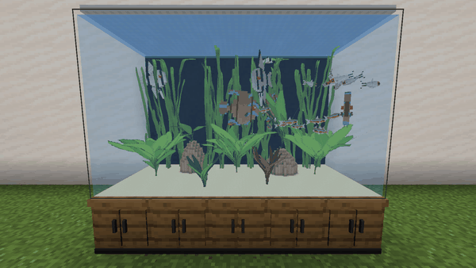

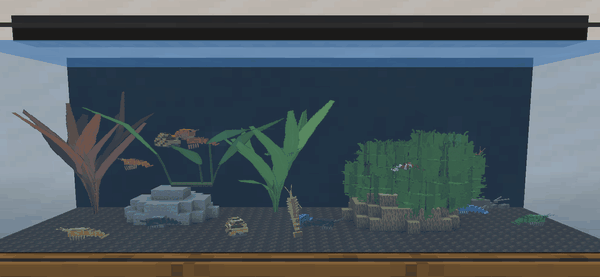

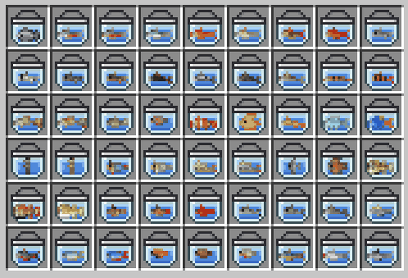

## Reef tanks and seahorses

- Sea water, salinity, protein skimmer, flow pump, reef and live rock, actinic light. Seven corals and the bubble tip
  anemone grow with light, flow, calcium, alkalinity and magnesium (four-channel dosing pump), bleach or glow and give
  frags. Clownfish spawn at their anemone, and their **larvae need rotifers** that live on phytoplankton (both cultured in
  bottles); tang, goby, chromis, damsel, the lyretail anthias (a shoal fed often), the **Banggai cardinalfish** (the male
  broods in his mouth), the **mandarinfish** that lives only on the copepods of the live rock, cleaner and fire shrimp,
  hermit crabs, turbo snails.
- **Seahorses** (the lined seahorse in three colours and the dwarf seahorse) swim upright, hold on to seagrass, kelp and
  corals with their tails, eat live food, and the male gives birth from his brood pouch.
- **Sump** in the cabinet under the tank: its water counts with the tank, its chambers hold heaters, a protein skimmer,
  filter media and a **refugium** with Chaetomorpha that takes up nitrate; a **calcium reactor** dissolves coral rubble with
  CO2 for the stony corals.

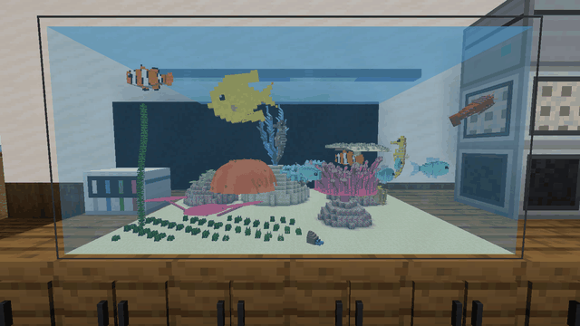

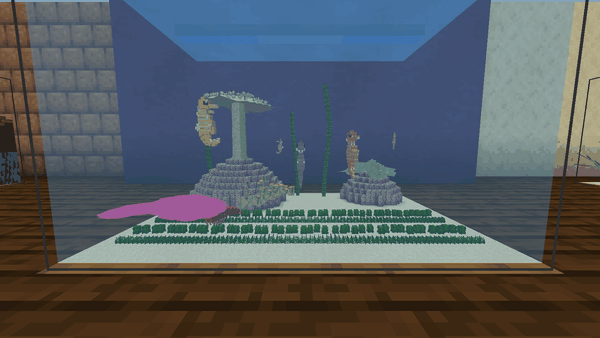

## Brackish water and mangroves

- The **archerfish** shoots insects off the leaves above an open tank with a jet of water (and now and then a player), the
  **mudskipper** skips over the mud of a brackish paludarium and climbs roots, the **Amano shrimp** needs brackish water for
  its larvae (net them over into a brackish tank), and a **mangrove propagule** grows into a small mangrove with stilt
  roots and a crown over the water.

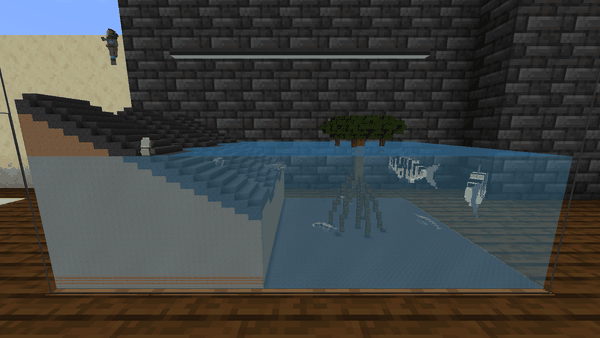

## Big tanks and big animals

- **Big tanks** up to 32 x 16 x 32 blocks with a coarser interior (scale 8 or 4); a decorated tank that grows past 16
  blocks keeps its layout at the new scale, and nothing is lost.
- **A size rule** for big animals by their real length (12 x 6 x 3 blocks and 100 water blocks per metre, adding up).
- **Ten giants:** pangasius, redtail and wels catfish, arapaima and motoro stingray in fresh water; bamboo shark (it lays
  egg cases that hatch when there is room), blacktip reef shark, spotted eagle ray, schooling cownose rays and the
  honeycomb moray in its lair in sea water. Wild in rivers, jungle water and warm oceans; vanilla **dolphins** in very
  big sea water tanks (they want raw fish by hand or from a feeder). The giant fish of other mods (arapaimas, coelacanth,
  tuna, gar, catfish, the manta ray and shark of Living Things) go into big tanks by the same rule with their real length.
- Caught with the **large net** or the **steel leader** into a **transport tub** that carries one animal; big animals
  swim wide curves, turn slowly and eat the small fish of their tank.

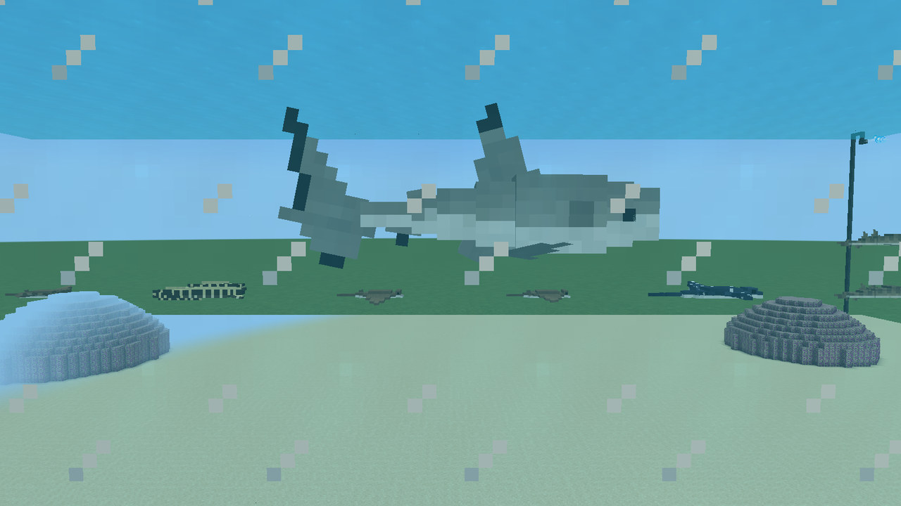

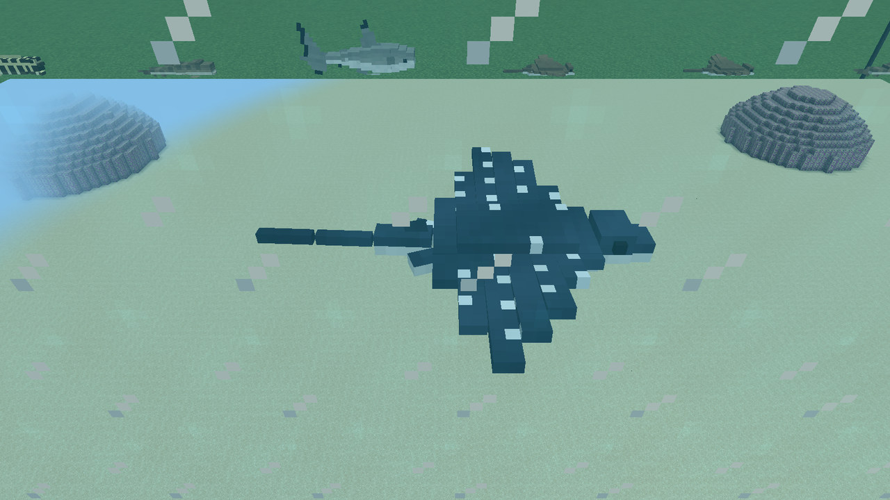

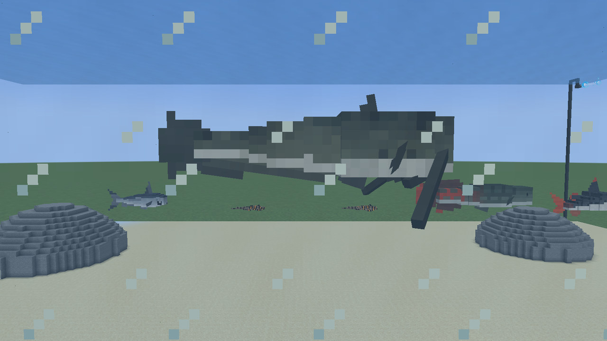

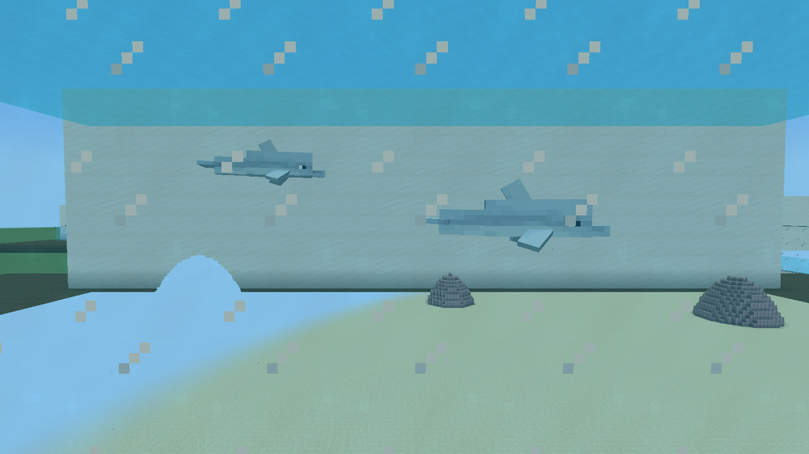

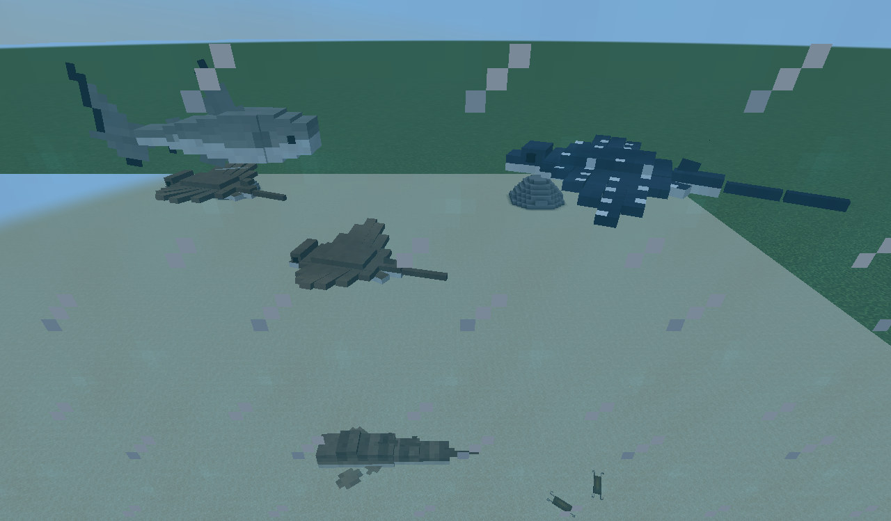

## Terraria, paludaria and their plants

- **Terrarium and paludarium:** a tank without water is a terrarium, one with water and land built in its interior a
  paludarium, with air temperature, humidity and UV; heat mats, basking lamps, misters and a thermo-hygrometer. The
  tank type can also be fixed in the menu, so a terrarium is never flooded by mistake.
- **36 terrarium plants** for the land of terraria and paludaria, in three habitats: bromeliads (Neoregelia, Guzmania,
  Vriesea), the air plant, Fittonia, Pothos, Marcgravia, ferns, cushion moss, reindeer lichen, Selaginella, a miniature
  orchid, the rex begonia and Peperomia for the rainforest; sundew, trumpet pitcher, Nepenthes, Venus flytrap,
  butterwort, sedges, soft rush and papyrus for the swamp and the shore; cacti, Echeveria, Haworthia, aloe, agave, living
  stones, stonecrop and grasses for the desert.
- They grow by the **light, humidity and air temperature** of the tank (each species its own ranges, shown in its
  tooltip), languish in the wrong climate or under water, spread (side shoots, runners, offsets) and keep the air humid.
  Shears take cuttings, **offsets** (cacti, succulents, bromeliads, the air plant) and **divide** the mosses.
- **Wild** in jungles, lush caves, swamps and mangroves, deserts, badlands and savannas; outside a tank they can be planted
  as decoration. Tortoises **graze** the prickly pear, the stonecrop and the grasses, dart frogs carry their **tadpoles
  into the cups of grown bromeliads**, snakes and geckos **hide** among the plants; aquarium plants grow emersed above the
  water of a humid paludarium.

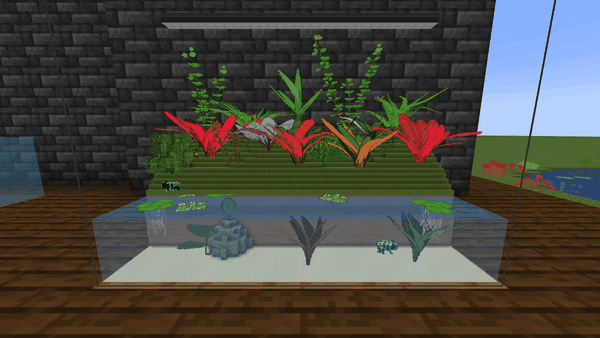

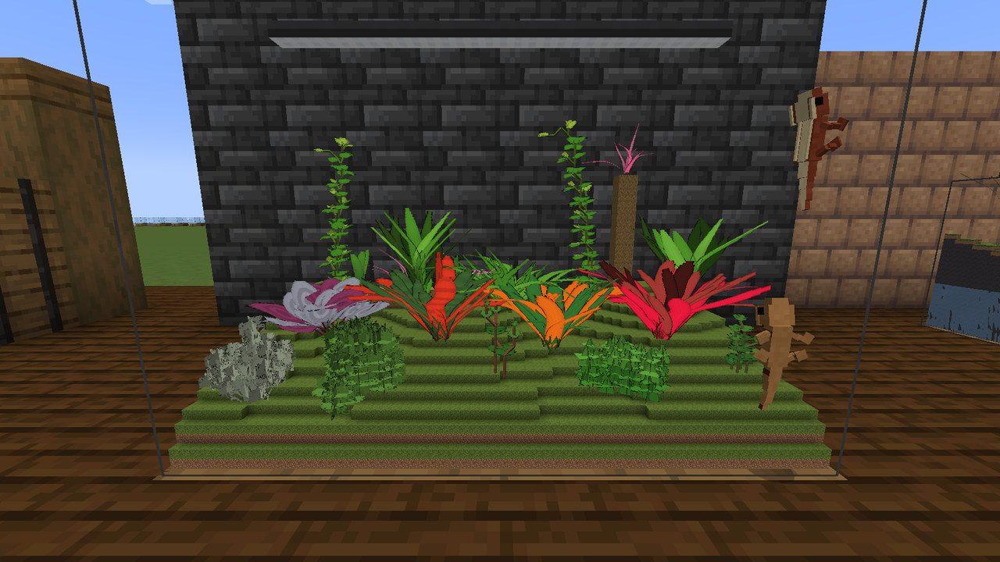

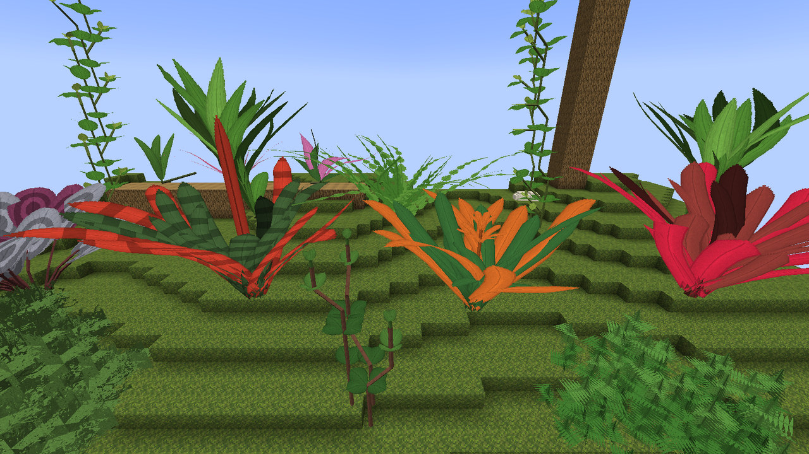

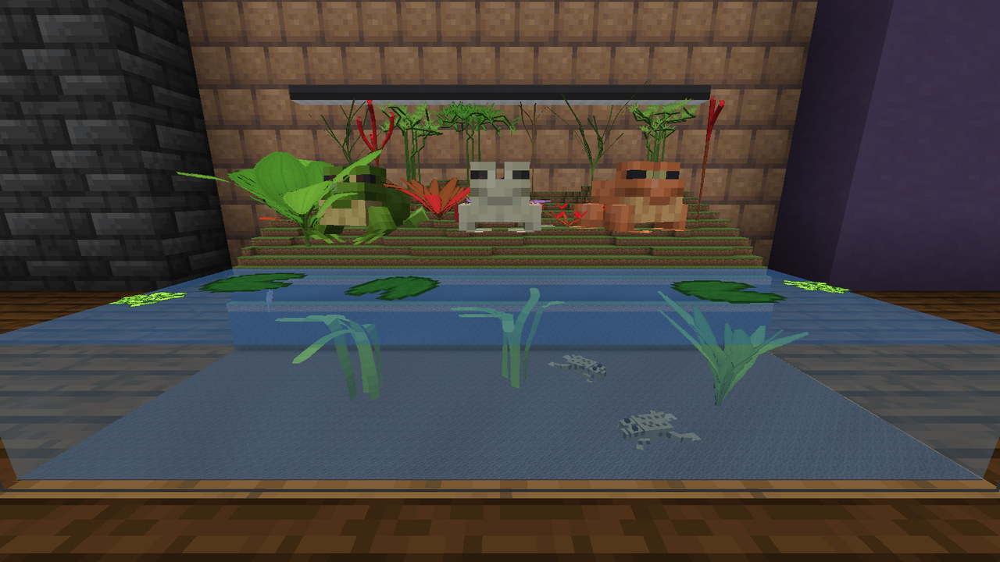

## Turtles, frogs, geckos and snakes

- **Turtles:** musk turtle, red-eared and yellow-bellied slider, Hermann's tortoise (brumates in the cold) and Reeves'
  turtle; eggs in sand or soil, and the **nest temperature decides the sex** of the hatchlings. **Grown sea turtles** go
  into big sea water paludaria with a beach.
- **Amphibians and reptiles:** poison dart frogs (tadpoles in the water or in the bromeliads), Cranwell's horned frog,
  leopard and crested geckos (the crested one climbs the glass) and the corn snake, with crickets and fruit flies from
  their cultures; wild in jungles, deserts, forests, savannas and swamps.
- They **move like the real animals**, in the world as in the tank: each keeps its hours (dart frogs, the mudskipper and
  the turtles by day, the geckos, the horned frog and the musk turtle at night, the corn snake at dusk and dawn), goes at a
  calm pace with short sprints, climbs branches, roots and rocks, sits on leaves, hides in caves and under overhangs, and
  does things while it sits still: the snake raises its head, flicks its tongue and lies coiled, lizards look around and
  wave the tail tip, frogs call with a pumping throat, turtles stretch their necks. In the world they bask in the sun and
  run from a player who comes close. **Climbing in the world:** turtles, the tortoise, the leopard gecko and the corn
  snake climb one-block steps instead of jumping, the crested gecko climbs whole walls (to the top and over, or part of
  the way to hold on), the mudskipper climbs logs and mangrove roots; snails and shrimp climb walls under water.

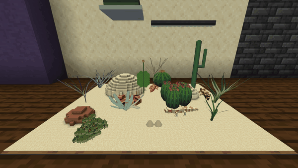

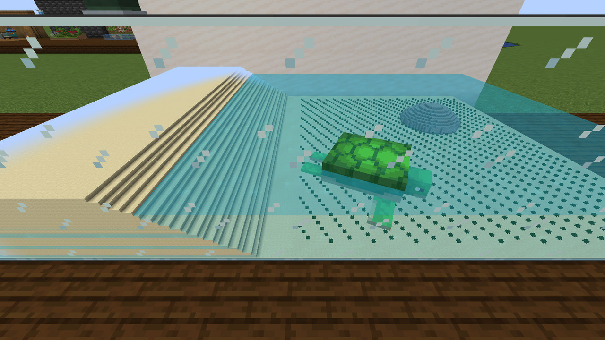

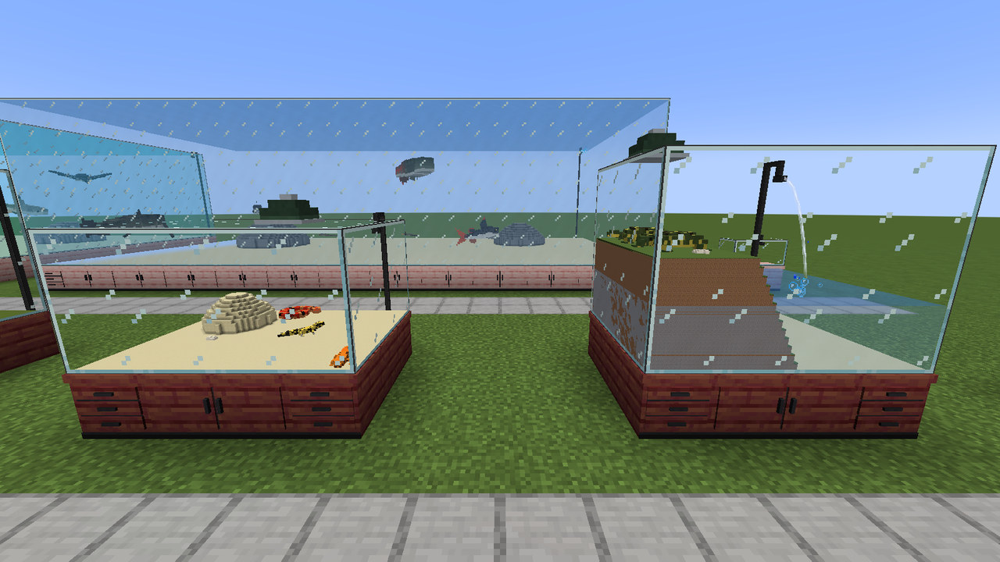

## Guests: pets, animals of other mods and mobs in glass

- **Land animals of other mods:** with a terrarium profile they get our care, breeding and walker in terraria and
  paludaria: the Naturalist tortoise, alligator, lizard, snake, scorpions, snail, crab, dragonfly, duck and capybara, the
  Critters and Companions dragonfly, leaf insect and otter; the terrarium box catches them. Fish live in the water part of
  a paludarium.
- **Insects, small mammals and birds of other mods:** butterflies, fireflies (they glow at night), beetles, ladybugs,
  hedgehogs, rats, ferrets, red pandas, koalas, owls, penguins, flamingos and more of Naturalist, Critters and Companions
  and Living Things; fliers need a lid, woodlice and snails are the clean-up crew, mammals and birds breed as pairs; the
  komodo dragon, bears, deer, zebras and lions in big terraria. The Aquaculture turtles follow our turtle rules.
- **Minecraft animals as pets:** chickens (chicks from eggs in the sand), rabbits on grass, bees with flowers and a mini
  beehive in the interior, frogs in paludaria, cats, foxes, parrots, armadillos, bats and wolves at their real size; pigs,
  sheep, cows, horses, llamas and pandas in big terraria. Caught with the terrarium box or bait; no drops, no farm.
- **Mobs in glass:** drowned, zombies, skeletons, spiders, small slimes and a few more live **shrunk and harmless** in
  tanks: caught with the mob jar, lured with bait or put in from an EnderIO soul vial; a zombie under water becomes a
  drowned, fed pairs breed, and they never drop anything. Mobs and pets walk with real steps in their tanks.

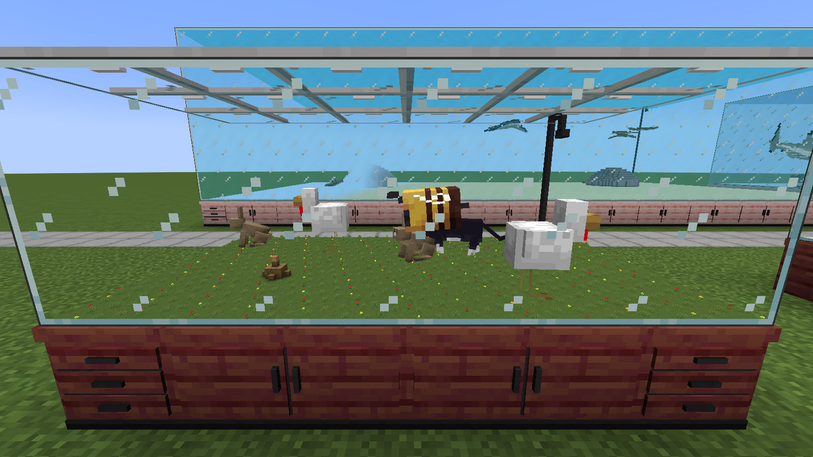

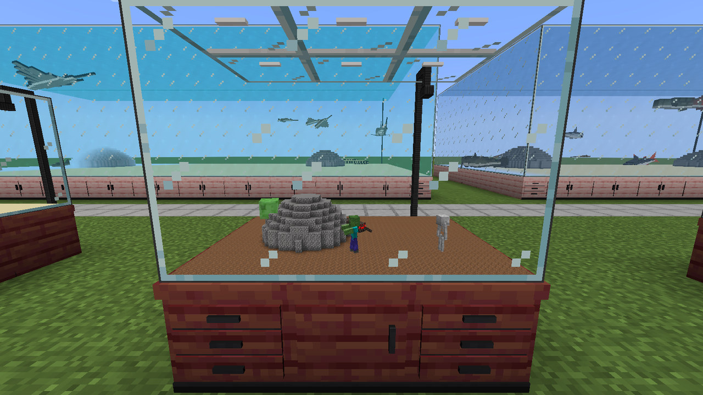

## Equipment and water

- Internal, external, sponge and corner filters (the external filter may stand beside its tank or one or two blocks lower;
  sneak-click it to choose the tank from a list), cabinets of any wood or stone (with the filter and an air pump inside; a
  row of cabinets gets one front with drawers at both ends and double doors between them, or a front of your choice;
  cabinets join to the back as well, so a 10 x 5 tank stands on one under-cabinet, the middle may be normal blocks),
  automatic and clip-on feeders, air pumps with air stones (bubble columns), light bar, LED panel and high-power LED in 16
  colours with dimmer and daylight timer.
- **Pipes and water changes:** glass and stainless steel pipes and a water pump carry water with all its values, a
  bulkhead leads to interior pipes, a multiblock filter of any size with media that clog; nitrate makes water changes
  matter, a water change controller and a top-off do them for you.
- **One filter, many aquariums:** filter pipes with T-pieces dock on any side of a tank (guards inside keep the animals
  out), up to four lines run in one pipe bundle, fresh and waste water ports do the water changes of every tank of the
  filter, and a pipe cover (or the facades of AE2, EnderIO, Mekanism Covers and Cable Facades) hides the pipes behind any
  block.
- **Water chemistry:** TDS, pH and hardness from water, substrate (active soil), driftwood, leaves and CO2, with a range
  for every animal; CO2 cylinders and bio CO2, a reverse osmosis unit, and RO and sea water as fluids for other mods.
- **Power, your choice:** by default nothing needs energy. Optional Forge Energy (Team Reborn Energy on Fabric) for the
  equipment, a power regulator, own procedural sounds. No generator? A **crank** winds the filters, the water devices and
  the cabinet under a tank, which then powers every device of its tank; all cabinets under a tank share one spring store
  (also two that do not touch), one crank at any of them winds it. With **Create** a drive adapter on the tank (or a
  shaft on its cabinet) powers every device of the tank from rotation, with real stress.
- **Tanks on the road** (Create, NeoForge 1.21.1): on Create contraptions, carts and trains the care goes on with the
  tank's data (hunger, temperature, water quality, the filters and heaters that travel along, powered by the tank's buffer,
  a drive adapter that turns with the trip or FE batteries of the contraption); on Create Aeronautics airships the animals
  stay real and everything runs as on the ground. The water sloshes in curves and when a contraption stops.

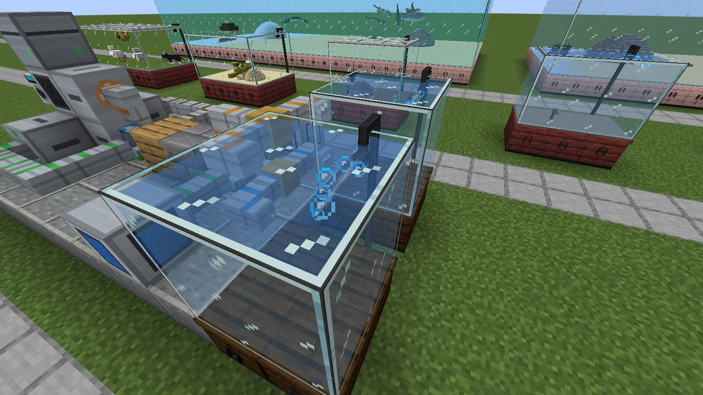

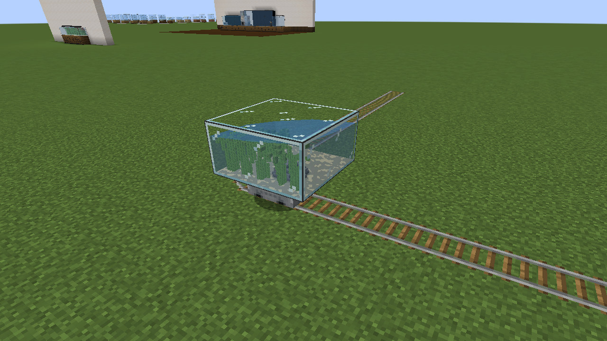

## Monitors, maps and waypoints

- **Monitors:** monitor blocks join into screens of up to 8 x 5 blocks that find every tank around them and show a
  dashboard: values, traffic lights with the tank's warnings, graphs over up to 7 in-game days, animals and breeding,
  devices and power, alarms with a redstone signal and the logbook; arranged by drag and drop in an editor.
- **Alarm waypoints:** a monitor alarm (and a warning of the hired aquarist) sets a waypoint at the tank in **JourneyMap**,
  **Xaero's Minimap** and World Map and **FTB Chunks**, for the owner and the listed users of the tank only. Every user
  switches it per tank in the users tab, the owner and the caretakers for all users; the client config has a switch per
  map mod for packs with several of them.

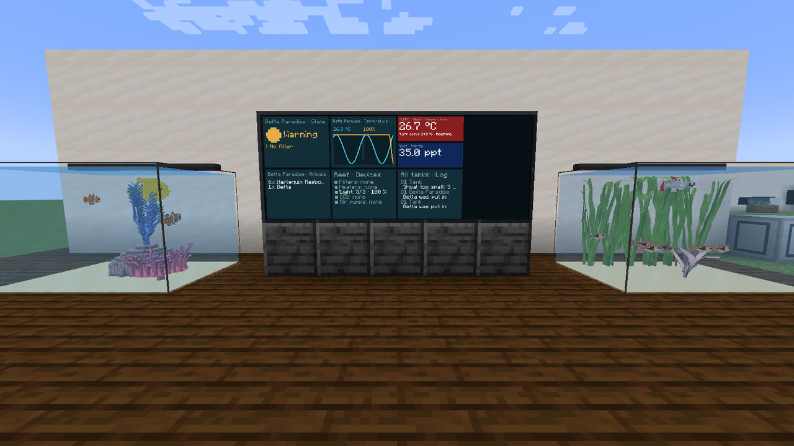

## Food and live food

- **Live food cultures:** tubifex worms in a dish with mud and mulm (or the waste water of a tank), daphnia in a barrel
  with yeast or green water and light, mosquito larvae and artemia; they grow, go stale, crash when crowded or hot. A
  **live food pump** feeds them through the pipes into the tanks on a schedule.
- **Food maker:** pellets, flakes, granules, algae wafers, fry powder, shrimp food and frozen food from wheat, kelp, fish,
  spider eyes, sugar, eggs, vegetables and live food; runs on a spring wound with the crank (a day per spring) or on FE.
  Hoppers, AE2 and Refined Storage fill and empty it, the feeder and the reservoir.
- **Food variety:** favourite and poorly suited food for every kind of eater; a varied diet helps the fish recover and
  makes the bettas' colours stronger. All data-driven (item tags).

## The aquarist villager and the hired aquarist

- **Aquarist villager:** place a breeding basin in a village and an unemployed villager becomes an aquarist. He sells
  food, floating and aquarium plants, terrarium plants, shrimp, snails, test kits, substrate and live food cultures, as a
  master pairs of rare bred tankmate varieties, and **buys your bettas and bred tankmates** for emeralds by the rarity of
  their visible genes (a data file modpacks can change).
- **Hired aquarist:** once a player keeps three tanks and bred something, an aquarist (a person of his own, with four
  procedural looks) comes by and offers his work; refused, the next one comes days later after another breeding. Hired, he
  lives in a bed near a breeding basin, takes an emerald (or some bread) a day from a chest there and really walks to the
  tanks: feeding from the chest, water changes from the reservoir, algae, trimming plants (cuttings into the chest),
  moving young into a rearing tank and warnings in the chat (map waypoints); six tasks with three levels each in his
  menu. Multiplayer: each player has his own; he works only at his employer's tanks, those of the FTB Teams party and
  those released for him in the tank menu, never at locked ones. Without wage he slows down and leaves after three days.

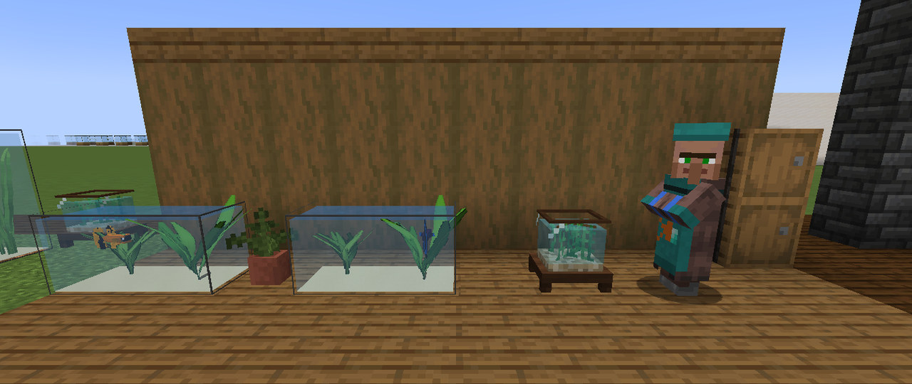

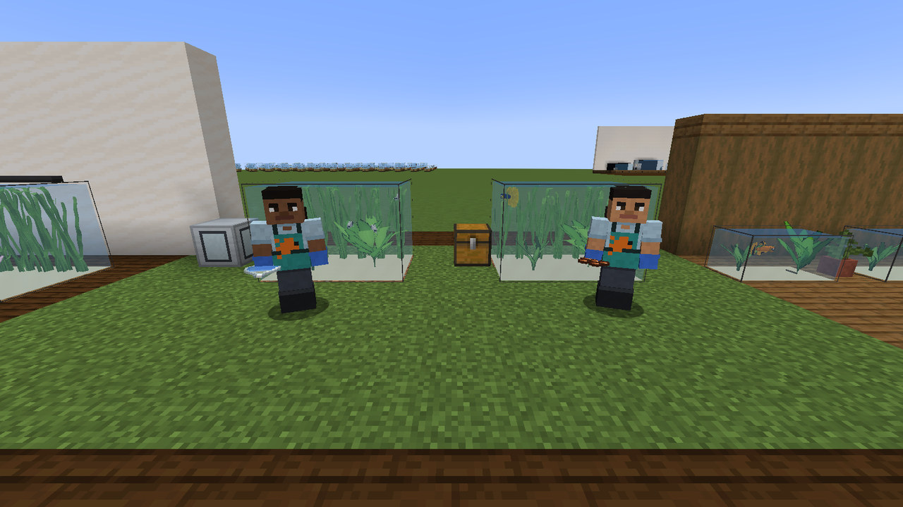

## Handbook, progression, switches

- Every catcher (buckets, bags, terrarium boxes, transport tubs, mob jars) asks before it lets an animal go into the world,
  and none lets go for half a second after a catch, so a double click never releases what you just caught.
- 368 handbook pages in English and German with a page for every animal, plant, coral and device and where to get it
  (generated from the game data): GuideME on NeoForge; on Fabric the same pages as a Patchouli book (1.21.1) or a
  Modonomicon book (1.21.11 and 26.x), converted at build time. 72 advancements, information pages in JEI (and REI and
  EMI on Fabric), tooltips, and an FTB Quests chapter of 115 quests for modpacks.
- Every feature has its own switch (`features.<group>.enabled` and sub-switches, 144 in all): off, it loses its recipes,
  trades, loot and spawns, hides from the creative tab, JEI and the handbook, and its logic rests (nothing is deleted).
- Presets for modpacks (`preset = SIMPLE | REALISTIC | DECOR`), a care mode without deaths (`care.mode`), optional death of
  old age (`health.oldAge.enabled`).

## Debug log and bug reports

- `/bettacraft debug all on` (operators, and the owner of a single player world) writes what happens and why to
  `logs/bettacraft-debug.log`: deaths with their reason, breeding results, refused animals, the tank log, packet sizes,
  the jobs of the hired aquarist, wild spawns and the errors of integrations, in nine areas that can be switched one by
  one (also for good in the common config: `debug.logLevel`, `debug.areas`). The normal log stays clean; warnings that
  repeat come at most once a minute. Switched off (the default) a debug line costs nothing.
- `/bettacraft report` writes `logs/bettacraft-report-<date>.txt` with the versions, the integrations and every loaded
  mod, the config values that differ from the default, the tank you look at with its animals and the end of the debug
  log, for the [bug report form](https://github.com/0verEngineer/BettaCraft/issues/new?template=bug_report.yml). See
  "Reporting bugs" in the README.

More pictures, most also with shaders, are in [docs/images](docs/images).
