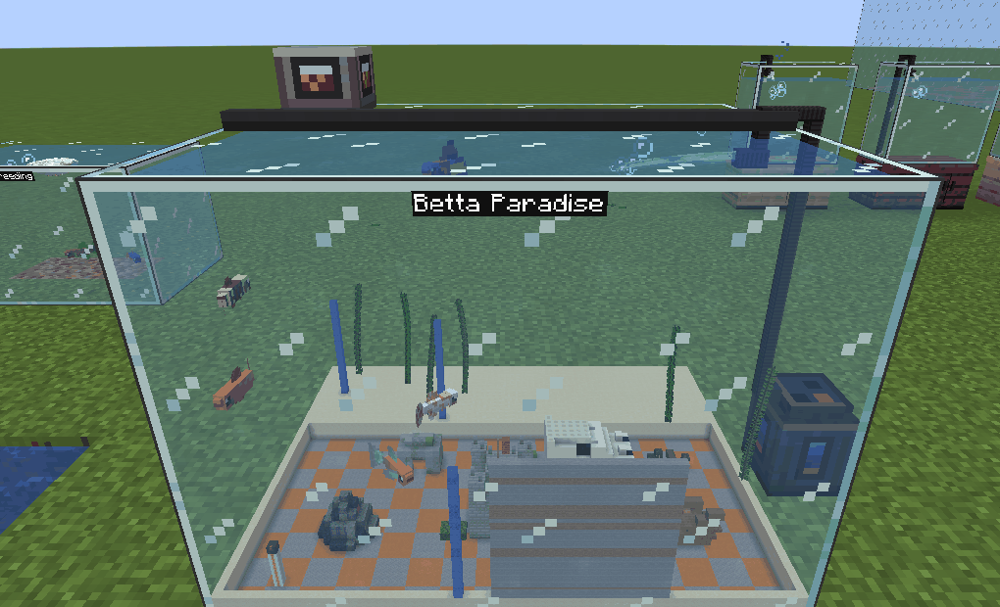

<p align="center"></p>

# Bettacraft

Betta fish for Minecraft 1.21.1 (NeoForge): catch wild bettas in swamps, keep them in multiblock aquariums of any glass,
care for heat, food and space, breed them with real Mendel genetics and decorate the inside of the aquarium block by
block.



## Features

- **Bettas** spawn in swamps (`#c:is_swamp`, so also the swamps of Biomes O' Plenty, Regions Unexplored and others).
  Catch them with a water bucket or a fish bag; the fish keeps all its genes.
- **Genetics:** nine loci with two alleles each (tail shape, fin length, pectorals, body colour, fin colour, pattern,
  pattern colour, iridescence and its colour), dominance, carriers and a small mutation chance. 8 tail shapes,
  short- and long-finned forms, dumbo ears, 43 colours, 12 patterns and 16 named varieties (Koi Galaxy, Nemo,
  Black Orchid, Mustard Gas, ...). Colours, genes and varieties are data-driven and can be changed with datapacks.
- **Aquariums:** a multiblock tank of any glass and any connected shape (box, L, T, steps ...), up to 16x16x16
  (configurable up to 64), either with the connected texture of its glass or as perfectly clear glass, with thin dark
  edges only along the outer edges. Real vanilla water, filled
  bucket by bucket from the bottom, rendered clear and without biome tint, also with Sodium and Iris. The animals are
  real entities, so frogs, axolotls and the fish of other mods keep their own behaviour.
- **Care:** water temperature from the biome and the time of day, heaters and coolers in three sizes, health with
  hunger, temperature, overcrowding and water quality stress, sickness and recovery; a tank log tells you what
  happened.
- **Water quality and evaporation:** waste of the animals and overfeeding foul the water, filters keep it clean,
  water changes with buckets (or pipes) bring it back; open aquariums slowly evaporate, a lid stops that.
- **Power (optional):** a server can make heaters, coolers, filters and lights need Forge Energy from any FE mod.
- **Live food breeding:** a larva tub for mosquito larvae and an artemia hatchery for nauplii, both with hoppers.
- **Breeding:** conditioning with live food, bubble nest, spawning, eggs, larvae and six life stages. Take the
  female out after spawning and the male once the fry swim, or they get hurt or eaten. Fry need infusoria and
  artemia nauplii, which you culture yourself.
- **Fights and predators:** two adult males fight (they flare at each other first, or at a mirror stick), pufferfish
  and the predators of other mods hunt small fish.
- **Interior:** sneak and right-click an aquarium with an empty hand to step inside a void dimension at 16 blocks per
  tank block (4 or 8 configurable) and build with any block. The result is shown in the aquarium as a miniature.
  Floor textures (substrate), decoration structures (castle, shipwreck, skull, volcano, driftwood, cave, ...),
  heaters, internal filters and floating plants.
- **Equipment:** internal and external filters with a water jet, aquarium cabinets of any wood (they hold the
  external filter and food), an automatic feeder (1 to 3 times per day, takes food from the cabinets below) and a
  connecting light bar that redstone switches off.
- **Tank menu:** overview with target temperature, inhabitants with genotype, breeding tab with Punnett squares,
  interior and log; name sign on the glass and a lock for the owner.
- **Handbook and progression:** 31 handbook pages in English and German (with GuideME) and 29 advancements.
- **Languages:** English and German.

## Requirements

| | |
|---|---|
| Minecraft | 1.21.1 |
| NeoForge | 21.1.200 or newer |
| Java | 21 |
| Side | client and dedicated server (install on both) |

No other mod is required.

## Optional integrations

| Mod | What you get |
|---|---|
| [GuideME](https://modrinth.com/mod/guideme) | the in-game handbook (given once per player, see `guide.giveBook`) |
| [JEI](https://modrinth.com/mod/jei) | information pages for every Bettacraft item |
| [Jade](https://modrinth.com/mod/jade), [The One Probe](https://modrinth.com/mod/the-one-probe), [WTHIT](https://modrinth.com/mod/wthit) | aquarium (name, glass and style, temperature, water, animals, nest, filters, warnings), betta behind the glass (type, sex, health, hunger, stage, genes), filter and cabinet. Sneak for details; The One Probe needs its probe for the extended view. |
| Better Fish Tanks | its fish bag puts animals into and takes them out of Bettacraft aquariums; bettas live in its tanks |
| [Fintastic](https://modrinth.com/mod/fintastic) | fish and fishnet in both directions, live prey, fish food, water plants in the interior |
| [Fish of Thieves](https://modrinth.com/mod/fish-of-thieves) | fish and predators in Bettacraft aquariums, bettas on the fish plaque |
| [Aquaculture 2](https://modrinth.com/mod/aquaculture) | small fish welcome, piranha as predator, worms as live food, fillets for pellets |
| [Naturalist](https://modrinth.com/mod/naturalist) | small animals welcome, piranha and anglerfish as predators |
| Sodium, Iris | supported (water and miniatures render correctly, also with shaders) |

Without GuideME every Bettacraft item explains itself in its tooltip (hold Shift).

## Getting started

1. Find a swamp and catch a betta with a water bucket.
2. Craft aquarium blocks (six glass of one kind and three iron ingots give four; an iron nugget in the middle instead
   of the ingot makes clear glass aquariums from vanilla glass) and place them next to each other.
3. Fill the aquarium with water buckets, at least half full.
4. Right-click it with the betta bucket.
5. Outside warm biomes add a heater (in the interior or in an external filter) and feed every day with betta pellets
   or mosquito larvae, or place a feeder on top.

The handbook (GuideME) and the JEI pages explain everything else.

## Configuration

| File | Content |
|---|---|
| `<world>/serverconfig/bettacraft-server.toml` | game rules per world: tank size, shapes and limits, health timers, temperature, breeding, fights, food, life stages, interior, drops, water quality, evaporation, power, food breeding, handbook, time in unloaded chunks |
| `config/bettacraft-common.toml` | spawn weight and group size of wild bettas, fish bag recipe (kelp or plastic) |
| `config/bettacraft-client.toml` | animation and miniature distances, water surface animation, filter sound |

Every option has a comment in the file and can also be changed in the in-game config screen (Mods > Bettacraft >
Config). By default, time stands still for aquariums in unloaded chunks (`simulateUnloadedTime = false`), water quality
and evaporation are on but gentle, and no equipment needs power (`power.*RequiresEnergy = false`).

### For pack makers

- **Tags:** `#bettacraft:betta_spawn_biomes`, `#bettacraft:salt_water_biomes` (biomes); `#bettacraft:tank_inhabitants`,
  `#bettacraft:tank_blacklist`, `#bettacraft:predators`, `#bettacraft:betta_prey` (entity types);
  `#bettacraft:betta_food`, `#bettacraft:live_food`, `#bettacraft:fry_food`, `#bettacraft:fry_food_start`,
  `#bettacraft:pellet_fish`, `#bettacraft:plastic_sheets` (items); `#bettacraft:floating_plants`,
  `#bettacraft:interior_water_plants`, `#bettacraft:substrate_blacklist`, `#bettacraft:artemia_sand` (blocks).
- **Datapacks:** `data/<namespace>/bettacraft/colors/*.json`, `.../genes/<locus>.json` and `.../varieties/*.json`
  add or change colours, allele ranks and frequencies, and named varieties.
- **Commands:** `/bettacraft interior leave` for everyone; operators: `/bettacraft interior resync` and
  `/bettacraft interior bench`.

## Building from source

```
./gradlew build                 # jar in build/libs, runs the unit tests
./gradlew runGameTestServer     # GameTests
./gradlew runData               # regenerate src/generated (recipes, tags, models, en_us, advancements)
./gradlew runClient             # dev client with Jade, JEI, GuideME, The One Probe, WTHIT and the aquarium mods
```

Leave optional mods out of the dev runtime with `-PnoJade`, `-PnoJei`, `-PnoGuideme`, `-PnoTop`, `-PnoWthit` and
`-PnoCompat`. Textures, models and the logo come from the procedural generator in `tools/assetgen` (Python, see its
README); the generated files are committed, so the Gradle build does not need Python.

## License

MIT, see [LICENSE](LICENSE). This covers the code, the asset generator and all assets, so modpacks may include the mod
freely.

Bug reports and ideas: [GitHub issues](https://github.com/0verEngineer/BettaCraft/issues).
