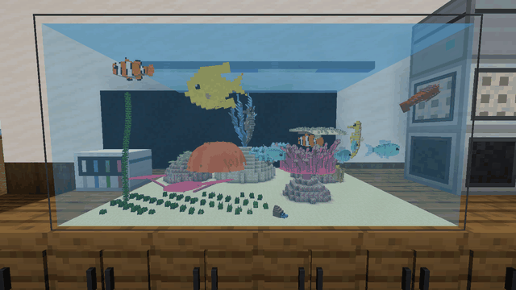
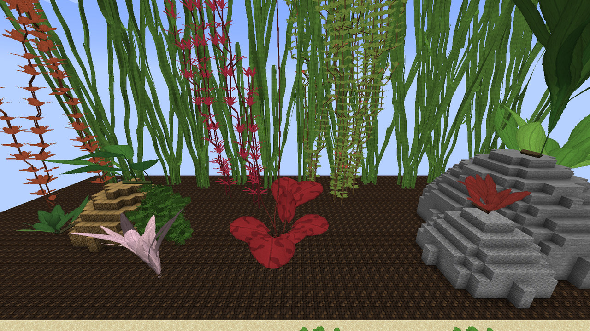

<p align="center"></p>

# Bettacraft

Betta fish and real aquariums for Minecraft 1.21.1 (NeoForge): catch wild bettas and tankmates, keep them in multiblock
aquariums of any glass and shape, aquascape the inside block by block with plants and corals that sway in the water,
run filters, lights, CO2 and reef dosing, and breed new colours with real Mendel genetics.


<table>
  <tr>
    <td></td>
    <td></td>
  </tr>
  <tr>
    <td></td>
    <td></td>
  </tr>
</table>


More pictures and animations (also with Complementary shaders) are in [docs/images](docs/images).

## Features

### Bettas and genetics
- **Wild bettas** spawn in swamps (also those of biome mods); catch them with a water bucket or a fish bag, the fish keeps
  all its genes. A **magnifier** (or the aquarium) analyses the hidden genes of a new animal. Some wild bettas are
  *Betta imbellis* or *Betta smaragdina*: they cross with *B. splendens* into fertile hybrids.
- **Mendel genetics:** nine loci with two alleles each (tail shape, fin length, pectorals, body colour, fin colour,
  pattern, pattern colour, iridescence and its colour), dominance, carriers and mutations: 8 tail shapes, short and
  long fins, dumbo ears, 43 colours, 12 patterns and 16 named varieties (Koi Galaxy, Nemo, Black Orchid, Mustard Gas
  ...), all data-driven and changeable with datapacks.
- **Breeding:** conditioning with live food, bubble nest under floating plants, spawning, eggs, larvae and six life
  stages; fry need infusoria and artemia that you culture yourself (larva tub, artemia hatchery). Two adult males
  fight (they flare first, also at a mirror stick).

### Aquariums and the interior
- **Multiblock tanks** of any glass and any connected shape (box, L, T, steps ...), up to 16x16x16 (configurable to
  64; big tanks up to 32x16x32), with the connected texture of the glass or perfectly clear. Real vanilla water, filled bucket by bucket,
  rendered clear (also with Sodium and Iris). The animals are real entities.
- **Interior:** sneak and right-click with an empty hand to step inside a pocket dimension at 16 blocks per tank block
  and build with any block: substrates, equipment and 28 decorations (castle, wrecks, skull, aquascaping stones such
  as Seiryu, dragon stone and holey rock, roots, clay tubes that are spawning caves, a diving helmet, a treasure chest
  that bubbles from the air pump ...). Almond leaves and alder cones on the floor lower the pH and feed the shrimp. The
  aquarium shows the result as a live miniature; several players can build at once.
- **Care:** temperature from biome and time of day, heaters and coolers, hunger, overcrowding, water quality, oxygen,
  sickness and recovery; a tank log tells you what happened. Tank menu with overview, inhabitants and their
  genotype, breeding tab with Punnett squares, water, devices, plants, interior and log; name sign, owner lock and a
  break protection.

### Plants and corals
- **49 aquarium plants** (Java fern, six Anubias, ten Bucephalandras, Java, Christmas and flame moss, Riccia,
  Cryptocorynes, Amazon sword and Echinodorus 'Red Diamond', Rotalas, Ludwigias and other stem plants, carpets such as
  Monte Carlo, HC 'Cuba', hairgrass and Marsilea, Vallisneria, Sagittaria, Aponogeton, tiger lotus ...) grow over the
  days from a cutting into plants of many blocks, get redder (or white) in strong light, some need CO2 or soft water,
  are trimmed with shears and clean the water. The **Marimo** ball rolls with the current. **Floating plants**
  (duckweed, frogbit, salvinia, red root floater, water lettuce, hornwort, Riccia) drift on the surface, grow and
  spread; lily pads stay put.
- **Every plant grows wild** in the waters of its origin: Anubias and Bucephalandra on stones in jungle water, stem
  plants and carpets in swamps, Vallisneria and mosses in rivers, Marimo balls in cold lakes, floating plants on calm
  water. Shears cut a cutting, the plant grows back.
- Every plant and coral has **real leaves, polyps and tentacles that sway** in the water, inside and in the miniature
  outside; zoanthids and star polyps close when a fish swims by. Kelp and seagrass sway too.

### Tankmates and small animals
- **48 freshwater tankmates** with their own models and behaviour: tetras, rasboras and danios, rainbowfish,
  corydoras, plecos, otocinclus, loaches and garra, barbs, guppies and endlers (own genetics with 28 strains), platys,
  mollies and swordtails, gouramis, **cichlids** (rams, Apistogramma, angelfish, discus) and **puffers**. Shoals, water
  ranges, predators and prey, fin nippers, snail eaters, and a breeding style per species (glued eggs, caves, egg
  scatterers, livebearers, foam nests, open and cave brooders that guard their young, a mouthbrooder).
- **Small animals:** Neocaridina in eleven colours with selection grades, bee shrimp (Crystal Red/Black S to SSS, Blue
  Bolt, Wine Red, Tiger), Sulawesi shrimp and snails, dwarf crayfish, nerites, apple snails, ramshorns and more crawl
  over floor, plants and glass; algae grow and the cleaning crew eats them. Dwarf clawed frogs. **Big crayfish** (the
  Florida crayfish in blue and orange, the all-female marbled crayfish) eat plants, dig them up and catch slow fish.
- **Axolotls** (vanilla) get real care in a tank: cool water with a cooler, eggs on the plants, larvae, and the five
  colours inherited by Mendel (blue recessive and rare).
- **Wild animals and corals** live in the waters they come from (jungle, swamp, river, mangrove, warm and lukewarm
  ocean); the waters are biome tags, so the biomes of biome mods count too. Catch them with the aquarium net. An own
  frugal spawn pass keeps them findable next to the fish of other mods; `/bettacraft wildlife` shows what lives where.
- **Water animals of all mods** (fish, axolotls, tadpoles, seahorses ...) live in the aquariums; whales, bosses and
  hostile mobs are refused with a reason, other big animals go by the size rule of the big tanks.

### Reef tanks and seahorses
- Sea water, salinity, protein skimmer, flow pump, reef and live rock, actinic light. Eight corals and the bubble tip
  anemone grow with light, flow, calcium, alkalinity and magnesium (four-channel dosing pump), bleach or glow and give
  frags. Clownfish spawn at their anemone; tang, goby, chromis, damsel, cleaner shrimp, hermit crabs, turbo snails.
- **Seahorses** (lined and dwarf) swim upright, hold on to plants and corals, eat live food, and the male gives birth
  from his brood pouch.

### Big tanks and big animals
- **Big tanks** up to 32 x 16 x 32 blocks with a coarser interior (scale 8 or 4); a decorated tank that grows past 16
  blocks keeps its layout at the new scale, and nothing is lost.
- **A size rule** for big animals by their real length (12 x 6 x 3 blocks and 100 water blocks per metre, adding up).
- **Ten giants:** pangasius, redtail and wels catfish, arapaima and motoro stingray in fresh water; bamboo shark (it lays
  egg cases that hatch when there is room), blacktip reef shark, spotted eagle ray, schooling cownose rays and the
  honeycomb moray in its lair in sea water. Wild in rivers, jungle water and warm oceans; vanilla **dolphins** in very
  big sea water tanks.
- Caught with the **large net** or the **steel leader** into a **transport tub** that carries one animal; big animals
  swim wide curves, turn slowly and eat the small fish of their tank.

### Terraria, turtles, frogs and mobs in glass
- **Terrarium and paludarium:** a tank without water is a terrarium, one with water and land built in its interior a
  paludarium, with air temperature, humidity and UV; heat mats, basking lamps, misters and a thermo-hygrometer. The
  tank type can also be fixed in the menu, so a terrarium is never flooded by mistake.
- **Turtles:** musk turtle, red-eared and yellow-bellied slider, Hermann's tortoise (brumates in the cold) and Reeves'
  turtle; eggs in sand or soil, and the **nest temperature decides the sex** of the hatchlings.
- **Amphibians and reptiles:** poison dart frogs (tadpoles in the water), Cranwell's horned frog, leopard and crested
  geckos (the crested one climbs the glass) and the corn snake, with crickets and fruit flies from their cultures; wild
  in jungles, deserts, forests, savannas and swamps.
- **Land animals of other mods:** with a terrarium profile they get our care, breeding and walker in terraria and
  paludaria: the Naturalist tortoise, alligator, lizard, snake, scorpions, snail, crab, dragonfly, duck and capybara, the
  Critters and Companions dragonfly, leaf insect and otter; the terrarium box catches them. Fish live in the water part of a
  paludarium, and grown sea turtles go into big sea water paludaria with a beach.
- **Mobs in glass:** drowned, zombies, skeletons, spiders, small slimes and a few more live **shrunk and harmless** in
  tanks: caught with the mob jar, lured with bait or put in from an EnderIO soul vial; a zombie under water becomes a
  drowned, fed pairs breed, and they never drop anything.

### Equipment and water
- Internal, external, sponge and corner filters, cabinets of any wood or stone (with the filter and an air pump inside), automatic and
  clip-on feeders, air pumps with air stones (bubble columns), light bar, LED panel and high-power LED in 16 colours
  with dimmer and daylight timer.
- **Pipes and water changes:** glass and stainless steel pipes and a water pump carry water with all its values, a
  bulkhead leads to interior pipes, a multiblock filter of any size with media that clog; nitrate makes water changes
  matter, a water change controller and a top-off do them for you.
- **Water chemistry:** TDS, pH and hardness from water, substrate (active soil), driftwood, leaves and CO2, with a range
  for every animal; CO2 cylinders and bio CO2, a reverse osmosis unit, and RO and sea water as fluids for other mods.
- Optional Forge Energy for the equipment, power regulator, own procedural sounds.

### Food and live food
- **Live food cultures:** tubifex worms in a dish with mud and mulm (or the waste water of a tank), daphnia in a barrel
  with yeast or green water and light, mosquito larvae and artemia; they grow, go stale, crash when crowded or hot. A
  **live food pump** feeds them through the pipes into the tanks on a schedule.
- **Food maker:** pellets, flakes, granules, algae wafers, fry powder, shrimp food and frozen food from wheat, kelp, fish,
  spider eyes, sugar, eggs, vegetables and live food; runs on a hand-wound spring (a day per spring) or on FE. Hoppers,
  AE2 and Refined Storage fill and empty it, the feeder and the reservoir.
- **Food variety:** favourite and poorly suited food for every kind of eater; a varied diet helps the fish recover and
  makes the bettas' colours stronger. All data-driven (item tags).
- **Monitors:** monitor blocks join into screens of up to 8 x 5 blocks that find every tank around them and show a
  dashboard: values, traffic lights with the tank's warnings, graphs over up to 7 in-game days, animals and breeding,
  devices and power, alarms with a redstone signal and the logbook; arranged by drag and drop in an editor.

### Handbook, progression, languages
- 224 handbook pages (GuideME) in English and German with a page for every animal, plant, coral and device and where to
  get it (generated from the game data), 31 advancements, JEI pages and tooltips.
- Every feature has its own switch (`features.<group>.enabled` and sub-switches, 105 in all): off, it loses its recipes,
  trades, loot and spawns, hides from the creative tab, JEI and the handbook, and its logic rests (nothing is deleted).
- Presets for modpacks (`preset = SIMPLE | REALISTIC | DECOR`), a care mode without deaths (`care.mode`), optional death of
  old age (`health.oldAge.enabled`).

## Requirements

| | |
|---|---|
| Minecraft | 1.21.1 |
| NeoForge | 21.1.200 or newer |
| Java | 21 |
| Side | client and dedicated server (install on both) |

No other mod is required.

## Optional integrations

| Mod | What you get |
|---|---|
| [GuideME](https://modrinth.com/mod/guideme) | the in-game handbook (given once per player, see `guide.giveBook`) |
| [JEI](https://modrinth.com/mod/jei) | information pages for every Bettacraft item |
| [Jade](https://modrinth.com/mod/jade), [The One Probe](https://modrinth.com/mod/the-one-probe), [WTHIT](https://modrinth.com/mod/wthit) | aquarium (name, glass and style, temperature, water, animals, nest, filters, warnings), betta behind the glass (type, sex, health, hunger, stage, genes), filter and cabinet. Sneak for details; The One Probe needs its probe for the extended view.; with several overlay mods only the first shows them, see `compat.overlayProvider` |
| Better Fish Tanks | its fish bag puts animals into and takes them out of Bettacraft aquariums; bettas live in its tanks |
| [Fintastic](https://modrinth.com/mod/fintastic) | fish and fishnet in both directions, live prey, fish food, water plants in the interior |
| [Fish of Thieves](https://modrinth.com/mod/fish-of-thieves) | fish and predators in Bettacraft aquariums, bettas on the fish plaque |
| [Aquaculture 2](https://modrinth.com/mod/aquaculture) | small fish welcome, piranha as predator, worms as live food, fillets for pellets |
| [Naturalist](https://modrinth.com/mod/naturalist) | small animals welcome, piranha and anglerfish as predators |
| Fintastic, Aquaculture 2, Critters and Companions, Naturalist (profiles) | their fish get our care (hunger, water values, sickness) and our breeding in Bettacraft aquariums, the young inherit their variants; their own breeding is suppressed there; their land and marsh animals (tortoise, alligator, lizard, snake, scorpions, crab, dragonflies, duck, capybara, otter ...) live in terraria and paludaria; modpacks add profiles for any animal (`data/<namespace>/bettacraft/foreign_animals`) |
| [Create](https://modrinth.com/mod/create), Create Aeronautics | aquariums travel on contraptions, trains and airships with their animals; rotation drives pumps, the reverse osmosis unit and the food maker; Display Links show tank values; Create pipes fill aquariums |
| Applied Energistics 2, Refined Storage | buses and interfaces move food, ingredients and products; pattern providers and autocrafters feed the food maker and the crucible |
| [FTB Quests](https://www.curseforge.com/minecraft/mc-mods/ftb-quests-forge), [KubeJS](https://modrinth.com/mod/kubejs) | a quest chapter "Bettacraft" and events for scripts (animal born, animal died, monitor alarm), in `bettacraft-modpack-<version>.zip` of the release |
| [JourneyMap](https://modrinth.com/mod/journeymap) | a waypoint at a tank whose monitor alarm went off |
| any mod with water animals | its small water animals go into aquariums (tested with Alex's Caves, Critters and Companions, Living Things, Deeper Darker, The Undergarden, Shiny, Sushi Go Crafting, L_Ender's Cataclysm, Ice and Fire, DragN's Just Bettas), large, boss and hostile ones are refused |
| Mekanism, EnderIO, Create, Thermal | stainless steel from their machines (metallurgic infuser, alloy smelter, heated mixing, induction smelter); their tanks and pipes join Bettacraft pipes, aquariums and reservoirs (standard fluid handler, also AE2 and RS interfaces), also with the fluids `bettacraft:ro_water`, `bettacraft:sea_water` and `bettacraft:live_food` (Mekanism tanks too); CO2 gas of other mods (`#bettacraft:co2_gas`) fills CO2 cylinders |
| Biome mods (Regions Unexplored, Oh The Biomes We've Gone, Biomes O' Plenty, Twilight Forest, ...) | their swamps, rivers, mangroves, lush caves and warm oceans get the wild animals, net catches, fishing loot and corals of their vanilla counterparts (biome tags `#bettacraft:*_waters`, `#bettacraft:coral_reef_biomes`) |
| Sodium, Iris | supported (water and miniatures render correctly, also with shaders) |

Without GuideME every Bettacraft item explains itself in its tooltip (hold Shift).

## Getting started

1. Find a swamp and catch a betta with a water bucket.
2. Craft aquarium blocks (six glass of one kind and three iron ingots give four; an iron nugget in the middle instead
   of the ingot makes clear glass aquariums from vanilla glass) and place them next to each other.
3. Fill the aquarium with water buckets, at least half full.
4. Right-click it with the betta bucket.
5. Outside warm biomes add a heater (in the interior or in an external filter) and feed every day with betta pellets
   or mosquito larvae, or place a feeder on top.

The handbook (GuideME) and the JEI pages explain everything else.

## Configuration

| File | Content |
|---|---|
| `<world>/serverconfig/bettacraft-server.toml` | game rules per world: tank size, shapes and limits, which animals aquariums take, health timers, temperature and tolerated range, breeding, fights, food, life stages, interior, drops, water quality, floating plants, aquarium plants, small animals, frogs, tankmates (breeding, getting along, food), stocking, algae, salt water and reef tanks, evaporation, power, food breeding, handbook, time in unloaded chunks |
| `config/bettacraft-common.toml` | spawn weight and group size of wild bettas, fish bag recipe (kelp or plastic), which overlay mod shows the Bettacraft lines (`compat.overlayProvider`), feature switches (`features.*`, a tree per feature group; old 1.25 keys are migrated automatically, backup
`bettacraft-common.toml.pre-m33`), presets (`preset`, `presetKeep`) |
| `config/bettacraft-client.toml` | animation, miniature and tank detail distances, water surface animation, connected glass, edge width, name sign size, water tint of coloured lights, interior leave hint, filter sound, device volumes, air pump and flow pump sounds (off by default) |

Every option has a comment in the file and can also be changed in the in-game config screen (Mods > Bettacraft >
Config). By default, time stands still for aquariums in unloaded chunks (`simulateUnloadedTime = false`), water quality
and evaporation are on but gentle, and no equipment needs power (`power.*RequiresEnergy = false`).

### For pack makers

- **Tags:** `#bettacraft:betta_spawn_biomes`, `#bettacraft:salt_water_biomes`, `#bettacraft:warm_ocean_waters`,
  `lukewarm_ocean_waters`, `mangrove_waters`, `lush_cave_waters`, `swamp_waters`, `river_waters`, `beach_waters`,
  `jungle_waters`, `#bettacraft:coral_reef_biomes` (biomes); `#bettacraft:tank_inhabitants`,
  `#bettacraft:tank_blacklist`, `#bettacraft:predators`, `#bettacraft:betta_prey` (entity types); `#bettacraft:mob_capture_items`,
  `#bettacraft:turtle_greens`, `#bettacraft:feeder_insects`;
  `#bettacraft:betta_food`, `#bettacraft:live_food`, `#bettacraft:fry_food`, `#bettacraft:fry_food_start`,
  `#bettacraft:pellet_fish`, `#bettacraft:frozen_food`, `#bettacraft:critter_food`, `#bettacraft:sinking_food`,
  `#bettacraft:food_groups/*`, `#bettacraft:diet/*/favourite` and `/poor`, `#bettacraft:plastic_sheets`, `#bettacraft:aquatic_plants` (items); `#bettacraft:floating_plants`,
  `#bettacraft:interior_water_plants`, `#bettacraft:substrate_blacklist`, `#bettacraft:artemia_sand`, `#bettacraft:epiphyte_surfaces`,
  `#bettacraft:plant_substrate`, `#bettacraft:not_in_tank_interior`, `#bettacraft:swaying_plants`, `#bettacraft:shrimp_shelter` (blocks).
- **Animals in aquariums:** `inhabitants.allow` / `inhabitants.deny` in the server config (`modid:name`, `modid:*`; a hostile
  mob in `allow` lives shrunk in glass, `deny` takes a mob in glass out),
  `inhabitants.maxHitbox`, `inhabitants.refuseHostile`, `inhabitants.tadpoles`, `inhabitants.outgrown`; `/bettacraft wateranimals` writes a table
  of every water animal of the loaded mods and whether aquariums take it.
- **Datapacks:** `data/<namespace>/bettacraft/colors/*.json`, `.../genes/<locus>.json` and `.../varieties/*.json`
  add or change colours, allele ranks and frequencies, and named varieties.
- **Animals of other mods:** profiles in `data/<namespace>/bettacraft/foreign_animals/*.json` give any water animal our
  care and breeding (format in the handbook, "Profiles for animals of other mods").
- **Quests and scripts:** `bettacraft-modpack-<version>.zip` of every release (`gradlew modpackZip`, the folder
  `modpack/`) has the FTB Quests chapter `config/ftbquests/quests/chapters/bettacraft.snbt` and a KubeJS example; the
  NeoForge events `AnimalBornEvent`, `AnimalDiedEvent`, `TankAlarmEvent` (`org.overengineer.bettacraft.api.event`) and
  `org.overengineer.bettacraft.api.BettacraftApi` are for scripts and other mods (`features.modpackEvents`).
- **Feature switches and presets:** every feature can be turned off on its own (`features.*` in
  `config/bettacraft-common.toml`; the server sends them to the clients). Datapacks can use the recipe and loot condition
  `{"type": "bettacraft:feature", "feature": "tankmates.cichlids"}`. `preset = SIMPLE | REALISTIC | DECOR` sets other
  defaults for the switches and the server values (values changed in the files and paths in `presetKeep` win);
  `care.mode = NO_DEATH | DECOR` keeps every animal alive.
- **Commands:** `/bettacraft interior leave` and `/bettacraft preset` for everyone; operators: `/bettacraft interior resync`,
  `/bettacraft interior bench`, `/bettacraft wateranimals`, `/bettacraft wildlife`, `/bettacraft preset <name>` and
  `/bettacraft foreign list [radius]` (the animals of other mods in tanks and their profiles; a profile whose entity was
  renamed is reported in the log).

## Building from source

```
./gradlew build                 # jar in build/libs, runs the unit tests
./gradlew runGameTestServer     # GameTests
./gradlew runData               # regenerate src/generated (recipes, tags, models, en_us, advancements)
./gradlew runClient             # dev client with Jade, JEI, GuideME and the aquarium mods
./gradlew buildShowcase         # (re)builds the showcase world "Bettacraft Schaukasten" in run/saves (no window)
./gradlew runMultiplayerTest    # dedicated server + two background clients (Dev1, Dev2) play a scripted session
./gradlew runClient -Psmoketestreadme -PnoJei   # README media scene (background window), then:
py tools/assetgen/readme_media.py       # run/screenshots -> docs/images (stills, GIF and WebP animations)
```

Leave optional mods out of the dev runtime with `-PnoJade`, `-PnoJei`, `-PnoGuideme` and `-PnoCompat`; add The One
Probe and WTHIT with `-Ptop` and `-Pwthit` (config `compat.overlayProvider` picks which overlay shows the Bettacraft
lines; AUTO = only the first of Jade, WTHIT, The One Probe). Textures, models and the logo come from the procedural generator in `tools/assetgen` (Python, see its
README); the generated files are committed, so the Gradle build does not need Python.

Development-only code (smoke tests, the showcase world, GameTests) lives in the source set `src/dev`: every `run*` task
loads it, the jar does not contain it.

## Continuous integration and releases

[](https://github.com/0verEngineer/BettaCraft/actions/workflows/build.yml)

- **Build** (`.github/workflows/build.yml`, every push to `master` and every pull request): `gradlew build` (unit tests
  and `verifyReleaseJar`), the changelog section, `runData` must not change `src/generated`, GameTests and a dedicated
  server smoke test. Started by hand with *full* (and before every release) it also runs the server smoke without any
  optional mod and with The One Probe and WTHIT, and the GameTests with the power mods of `-Ppower` (pinned Modrinth
  jars, `tools/ci/power-mods.json`, fetched and SHA-512 checked by `tools/ci/fetch_mods.py`). A failed GameTest shows
  up with its message as an annotation on the run page.
- **Release** (`.github/workflows/release.yml`, a pushed tag `v<mod_version>`): the full test set, the jar of the tag,
  `verifyReleaseJar`, the top section of `CHANGELOG.md` as release notes, a GitHub release (a prerelease for `-alpha`,
  `-beta` and `-rc` versions) and, once the token and project id are set, the file upload to CurseForge (the only mod
  site). It also builds the CurseForge project description (`curseforgeDescription`, see below) as a workflow artifact.
- The same checks locally:

```
./gradlew verifyReleaseJar      # the jar holds only Bettacraft classes and namespaces, no dev / GameTest code, version ok
./gradlew releaseNotes          # build/release-notes.md from the top section of CHANGELOG.md (must be mod_version)
./gradlew curseforgeDescription # build/curseforge/description.md + .html from docs/description.md, image links pinned
                                # to -PdescriptionRef=<tag> (default: the current commit), ready to paste on CurseForge
```

The mod page text lives in [docs/description.md](docs/description.md) (relative image links, so it reads on GitHub too).
CurseForge has no API for the project description, so it is pasted by hand after a release; its images come from
`raw.githubusercontent.com` and load only while the repository is public.

Client smoke tests, the multiplayer test, `buildShowcase`, `smoketestUpgrade`, `-Paquatic`, `-Pbiomes`, `-Pstorage` (AE2 and Refined Storage) and `-Pshaders` only run
locally (they need a window, local worlds or mod jars that cannot all be downloaded in CI).

## License

MIT, see [LICENSE](LICENSE). This covers the code, the asset generator and all assets, so modpacks may include the mod
freely.

### Sound credits

Every sound of Bettacraft is generated by `tools/assetgen/sounds.py` (own work, MIT like the rest); no third-party
recordings are used, so nothing needs attribution. The list of all files is in [SOUNDS-CREDITS.md](SOUNDS-CREDITS.md).

Bug reports and ideas: [GitHub issues](https://github.com/0verEngineer/BettaCraft/issues).
