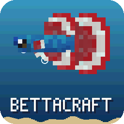
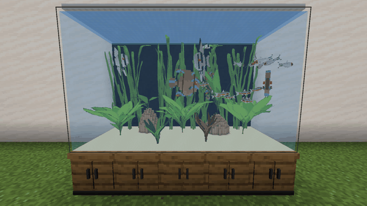
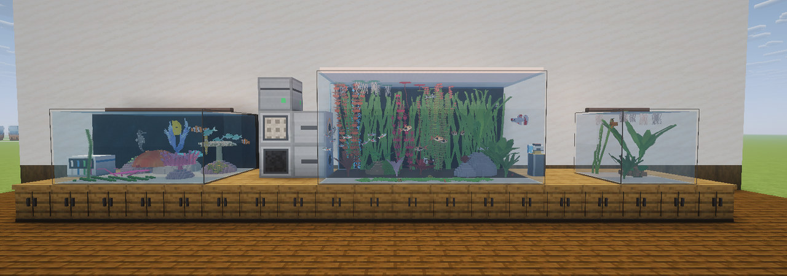

<p align="center"></p>

# Bettacraft

Betta fish and real aquariums for Minecraft 1.21.1, 1.21.11, 26.1.2, 26.2 and 26.3, on NeoForge and Fabric: catch wild fish and tankmates, keep them in multiblock
aquariums of any glass and shape, aquascape the inside block by block with plants and corals that sway in the water,
run filters, lights, CO2 and reef dosing, and breed new colours with real Mendel genetics.


<table>
  <tr>
    <td></td>
    <td></td>
  </tr>
  <tr>
    <td></td>
    <td></td>
  </tr>
  <tr>
    <td></td>
    <td></td>
  </tr>
  <tr>
    <td></td>
    <td></td>
  </tr>
  <tr>
    <td></td>
    <td></td>
  </tr>
  <tr>
    <td></td>
    <td></td>
  </tr>
</table>


More pictures and animations (most also with Complementary Reimagined shaders) are in [docs/images](docs/images); they
are made in the showcase world by `gradlew runClient -Psmoketestm43` (see "Building from source").

## Features

### Bettas and genetics
- **Wild bettas** spawn in swamps (also those of biome mods); catch them with a water bucket or a fish bag, the fish keeps
  all its genes. A **magnifier** (or the aquarium) analyses the hidden genes of a new animal. Some wild bettas are
  *Betta imbellis* or *Betta smaragdina*: they cross with *B. splendens* into fertile hybrids.
- **Mendel genetics:** nine loci with two alleles each (tail shape, fin length, pectorals, body colour, fin colour,
  pattern, pattern colour, iridescence and its colour), dominance, carriers and mutations: 8 tail shapes, short and
  long fins, dumbo ears, 43 colours, 12 patterns and 16 named varieties (Koi Galaxy, Nemo, Black Orchid, Mustard Gas
  ...), all data-driven and changeable with datapacks.
- **Breeding:** conditioning with live food, bubble nest under floating plants, spawning, eggs, larvae and six life
  stages; fry need infusoria and artemia that you culture yourself (larva tub, artemia hatchery). Two adult males
  fight (they flare first, also at a mirror stick).
- **Two sizes:** bettas are drawn at **Normal** size (the default since 1.28, about halfway between the old size and the
  bettas of other mods) or **Large** (the size before 1.28); the server sets it for everyone (`sizes.betta`), the hitbox
  follows the look, nothing else changes.
- **Aquarist villager:** place a breeding basin in a village and an unemployed villager becomes an aquarist. He sells
  food, floating and aquarium plants, shrimp, snails, test kits, substrate and live food cultures, as a master pairs of
  rare bred tankmate varieties, and **buys your bettas and bred tankmates** for emeralds by the rarity of their visible
  genes (a data file modpacks can change).
- **Hired aquarist:** once a player keeps three tanks and bred something, an aquarist (a person of his own, with four
  procedural looks) comes by and offers his work; refused, the next one comes days later after another breeding. Hired, he
  lives in a bed near a breeding basin, takes an emerald (or some bread) a day from a chest there and really walks to the
  tanks: feeding from the chest, water changes from the reservoir, algae, trimming plants (cuttings into the chest),
  moving young into a rearing tank and warnings in the chat (map waypoints); six tasks with three levels each in his
  menu. Multiplayer: each player has his own; he works only at his employer's tanks, those of the FTB Teams party and
  those released for him in the tank menu, never at locked ones. Without wage he slows down and leaves after three days.

### Aquariums and the interior
- **Multiblock tanks** of any glass and any connected shape (box, L, T, steps ...), up to 16x16x16 (configurable to
  64; big tanks up to 32x16x32), with the connected texture of the glass or perfectly clear. Real vanilla water, filled bucket by bucket,
  rendered clear (also with Sodium and Iris). The animals are real entities.
- **Interior:** sneak and right-click with an empty hand to step inside a pocket dimension at 16 blocks per tank block
  and build with any block: substrates, equipment and 29 decorations (castle, wrecks, skull, aquascaping stones such
  as Seiryu, dragon stone and holey rock, roots, mangrove stilt roots, clay tubes that are spawning caves, a diving helmet, a treasure chest
  that bubbles from the air pump ...). Almond leaves and alder cones on the floor lower the pH and feed the shrimp. The
  aquarium shows the result as a live miniature; several players can build at once.
- **Care:** temperature from biome and time of day, heaters and coolers, hunger, overcrowding, water quality, oxygen,
  sickness and recovery; a tank log tells you what happened. Tank menu with overview, inhabitants and their
  genotype, breeding tab with Punnett squares, water, devices, plants, users and log; name sign, owner lock, a
  break protection and tank users (owner, caretakers, viewers) with their own alarm waypoint switches.

### Plants and corals
- **49 aquarium plants** (Java fern, six Anubias, ten Bucephalandras, Java, Christmas and flame moss, Riccia,
  Cryptocorynes, Amazon sword and Echinodorus 'Red Diamond', Rotalas, Ludwigias and other stem plants, carpets such as
  Monte Carlo, HC 'Cuba', hairgrass and Marsilea, Vallisneria, Sagittaria, Aponogeton, tiger lotus ...) grow over the
  days from a cutting into plants of many blocks, get redder (or white) in strong light, some need CO2 or soft water,
  are trimmed with shears and clean the water. The **Marimo** ball rolls with the current. **Floating plants**
  (duckweed, frogbit, salvinia, red root floater, water lettuce, hornwort, Riccia) drift on the surface, grow and
  spread; lily pads stay put.
- **Plants of Minecraft and other mods work too:** kelp, seagrass, lily pads and corals, and the water plants of
  Fintastic, Regions Unexplored, Twilight Forest and Alex's Caves in the interior lower the nitrate and count for
  breeding like a full-grown plant of ours (a little less), without growing and without needs; Fintastic's live rock
  filters salt water. Modpacks add more with profiles.
- **Liquid fertilizer** makes them grow up to half as fast again; the plants use it up, too much feeds the algae. A
  **fertilizer maker** mixes it from kelp meal, nutrient salt and water and pipes it into the tank; the dosing pump doses
  it too.
- **Every plant grows wild** in the waters of its origin: Anubias and Bucephalandra on stones in jungle water, stem
  plants and carpet cushions in swamps, Vallisneria and mosses in rivers, Marimo balls in cold lakes, floating plants on calm
  water. Shears cut a cutting, the plant grows back.
- Every plant and coral has **real leaves, polyps and tentacles that sway** in the water, inside and in the miniature
  outside; zoanthids and star polyps close when a fish swims by. Kelp and seagrass sway too.

### Tankmates and small animals
- **50 freshwater tankmates** with their own models and behaviour: tetras (neons also Diamond, Gold and Albino, gold
  cardinals, albino glowlights), rasboras and danios, rainbowfish, corydoras (albino and longfin panda, albino sterbai, the
  bronze cory with Albino and Gold Laser), plecos, otocinclus, loaches, the garra and the panda garra, barbs, guppies and
  endlers (own genetics with 28 strains), platys,
  mollies and swordtails, gouramis, **cichlids** (rams in six forms with Black and German Blue, Apistogramma, angelfish,
  discus) and **puffers**. Shoals, water
  ranges, predators and prey, fin nippers, snail eaters, and a breeding style per species (glued eggs, caves, egg
  scatterers, livebearers, foam nests, open and cave brooders that guard their young, a mouthbrooder).
- **Small animals:** Neocaridina in eleven colours with selection grades, bee shrimp (Crystal Red/Black S to SSS, Blue
  Bolt, Wine Red, Tiger), Sulawesi shrimp and snails, dwarf crayfish, nerites, apple snails, ramshorns and more crawl
  over floor, plants and glass; algae grow and the cleaning crew eats them. **Dwarf clawed frogs** breed like in nature: a
  cool water change sets a pair off (amplexus), the spawn floats at the surface (fish eat it, floating plants hide it),
  the tadpoles need infusoria and become froglets. **Big crayfish** (the
  Florida crayfish in blue and orange, the all-female marbled crayfish) eat plants, dig them up and catch slow fish.
- **Axolotls** (vanilla) get real care in a tank: cool water with a cooler, eggs on the plants, larvae, and the five
  colours inherited by Mendel (blue recessive and rare).
- **Wild animals and corals** live in the waters they come from (jungle, swamp, river, mangrove, warm and lukewarm
  ocean); the waters are biome tags, so the biomes of biome mods count too. Catch them with the aquarium net. An own
  frugal spawn pass keeps them findable next to the fish of other mods (the shrimp and snails with their own limit, in
  shallow water by the bank); `/bettacraft wildlife` shows what lives where.
- **Water animals of all mods** (fish, axolotls, tadpoles, seahorses ...) live in the aquariums; whales, bosses and
  hostile mobs are refused with a reason, other big animals go by the size rule of the big tanks.

### Reef tanks and seahorses
- Sea water, salinity, protein skimmer, flow pump, reef and live rock, actinic light. Seven corals and the bubble tip
  anemone grow with light, flow, calcium, alkalinity and magnesium (four-channel dosing pump), bleach or glow and give
  frags. Clownfish spawn at their anemone, and their **larvae need rotifers** that live on phytoplankton (both cultured in
  bottles); tang, goby, chromis, damsel, the lyretail anthias (a shoal fed often), the **Banggai cardinalfish** (the male
  broods in his mouth), the **mandarinfish** that lives only on the copepods of the live rock, cleaner and fire shrimp,
  hermit crabs, turbo snails.
- **Sump** in the cabinet under the tank: its water counts with the tank, its chambers hold heaters, a protein skimmer,
  filter media and a **refugium** with Chaetomorpha that takes up nitrate; a **calcium reactor** dissolves coral rubble with
  CO2 for the stony corals.

### Brackish water and mangroves
- The **archerfish** shoots insects off the leaves above an open tank with a jet of water (and now and then a player), the
  **mudskipper** skips over the mud of a brackish paludarium and climbs roots, the **Amano shrimp** needs brackish water for
  its larvae (net them over into a brackish tank), and a **mangrove propagule** grows into a small mangrove with stilt
  roots and a crown over the water.
- **Seahorses** (lined and dwarf) swim upright, hold on to plants and corals, eat live food, and the male gives birth
  from his brood pouch.

### Big tanks and big animals
- **Big tanks** up to 32 x 16 x 32 blocks with a coarser interior (scale 8 or 4); a decorated tank that grows past 16
  blocks keeps its layout at the new scale, and nothing is lost.
- **A size rule** for big animals by their real length (12 x 6 x 3 blocks and 100 water blocks per metre, adding up).
- **Ten giants:** pangasius, redtail and wels catfish, arapaima and motoro stingray in fresh water; bamboo shark (it lays
  egg cases that hatch when there is room), blacktip reef shark, spotted eagle ray, schooling cownose rays and the
  honeycomb moray in its lair in sea water. Wild in rivers, jungle water and warm oceans; vanilla **dolphins** in very
  big sea water tanks. The giant fish of other mods (arapaimas, coelacanth, tuna, gar, catfish, the manta ray and shark of
  Living Things) go into big tanks by the same rule with their real length.
- Caught with the **large net** or the **steel leader** into a **transport tub** that carries one animal; big animals
  swim wide curves, turn slowly and eat the small fish of their tank.

### Terraria, turtles, frogs, pets and mobs in glass
- **Terrarium and paludarium:** a tank without water is a terrarium, one with water and land built in its interior a
  paludarium, with air temperature, humidity and UV; heat mats, basking lamps, misters and a thermo-hygrometer. The
  tank type can also be fixed in the menu, so a terrarium is never flooded by mistake.
- **Turtles:** musk turtle, red-eared and yellow-bellied slider, Hermann's tortoise (brumates in the cold) and Reeves'
  turtle; eggs in sand or soil, and the **nest temperature decides the sex** of the hatchlings.
- **Amphibians and reptiles:** poison dart frogs (tadpoles in the water), Cranwell's horned frog, leopard and crested
  geckos (the crested one climbs the glass) and the corn snake, with crickets and fruit flies from their cultures; wild
  in jungles, deserts, forests, savannas and swamps.
- **Land animals of other mods:** with a terrarium profile they get our care, breeding and walker in terraria and
  paludaria: the Naturalist tortoise, alligator, lizard, snake, scorpions, snail, crab, dragonfly, duck and capybara, the
  Critters and Companions dragonfly, leaf insect and otter; the terrarium box catches them. Fish live in the water part of a
  paludarium, and grown sea turtles go into big sea water paludaria with a beach.
- **Insects, small mammals and birds of other mods:** butterflies, fireflies (they glow at night), beetles, ladybugs,
  hedgehogs, rats, ferrets, red pandas, koalas, owls, penguins, flamingos and more of Naturalist, Critters and Companions
  and Living Things; fliers need a lid, woodlice and snails are the clean-up crew, mammals and birds breed as pairs; the
  komodo dragon, bears, deer, zebras and lions in big terraria. The Aquaculture turtles follow our turtle rules.
- **Minecraft animals as pets:** chickens (chicks from eggs in the sand), rabbits on grass, bees with flowers and a mini
  beehive in the interior, frogs in paludaria, cats, foxes, parrots, armadillos, bats and wolves at their real size; pigs,
  sheep, cows, horses, llamas and pandas in big terraria. Caught with the terrarium box or bait; no drops, no farm.
- **Mobs in glass:** drowned, zombies, skeletons, spiders, small slimes and a few more live **shrunk and harmless** in
  tanks: caught with the mob jar, lured with bait or put in from an EnderIO soul vial; a zombie under water becomes a
  drowned, fed pairs breed, and they never drop anything. Mobs and pets walk with real steps in their tanks (their legs
  matched to their size and pace).

### Equipment and water
- Internal, external, sponge and corner filters, cabinets of any wood or stone (with the filter and an air pump inside; a row of
  cabinets gets one front with drawers at both ends and double doors between them, or a front of your choice), automatic and
  clip-on feeders, air pumps with air stones (bubble columns), light bar, LED panel and high-power LED in 16 colours
  with dimmer and daylight timer.
- **Pipes and water changes:** glass and stainless steel pipes and a water pump carry water with all its values, a
  bulkhead leads to interior pipes, a multiblock filter of any size with media that clog; nitrate makes water changes
  matter, a water change controller and a top-off do them for you.
- **One filter, many aquariums:** filter pipes with T-pieces dock on any side of a tank (guards inside keep the animals
  out), up to four lines run in one pipe bundle, fresh and waste water ports do the water changes of every tank of the
  filter, and a pipe cover (or the facades of AE2, EnderIO, Mekanism Covers and Cable Facades) hides the pipes behind any
  block.
- **Water chemistry:** TDS, pH and hardness from water, substrate (active soil), driftwood, leaves and CO2, with a range
  for every animal; CO2 cylinders and bio CO2, a reverse osmosis unit, and RO and sea water as fluids for other mods.
- Optional Forge Energy (Team Reborn Energy on Fabric) for the equipment, power regulator, own procedural sounds. No
  generator? A **crank** winds the filters, the water devices and the cabinet under a tank, which then powers every device
  of its tank. With **Create** a drive adapter on the tank (or a shaft on its cabinet) powers every device of the tank
  from rotation, with real stress.
- **Tanks on the road** (Create, NeoForge 1.21.1): on Create contraptions the care goes on with the tank's data (hunger,
  temperature, water quality, the filters and heaters that travel along, powered by the tank's buffer, a drive adapter that turns with the trip or FE
  batteries of the contraption); on Create Aeronautics airships the animals stay real and everything runs as on the ground.
  The water sloshes in curves and when a contraption stops.
- **Monitors:** monitor blocks join into screens of up to 8 x 5 blocks that find every tank around them and show a
  dashboard: values, traffic lights with the tank's warnings, graphs over up to 7 in-game days, animals and breeding,
  devices and power, alarms with a redstone signal and the logbook; arranged by drag and drop in an editor.

### Food and live food
- **Live food cultures:** tubifex worms in a dish with mud and mulm (or the waste water of a tank), daphnia in a barrel
  with yeast or green water and light, mosquito larvae and artemia; they grow, go stale, crash when crowded or hot. A
  **live food pump** feeds them through the pipes into the tanks on a schedule.
- **Food maker:** pellets, flakes, granules, algae wafers, fry powder, shrimp food and frozen food from wheat, kelp, fish,
  spider eyes, sugar, eggs, vegetables and live food; runs on a spring wound with the crank (a day per spring) or on FE. Hoppers,
  AE2 and Refined Storage fill and empty it, the feeder and the reservoir.
- **Food variety:** favourite and poorly suited food for every kind of eater; a varied diet helps the fish recover and
  makes the bettas' colours stronger. All data-driven (item tags).

### Handbook, progression, languages
- 327 handbook pages in English and German with a page for every animal, plant, coral and device and where to get it
  (generated from the game data): GuideME on NeoForge; on Fabric the same pages as a Patchouli book (1.21.1) or a
  Modonomicon book (1.21.11 and 26.x), converted at build time. 70 advancements, information pages in JEI (and REI and EMI
  on Fabric), tooltips, and an FTB Quests chapter of 113 quests for modpacks.
- Every feature has its own switch (`features.<group>.enabled` and sub-switches, 136 in all): off, it loses its recipes,
  trades, loot and spawns, hides from the creative tab, JEI and the handbook, and its logic rests (nothing is deleted).
- Presets for modpacks (`preset = SIMPLE | REALISTIC | DECOR`), a care mode without deaths (`care.mode`), optional death of
  old age (`health.oldAge.enabled`).

## Requirements

One CurseForge project, one file per loader and Minecraft version: `bettacraft-<loader>-<minecraft>-<version>.jar`.
Install it on client and dedicated server. Every version has the same content, ids, data, configs and handbook pages, and
every branch gets every new feature and fix. Worlds load within their Minecraft version (old Bettacraft versions are
migrated); they do not move between Minecraft versions.

| Minecraft | Java | NeoForge | Fabric | Handbook (NeoForge / Fabric) | Branch |
|---|---|---|---|---|---|
| 1.21.1 (main version, ATM10) | 21 | 21.1.200+ | Loader 0.16.1+, Fabric API 0.116+ | GuideME / Patchouli | `master` |
| 1.21.11 | 21 | 21.11.40+ | Loader 0.18+, Fabric API 0.141+ | GuideME / Modonomicon | `1.21.11` |
| 26.1.2 (Fabric also 26.1 and 26.1.1) | 25 | 26.1.2.100+ | Loader 0.19.0+, Fabric API 0.155+ | GuideME / Modonomicon | `26.1.2` |
| 26.2 | 25 | 26.2.0.95+ | Loader 0.19.2+, Fabric API 0.161+ | GuideME (alpha) / Modonomicon | `26.2` |
| 26.3 | 25 | 26.3.0.113+ | Loader 0.19.4+, Fabric API 0.166+ | GuideME (alpha) / Modonomicon | `26.3` |

The Fabric minimums are tested: the GameTests, the server and client smoke tests and the production runs with the
official jars pass with exactly that Fabric Loader and Fabric API (`-PexactFabricVersions`, see "Building from source").

| Loader | Required mods | Optional |
|---|---|---|
| NeoForge | none | GuideME (handbook), JEI, Jade, The One Probe, WTHIT, ... |
| Fabric | Fabric API, Forge Config API Port | Patchouli or Modonomicon (handbook), Mod Menu (config screen), Jade, WTHIT, The One Probe, JEI, REI, EMI, FTB Quests, ... |

On Fabric, items and fluids go through Fabric's transfer API (pipes and tanks of Fabric tech mods) and energy through Team
Reborn Energy; the configs are the same TOML files and keys (Forge Config API Port). Since 26.1, trades are data
(`villager_trade` entries in the trade tags of the wandering trader and of `bettacraft:aquarist/level_1` ... `level_5`).

### What is missing where

An integration works where the other mod exists for that loader and Minecraft version (full lists in each version's
CHANGELOG section):

- **Fabric, every version:** Create (with Create Aeronautics and Sable), AE2, KubeJS, Aquaculture, Fintastic and Cable
  Facades are NeoForge only, and so are the script events of `api/event`; Mekanism, EnderIO and Thermal have no Fabric
  version. A glowing pipe cover gives no light on Fabric. The REI and EMI plugins are Fabric only.
- **1.21.11:** no 1.21.11 version of Create, AE2, Refined Storage, KubeJS, the power mods of ATM10, Cable Facades, Better
  Fish Tanks, Fintastic, Naturalist, Critters and Companions, Regions Unexplored, Twilight Forest and EMI; The One Probe is
  NeoForge only. The Modonomicon book shows the tank shapes and the animals of the GuideME scenes as items.
- **26.1.2:** no version of Create, Mekanism (and Mekanism Covers), Flux Networks, Industrial Foregoing, Farmer's Delight,
  Fintastic, Naturalist, Critters and Companions, Alex's Caves, Cataclysm, Deeper and Darker, Fish Eggs, Oh The Biomes
  We've Gone and EMI; AE2, KubeJS, Aquaculture and Cable Facades are NeoForge only.
- **26.2:** no version of FTB Quests (no quest chapter), KubeJS, Create, Mekanism, Flux Networks, EnderIO, Oritech,
  Industrial Foregoing, Refined Storage, LaserIO, Cable Facades, Fintastic, Critters and Companions, Twilight Forest,
  Regions Unexplored, Oh The Biomes We've Gone, Alex's Caves, EMI and a few more; AE2, Powah, Pipez, Integrated Dynamics,
  XNet, Modular Routers and Aquaculture are NeoForge only. Naturalist and Better Fish Tanks work on both loaders. Peaceful
  worlds have no monsters at all since 26.2, so a mob jar with a monster stays closed there.
- **26.3:** as 26.2, and no Modular Routers. The Vulkan backend draws the tanks, the miniature and the menus like OpenGL.
  Shaders work with Iris on Fabric; on NeoForge 26.3 Sodium and Iris do not run yet.

## Optional integrations

| Mod | What you get |
|---|---|
| [GuideME](https://modrinth.com/mod/guideme) (NeoForge), Patchouli (Fabric 1.21.1), Modonomicon (Fabric 1.21.11 and 26.x) | the in-game handbook (given once per player, see `guide.giveBook`) |
| [JEI](https://modrinth.com/mod/jei); REI and EMI (Fabric) | information pages for every Bettacraft item; crucible and food maker recipes |
| [Jade](https://modrinth.com/mod/jade), [The One Probe](https://modrinth.com/mod/the-one-probe), [WTHIT](https://modrinth.com/mod/wthit) | aquarium (name, glass and style, temperature, water, animals, nest, filters, warnings), betta behind the glass (type, sex, health, hunger, stage, genes), filter and cabinet. Sneak for details; The One Probe needs its probe for the extended view.; with several overlay mods only the first shows them, see `compat.overlayProvider` |
| Better Fish Tanks | its fish bag puts animals into and takes them out of Bettacraft aquariums (through the tank menu's bag button, not through the glass); bettas live in its tanks |
| [Fintastic](https://modrinth.com/mod/fintastic) | fish and fishnet in both directions, live prey, fish food, water plants in the interior |
| [Fish of Thieves](https://modrinth.com/mod/fish-of-thieves) | fish and predators in Bettacraft aquariums, bettas on the fish plaque |
| [Aquaculture 2](https://modrinth.com/mod/aquaculture) | small fish welcome, piranha as predator, worms as live food, fillets for pellets |
| [Naturalist](https://modrinth.com/mod/naturalist) | small animals welcome, piranha and anglerfish as predators |
| Fintastic, Aquaculture 2, Fish of Thieves, Critters and Companions, Naturalist, Living Things (profiles) | their fish get our care (hunger, water values, sickness) and our breeding in Bettacraft aquariums, the young inherit their variants; their own breeding is suppressed there; their land and marsh animals (tortoise, alligator, lizard, snake, scorpions, crab, dragonflies, duck, capybara, otter ...) live in terraria and paludaria; also Fish of Thieves (variants inherited, trophies sterile) and Living Things, the insects, mammals and birds of these mods, and big ones by the size rule; deep-sea, giant and hostile animals are refused with a reason; modpacks add profiles for any animal (`data/<namespace>/bettacraft/foreign_animals`) |
| [Create](https://modrinth.com/mod/create), Create Aeronautics | aquariums travel on contraptions, trains and airships with their animals, cared for on the road (live on airships), the water sloshing; rotation drives pumps, the reverse osmosis unit, the food maker and the fertilizer maker; a drive adapter on a tank (or a shaft on its cabinet) powers every device of the tank with real stress; Display Links show tank values; Create pipes fill aquariums |
| Applied Energistics 2, Refined Storage | buses and interfaces move food, ingredients, products and filter media; pattern providers and autocrafters feed the food maker and the crucible |
| [FTB Quests](https://www.curseforge.com/minecraft/mc-mods/ftb-quests-forge), [KubeJS](https://modrinth.com/mod/kubejs) | a quest chapter "Bettacraft" and events for scripts (animal born, animal died, monitor alarm), in `bettacraft-modpack-<version>.zip` of the release |
| [JourneyMap](https://modrinth.com/mod/journeymap), [Xaero's Minimap](https://modrinth.com/mod/xaeros-minimap) / [World Map](https://modrinth.com/mod/xaeros-world-map), [FTB Chunks](https://www.curseforge.com/minecraft/mc-mods/ftb-chunks-forge) | a waypoint at a tank whose monitor alarm went off, and at the tanks the hired aquarist warns about, for the owner and the listed users of the tank (switch per tank, per user and per map mod) |
| FTB Teams | the hired aquarist also works at the tanks of his employer's party (`hiredAquarist.ftbTeams`) |
| any mod with water animals | its small water animals go into aquariums (tested with Alex's Caves, Critters and Companions, Living Things, Deeper Darker, The Undergarden, Shiny, Sushi Go Crafting, L_Ender's Cataclysm, Ice and Fire, DragN's Just Bettas), large, boss and hostile ones are refused |
| Applied Energistics 2, EnderIO, Mekanism Covers, [Cable Facades](https://www.curseforge.com/minecraft/mc-mods/cable-facades) | their facades and covers hide the filter pipes and pipe bundles (Cable Facades through its block tag, its config untouched) |
| Mekanism, EnderIO, Create, Thermal | stainless steel from their machines (metallurgic infuser, alloy smelter, heated mixing, induction smelter); their tanks and pipes join Bettacraft pipes, aquariums and reservoirs (standard fluid handler, also AE2 and RS interfaces), also with the fluids `bettacraft:ro_water`, `bettacraft:sea_water` and `bettacraft:live_food` (Mekanism tanks too); CO2 gas of other mods (`#bettacraft:co2_gas`) fills CO2 cylinders |
| Biome mods (Regions Unexplored, Oh The Biomes We've Gone, Biomes O' Plenty, Twilight Forest, ...) | their swamps, rivers, mangroves, lush caves and warm oceans get the wild animals, net catches, fishing loot and corals of their vanilla counterparts (biome tags `#bettacraft:*_waters`, `#bettacraft:coral_reef_biomes`) |
| Sodium, Iris | supported (water and miniatures render correctly, also with shaders) |

Without a handbook mod every Bettacraft item explains itself in its tooltip (hold Shift). See "What is missing where"
above for the integrations of each loader and Minecraft version.

## Getting started

1. Find a swamp and catch a betta with a water bucket.
2. Craft aquarium blocks (six glass of one kind and three iron ingots give four; an iron nugget in the middle instead
   of the ingot makes clear glass aquariums from vanilla glass) and place them next to each other.
3. Fill the aquarium with water buckets, at least half full.
4. Right-click it with the betta bucket.
5. Outside warm biomes add a heater (in the interior or in an external filter) and feed every day with betta pellets
   or mosquito larvae, or place a feeder on top.

The handbook (GuideME, Patchouli or Modonomicon) and the JEI / REI / EMI pages explain everything else.

## Configuration

| File | Content |
|---|---|
| `<world>/serverconfig/bettacraft-server.toml` (NeoForge 26.3: `config/bettacraft-server.toml` for every world, a world's own copy in `<world>/syncedconfig/`) | game rules per world: tank size, shapes and limits, which animals aquariums take, health timers, temperature and tolerated range, breeding, fights, betta size (`sizes.betta`), food, life stages, interior, drops, water quality, floating plants, aquarium plants, small animals, frogs, tankmates (breeding, getting along, food), stocking, algae, salt water and reef tanks, evaporation, power, food breeding, handbook, time in unloaded chunks, the hired aquarist (`hiredAquarist.*`), sump, brackish water, Create travel (`createTravel.*`) |
| `config/bettacraft-common.toml` | spawn weight and group size of wild bettas, fish bag recipe (kelp or plastic), which overlay mod shows the Bettacraft lines (`compat.overlayProvider`), feature switches (`features.*`, a tree per feature group; old 1.25 keys are migrated automatically, backup
`bettacraft-common.toml.pre-m33`), presets (`preset`, `presetKeep`) |
| `config/bettacraft-client.toml` | animation, miniature and tank detail distances, water surface animation, connected glass, edge width, name sign size, water tint of coloured lights, interior leave hint, filter sound, device volumes, air pump and flow pump sounds (off by default) |

Every option has a comment in the file and can also be changed in the in-game config screen (Mods > Bettacraft >
Config; on Fabric through Mod Menu). The files and keys are the same on every loader and Minecraft version. By default, time stands still for aquariums in unloaded chunks (`simulateUnloadedTime = false`), water quality
and evaporation are on but gentle, and no equipment needs power (`power.*RequiresEnergy = false`).

### For pack makers

- **Tags:** `#bettacraft:betta_spawn_biomes`, `#bettacraft:salt_water_biomes`, `#bettacraft:warm_ocean_waters`,
  `lukewarm_ocean_waters`, `mangrove_waters`, `lush_cave_waters`, `swamp_waters`, `river_waters`, `beach_waters`,
  `jungle_waters`, `#bettacraft:coral_reef_biomes` (biomes); `#bettacraft:tank_inhabitants`,
  `#bettacraft:tank_blacklist`, `#bettacraft:predators`, `#bettacraft:betta_prey` (entity types); `#bettacraft:mob_capture_items`,
  `#bettacraft:turtle_greens`, `#bettacraft:feeder_insects`;
  `#bettacraft:betta_food`, `#bettacraft:live_food`, `#bettacraft:fry_food`, `#bettacraft:fry_food_start`,
  `#bettacraft:pellet_fish`, `#bettacraft:frozen_food`, `#bettacraft:critter_food`, `#bettacraft:sinking_food`,
  `#bettacraft:food_groups/*`, `#bettacraft:diet/*/favourite` and `/poor`, `#bettacraft:plastic_sheets`, `#bettacraft:aquatic_plants` (items); `#bettacraft:floating_plants`,
  `#bettacraft:interior_water_plants`, `#bettacraft:substrate_blacklist`, `#bettacraft:artemia_sand`, `#bettacraft:epiphyte_surfaces`,
  `#bettacraft:plant_substrate`, `#bettacraft:not_in_tank_interior`, `#bettacraft:swaying_plants`, `#bettacraft:shrimp_shelter` (blocks).
- **Animals in aquariums:** `inhabitants.allow` / `inhabitants.deny` in the server config (`modid:name`, `modid:*`; a hostile
  mob in `allow` lives shrunk in glass, `deny` takes a mob in glass out),
  `inhabitants.maxHitbox`, `inhabitants.refuseHostile`, `inhabitants.tadpoles`, `inhabitants.outgrown`; `/bettacraft wateranimals` writes a table
  of every water animal of the loaded mods and whether aquariums take it.
- **Datapacks:** `data/<namespace>/bettacraft/colors/*.json`, `.../genes/<locus>.json` and `.../varieties/*.json`
  add or change colours, allele ranks and frequencies, and named varieties.
- **Animals of other mods:** profiles in `data/<namespace>/bettacraft/foreign_animals/*.json` give any water animal our
  care and breeding (format in the handbook, "Profiles for animals of other mods").
- **Plants of other mods:** profiles in `data/<namespace>/bettacraft/foreign_plants/*.json` say what a block of another
  mod counts as in an aquarium (a stem plant, a carpet, floating leaves, a coral, live rock ...; handbook "Plants of other
  mods").
- **Quests and scripts:** `bettacraft-modpack-<version>.zip` of every release (`gradlew modpackZip`, the folder
  `modpack/`) has the FTB Quests chapter (`config/ftbquests/quests/chapters/bettacraft.snbt` on 1.21.x,
  `bettacraft.json5` on 26.1.2, because FTB Quests 26.1 reads JSON5; FTB Quests has no 26.2 or 26.3 version yet) and two
  KubeJS scripts; the NeoForge events `AnimalBornEvent`, `AnimalDiedEvent`, `TankAlarmEvent`, `FeaturesChangedEvent`
  (`org.overengineer.bettacraft.api.event`) and `org.overengineer.bettacraft.api.BettacraftApi` are for scripts and other
  mods (`features.modpackEvents`). See "Quest chapter" below.

### Quest chapter

The chapter **Bettacraft** has 113 quests (1.43.0; 33 before 1.36.0) in branches from the first tank: bettas and their
breeding, water care, plants and the interior, live food, tankmates with the guppy genetics, shrimp, snails and frogs, the
reef with reef fish and seahorses, terraria, paludaria and turtles, big animals, guests (axolotls, Minecraft pets, mobs in
glass, animals of other mods), the technology (cabinet, aeration, lights, power regulator, pipes, stainless steel, water
change controller, top-off, multiblock filter with filter lines) and three optional Create quests. Tasks are Bettacraft
advancements or items, rewards some experience and small items (plant cuttings, food, test kits, filter media, salt).

- **Updating a pack:** copy the new `bettacraft.snbt` (26.1.2: `bettacraft.json5`) over the old one and run `/ftbquests reload` (or restart). The 33
  quests of the first chapter keep their ids, tasks, dependencies and rewards, so the progress of every player stays;
  new quests only add to them. Advancement tasks of new quests complete by themselves for players who already have the
  advancement (FTB Quests checks them every few ticks once the quest may start), item tasks when the item is in the
  inventory. Quests you changed in the editor are replaced by the file's version, so keep your own quests in another chapter.
- **Switched-off features:** every quest carries FTB Quests tags for its feature switches
  (`bettacraft_feature:<path>`, also those of the quests it depends on), `bettacraft_mod:create` and
  `bettacraft_needs:power` (a power option of the server config); FTB Quests 26.1 keeps only tags of `[a-z0-9_]`, so on
  26.1.2 they are `bettacraft_feature_<path>` (lower case, `__` for `.`), `bettacraft_mod_create` and
  `bettacraft_needs_power`. `kubejs/server_scripts/bettacraft_quests.js` (KubeJS, NeoForge only) hides the
  quests whose tags are off (invisible and optional, so they never block the chapter) when the server starts, when a
  player logs in and when the configs are reloaded; switched on again, they show again. Nothing is written into the
  quest file. Without KubeJS the quests of switched-off features stay visible (hide them in the editor), and the Create
  and power quests are optional anyway. `BettacraftApi.questTagsOn(tags)` and `featureEnabled(path)` serve your own scripts.

<!-- quests:start -->
A quest is shown while its switch is on and also those of the quests it depends on (the tags in the chapter).

| Switch | Quests |
|---|---|
| always (the core of the mod) | Glass House, Water Works, The Basics, Travel Bag, Under the Tank, Cool Down, Swamp Soup |
| `features.algae.enabled` | Clear View |
| `features.aquaristNpc.enabled` | An Aquarist Comes By |
| `features.aquaticPlants.enabled` | Green Thumb |
| `features.bettas.enabled` | Labyrinth Fish, Moving In, Fish Flakes, Room Service, Tropical, Mirror, Mirror, Back on Fin, A Lesson Learned (optional) |
| `features.bigTanks.bigAnimals` | Heavy Lifting, Big Fish |
| `features.bigTanks.enabled` | Public Aquarium |
| `features.brackish.amanoShrimp` | Back from the Sea |
| `features.brackish.archerfish` | Sharpshooter |
| `features.brackish.mangroves` | Mangrove |
| `features.brackish.mudskipper` | Fish on Land |
| `features.breeding.enabled` | Bubble Architect |
| `features.breeding.enabled` + `features.bettas.enabled` | Clutch |
| `features.breeding.magnifier` | Under the Lens |
| `features.co2.enabled` | Fizz |
| `features.compat.create.contraptions` | Mobile Aquarium (needs create; optional) |
| `features.compat.create.drive` | Shaft Power (needs create; optional) |
| `features.compat.create.travelCare` | Fish Transport with Power (needs create; needs a power option; optional) |
| `features.corals.enabled` | Polyps |
| `features.corals.reefDosing` | Reef Chemistry |
| `features.decor.enabled` | Interior Design |
| `features.equipment.aeration` | Bubbles |
| `features.equipment.ledTiers` | Strong Light |
| `features.equipment.lightTimer` | Sunrise, Sunset |
| `features.equipment.moreInternalFilters` | Gentle Flow |
| `features.equipment.multiblockFilter` | Filter Room |
| `features.equipment.stainlessSteel` | Stainless |
| `features.equipment.tankUsers` | Open House |
| `features.fertilizer.dosing` | Automatic Gardener |
| `features.fertilizer.enabled` | Plant Food |
| `features.floatingPlants.enabled` | Floating Carpet |
| `features.foodMachine.enabled` | Food Factory |
| `features.foodVariety.enabled` | Balanced Diet |
| `features.foreignAnimals.enabled` | Guest from Afar |
| `features.foreignAnimals.vanillaPets` | House Pet |
| `features.frogs.breeding` | Tadpoles |
| `features.frogs.enabled` | Tiny Frogs |
| `features.interior.enabled` | Honey, I Shrunk Myself, Groundwork |
| `features.invertebrates.enabled` | Cleanup Crew, Colony |
| `features.liveFood.cultures` | Cultures |
| `features.liveFood.enabled` | Microscopic Menu, Wriggling, Food Farm |
| `features.liveFood.enabled` + `features.breeding.enabled` + `features.bettas.enabled` | Free Swimming, All Grown Up, Designer Fish, Dynasty |
| `features.liveFood.pump` | Live Delivery |
| `features.mobsInGlass.enabled` | Ship in a Bottle |
| `features.monitors.enabled` | Control Room |
| `features.osmosis.enabled` | Pure Water |
| `features.pipes.autoWaterChange` | Hands Free |
| `features.pipes.enabled` | Pipework |
| `features.pipes.filterLines` | Filter Lines, One Filter for All |
| `features.pipes.filterWater` | Fresh In, Waste Out |
| `features.pipes.interiorPipes` | Through the Glass |
| `features.pipes.pipeCovers` | Out of Sight |
| `features.pipes.topOff` | Top It Off |
| `features.power.enabled` | Plugged In (needs a power option; optional) |
| `features.power.regulator` | Turn It Down |
| `features.power.winding` | Wound Up (needs a power option; optional) |
| `features.saltwater.enabled` | Salt Water |
| `features.saltwater.enabled` + `features.osmosis.enabled` + `features.waterChemistry.enabled` + `features.bettas.enabled` | Clean Reef |
| `features.saltwater.larvaRearing` | Rotifer Rearing |
| `features.saltwater.moreReefAnimals` | Living Rock, Banggai Cardinalfish |
| `features.saltwater.reefFish` | Clownfish |
| `features.saltwater.seahorses` | Seahorses |
| `features.saltwater.seahorses` + `features.osmosis.enabled` + `features.waterChemistry.enabled` + `features.bettas.enabled` | Proud Father |
| `features.sources.aquaristVillager` | An Aquarist in the Village |
| `features.sump.calciumReactor` | Calcium Reactor |
| `features.sump.enabled` | The Sump |
| `features.sump.refugium` | Refugium |
| `features.tankmates.barbsAndLoaches` | Barbs and Loaches |
| `features.tankmates.cichlids` | Dwarf Cichlids |
| `features.tankmates.communityFish` | Schooling Fish |
| `features.tankmates.enabled` | Community Tank, Born Alive |
| `features.tankmates.gouramis` | Gouramis |
| `features.tankmates.livebearerGenetics` | Strain Breeder, Crossbreed, Strain Collection |
| `features.tankmates.moreBottomFish` | Bronze Cory and Panda Garra |
| `features.tankmates.puffers` | Puffers |
| `features.tankmates.tetraCoryForms` | Bred Forms of Tetras and Corys |
| `features.terrariums.devices` | Desert and Rainforest |
| `features.terrariums.devices` + `features.terrariums.herps` | Leopard Gecko |
| `features.terrariums.enabled` | Half and Half |
| `features.terrariums.herpBreeding` | Hatchlings |
| `features.terrariums.herps` | Dry Land |
| `features.turtles.breeding` | Warm or Cool |
| `features.turtles.enabled` | Turtles |
| `features.turtles.seaTurtles` | Ocean Giant |
| `features.waterChemistry.enabled` | Test Your Water |
| `features.waterChemistry.enabled` + `features.bettas.enabled` | Fresh Start, Plumbing |
<!-- quests:end -->
- **Feature switches and presets:** every feature can be turned off on its own (`features.*` in
  `config/bettacraft-common.toml`; the server sends them to the clients). Datapacks can use the recipe and loot condition
  `{"type": "bettacraft:feature", "feature": "tankmates.cichlids"}`. `preset = SIMPLE | REALISTIC | DECOR` sets other
  defaults for the switches and the server values (values changed in the files and paths in `presetKeep` win);
  `care.mode = NO_DEATH | DECOR` keeps every animal alive.
- **Commands:** `/bettacraft interior leave` and `/bettacraft preset` for everyone; operators: `/bettacraft interior resync`,
  `/bettacraft interior bench`, `/bettacraft wateranimals`, `/bettacraft wildlife`, `/bettacraft preset <name>` and
  `/bettacraft foreign list [radius]` (the animals of other mods in tanks and their profiles; a profile whose entity was
  renamed is reported in the log), `/bettacraft foreign plants [radius]` (the same for the plants).

## Building from source

The repository is a multiloader build (layout of the MultiLoader-Template): `common/` holds the whole mod against vanilla
only, `neoforge/` (ModDevGradle) and `fabric/` (Fabric Loom) the thin loader glue. Each Minecraft version has its own
branch (see Requirements); `master` is 1.21.1 with Java 21, the 26.x branches need Java 25. Gradle runs on JDK 25
(`gradle/gradle-daemon-jvm.properties`). Add `--no-configuration-cache` to the run, data and GameTest tasks.

```
./gradlew build                 # both jars in build/libs, unit tests, verifyReleaseJar
./gradlew runGameTestServer     # NeoForge GameTests
./gradlew runData               # regenerate common/src/generated (recipes, tags, models, en_us, advancements)
./gradlew updateGuide           # regenerate the data-driven handbook sections
./gradlew runClient             # NeoForge dev client with Jade, JEI, GuideME and the aquarium mods
./gradlew buildShowcase         # (re)builds the showcase world "Bettacraft Schaukasten" in run/saves (no window)
./gradlew runMultiplayerTest    # dedicated server + two background clients (Dev1, Dev2) play a scripted session
./gradlew smoketestUpgrade      # loads a reference world of an old version, nothing may be lost
./gradlew runClient -Psmoketestm43 -PnoJei      # README / mod page media in a copy of the showcase world (background
./gradlew runClient -Psmoketestm43 -PnoJei -Pshaders  # window; fixed day and weather), then the stills with Complementary
py tools/assetgen/readme_media.py       # run/screenshots -> docs/images (stills, GIF and WebP animations)

./gradlew :fabric:build         # the Fabric jar (+ the handbook book converted from the GuideME pages, verifyFabricJar)
./gradlew runFabricGameTest     # Fabric GameTests (the shared GameTest classes)
./gradlew runFabricServer -Psmoketest           # Fabric server smoke
./gradlew runFabricClient -Psmoketestfabric     # Fabric background client with smoke scenes (run-fabric/screenshots)
./gradlew prodFabricServer -Psmoketest          # production (intermediary) run with the official jars
./gradlew fabricMultiplayerTest                 # Fabric server + two background clients
./gradlew fabricSaveLoadTest                    # the showcase world built on Fabric, reloaded twice, nothing lost
# the declared Fabric minimums: any Fabric task with exactly that loader and Fabric API (other mods pull newer ones)
./gradlew runFabricGameTest -Pfabric_loader_version=<min> -Pfabric_api_version=<min> -PexactFabricVersions
```

Leave optional mods out of the NeoForge dev runtime with `-PnoJade`, `-PnoJei`, `-PnoGuideme` and `-PnoCompat`; add The One
Probe and WTHIT with `-Ptop` and `-Pwthit` (config `compat.overlayProvider` picks which overlay shows the Bettacraft
lines; AUTO = only the first of Jade, WTHIT, The One Probe). Fabric has its own dev mod groups in `run-fabric/<group>`:
`-Poverlays` (Jade, JEI, WTHIT, The One Probe), `-Prei`, `-Pemi`, `-Pfabricintegration` (Refined Storage, JourneyMap,
Better Fish Tanks, Naturalist, Fish of Thieves, Critters and Companions) and `-Pquests`. On both loaders `-Pmaps` (JourneyMap,
Xaero's Minimap and World Map, FTB Chunks), `-Pshaders` (Sodium, Iris, Sodium Extra; Complementary Reimagined in the run's
`shaderpacks`) and `-Pperf` (ImmediatelyFast, Entity Culling, ModernFix, FerriteCore, Distant Horizons, More Culling and other
render mods of the ATM packs) put the map, shader and performance mods into the run; `-Psmoketestm53` checks the users tab,
the waypoints in every map mod, the tank interior and every animal from six sides with them. Textures, models and the logo come
from the procedural generator in `tools/assetgen` (Python, see its README); the generated files are committed, so the
Gradle build does not need Python. The Fabric handbook is converted at build time from the GuideME pages (`tools/guide`).

Development-only code (smoke tests, the showcase world, GameTests) lives in the source set `neoforge/src/dev` (Fabric:
`fabric/src/dev`, which also compiles the shared GameTests): every `run*` task loads it, the jars do not contain it.

The normal NeoForge GameTests (about 800, a few minutes) include complete breeding runs over several generations
(`GenerationsGameTests`): a pair breeds, the young are reared, the chosen ones go by bucket, fish bag, net, transport tub or
terrarium box into a new tank and breed on, for bettas, guppies, Neocaridina, ramshorns, axolotls, dart frogs, slider
turtles, leopard geckos, bamboo sharks, stingrays, tropical fish and animals of other mods by their profiles (inheritance,
varieties, pedigree, the menu's values, rare traits). `-Pgametests=generations` runs only them (about a minute with the
server start); `-Pgametests=<prefix>[,...]` works for every GameTest run.

### Integration tests (optional)

The integrations with other mods have an optional test suite of their own that no build runs on its own:

```
./gradlew integrationTests --no-configuration-cache                    # all GameTests with every integrated mod, ~6 minutes
./gradlew integrationTests -Pgametests=bettacraft_integration --no-configuration-cache   # only the integration-only tests
./gradlew runClient -Pintegration -Psmoketestm42 --no-configuration-cache  # JEI and the handbook with every mod (background window)
```

It loads the dev mod groups of every mod Bettacraft integrates (`-Ppower`, `-Paquatic`, `-Pbiomes`, `-Pstorage`, `-Pcreate`,
`-Pquests`, `-Pkubejs`, `-Pfacades`, for the client also `-Pmaps`) plus `run/integration-mods` (Integrated Dynamics and
Integrated Tunnels, XNet, LaserIO, Modular Routers, Industrial Foregoing, their libraries, and Athena and Farmer's Delight
that other mods of the group look for). The jars are not in the
repository: copy them from a local ATM10 instance into the `run/*-mods` folders (`-Pintegration` works with any run task).
The GameTest server runs in `run/gametest-integration` and adds the integration-only tests (`gametest/integration`): items,
fluids and FE through the pipes, cables and networks of Pipez, EnderIO, Mekanism, Create, AE2, Refined Storage, Integrated
Tunnels, XNet, LaserIO, Modular Routers and Flux Networks into feeders, tanks and the filter; autocrafting into the food maker
and the crucible; the capture items of EnderIO and Industrial Foregoing; the KubeJS example script; every id of another mod in
Bettacraft's data; breeding runs of Critters and Companions koi. A missing mod fails these tests, so an incomplete group cannot look green. `-Pgametests=<prefix>` runs only
the tests whose method name or batch starts with the prefix (also in the normal suite).

### Zoo tests (optional)

The second part of the optional suite tests Bettacraft against the animals and water plants of mods it does **not**
integrate (no profile of its own):

```
./gradlew zooTests --no-configuration-cache                                 # all GameTests plus the zoo tests, ~7 minutes
./gradlew zooTests -Pgametests=bettacraft_zoo --no-configuration-cache      # only the zoo tests (~4 minutes)
./gradlew runClient -Pzoo -Psmoketestm42b --no-configuration-cache          # the miniature with those animals and plants
```

It loads `run/zoo-mods` (copied from an ATM10 instance: the Aether, Ars Nouveau and Ars Elemental, Productive Bees,
Occultism, Thaumaturge, EvilCraft, Actually Additions, Mahou Tsukai, Psychadelic Chemistry, Fungi Delight, Oritech Things and
Garnished with their libraries) together with the groups `-Paquatic`, `-Pbiomes` and `-Pcreate`, whose animals without a
profile count too. The zoo tests survey every foreign mob and water plant without a profile: how each way in decides (its own
bucket, the fish bag, the terrarium box, a capture item), how the animals live for a while in tanks, terraria and paludaria,
taking them out, putting them back, packing and releasing the tank, and plants in the interior and when the tank breaks. They
write their findings to `run/gametest-zoo/zoo/*.tsv` and fail only on a bug of Bettacraft (an exception in its code, an animal
lost or doubled, a refused animal left in the tank, an inhabited tank that can be broken, a plant that is lost).

## Continuous integration and releases

[](https://github.com/0verEngineer/BettaCraft/actions/workflows/build.yml)

- **Build** (`.github/workflows/build.yml`, every push to `master` and every pull request): `gradlew build` (unit tests
  and `verifyReleaseJar`), the changelog section, `runData` must not change `common/src/generated`, the NeoForge and
  Fabric GameTests and a dedicated server smoke test on both loaders. Started by hand with *full* (and before every
  release) it also runs the server smoke without any optional mod and with The One Probe and WTHIT, the Fabric production
  server smoke, the Fabric save and load test, and the GameTests with the power mods of `-Ppower` (pinned Modrinth
  jars, `tools/ci/power-mods.json`, fetched and SHA-512 checked by `tools/ci/fetch_mods.py`). A failed GameTest shows
  up with its message as an annotation on the run page.
- **Release** (`.github/workflows/release.yml`, a pushed tag `v<mod_version>+<loader>-<mc>`, e.g.
  `v1.42.0-beta.1+neoforge-1.21.1` or `v1.42.0-beta.1+fabric-26.1.2`, one tag per loader on the branch of that Minecraft
  version; it fails at once when the mod or Minecraft version does not match the tagged commit): the full tests of that
  loader, that loader's jar, `verifyReleaseJar`, the top section of `CHANGELOG.md` as release notes, a GitHub release (a prerelease for `-alpha`,
  `-beta` and `-rc` versions) and, once the token and project id are set, the file upload to CurseForge (the only mod
  site; the loader, the Minecraft versions and that loader's dependencies). A manual run is a dry run. It also builds the CurseForge project description (`curseforgeDescription`, see below) as a workflow artifact.
- **Integration tests** (`.github/workflows/integration.yml`, only started by hand): `gradlew integrationTests
  -PintegrationPartial` with the integrated mods that have an open licence and a pinned Modrinth download
  (`tools/ci/integration-mods.json`); the integration-only tests of the other mods pass with a notice. The complete run is
  local (see "Integration tests" above).
- The same checks locally:

```
./gradlew verifyReleaseJar      # the jar holds only Bettacraft classes and namespaces, no dev / GameTest code, version ok
./gradlew releaseNotes          # build/release-notes.md from the top section of CHANGELOG.md (must be mod_version)
./gradlew curseforgeDescription # build/curseforge/description.md + .html from docs/description.md, image links pinned
                                # to -PdescriptionRef=<tag> (default: the current commit), ready to paste on CurseForge
```

The mod page text lives in [docs/description.md](docs/description.md) (relative image links, so it reads on GitHub too).
CurseForge has no API for the project description, so it is pasted by hand after a release; its images come from
`raw.githubusercontent.com` and load only while the repository is public.

Client smoke tests, the multiplayer test, `buildShowcase`, `smoketestUpgrade`, `-Paquatic`, `-Pbiomes`, `-Pstorage` (AE2 and Refined Storage) and `-Pshaders` only run
locally (they need a window, local worlds or mod jars that cannot all be downloaded in CI).

## License

MIT, see [LICENSE](LICENSE). This covers the code, the asset generator and all assets, so modpacks may include the mod
freely.

### AI disclosure

Bettacraft is developed with the help of AI coding tools. No image or sound comes from an AI generator: textures,
models, sounds and the logo are made by the mod's own procedural generator (`tools/assetgen`), and the pictures and
animations in this README and on the mod page are real in-game captures, taken automatically in the showcase world.

### Sound credits

Every sound of Bettacraft is generated by `tools/assetgen/sounds.py` (own work, MIT like the rest); no third-party
recordings are used, so nothing needs attribution. The list of all files is in [SOUNDS-CREDITS.md](SOUNDS-CREDITS.md).

Bug reports and ideas: [GitHub issues](https://github.com/0verEngineer/BettaCraft/issues).
