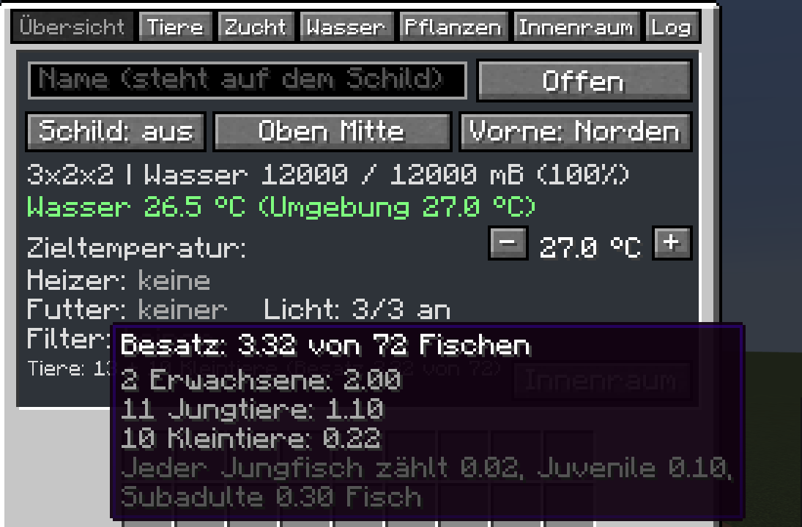

---
navigation:
  title: Bewohner
  icon: bettacraft:fish_bag
  parent: aquarium.md
  position: 60
---

# Bewohner

## Tiere einsetzen

Rechtsklicke das Aquarium mit einem **Betta-Eimer**, einem anderen **Fischeimer** oder einer gefüllten **Fischtüte**.
Das Tier erscheint mit all seinen Daten im Wasser. Das Aquarium muss mindestens halb voll sein. Eine gefüllte *Fish Bag*
von Better Fish Tanks (+100 mB) und ein volles *Fischnetz* von Fintastic (ohne Wasser) gehen ebenfalls.

Angenommen wird jedes **kleine Wassertier** (Hitbox bis 0,8 x 0,8), auch aus anderen Mods: Fische, Axolotl, Kaulquappen,
Tintenfische (mit der Fischtüte, sie haben keinen Eimer) und mehr. Abgelehnt werden zu große Tiere, Bosse, feindliche
Mobs, Landtiere und die Tiere in `#bettacraft:tank_blacklist` (Riesenfische anderer Mods); die Meldung nennt den Grund.
Die Tiere in `#bettacraft:tank_inhabitants` (z. B. der Fintastic-Pleco) sind immer willkommen. Einzelheiten und
Einstellungen: [Tiere anderer Mods](../settings/other_animals.md).

Andere Tiere behalten ihr eigenes Verhalten und haben im Aquarium **keine Bedürfnisse**; nur Bettas werden hungrig,
brauchen Wärme und vermehren sich. Kleine Wassertiere, die ohne Eimer ins Aquarium kommen (Spawn-Ei, Befehl), werden
ebenfalls übernommen.

## Tiere entnehmen

* **Menü:** Öffne das Aquarium-Menü, wähle das Tier im Tab *Bewohner* und klicke *Eimer* oder *Fischtüte*. Du brauchst
  einen leeren Eimer bzw. eine leere Fischtüte im Inventar. Eine Fischtüte nimmt jedes Tier, ein Eimer nur Tiere mit
  Eimer. Ist nicht genug Wasser da, ist der Knopf ausgegraut. Der
  Knopf *Fischtüte* füllt auch eine leere Fish Bag von Better Fish Tanks (-100 mB) oder ein Fintastic-Fischnetz (ohne
  Wasser).
* **Direkt:** Rechtsklicke einen Fisch im Aquarium mit einem Wassereimer, wie überall sonst.

## Eimer, Beutel und Flaschen ausleeren

* **Tiere in die Welt:** Ein Tier-Eimer oder ein gefüllter Fisch- oder Kleintier-Beutel fragt erst in einem kleinen
  Fenster nach, wenn du ihn auf die Welt anwendest (Boden, Teich, das Meer vom Ufer oder Boot aus): *Abbrechen* behält
  die Tiere, *Ausleeren* lässt sie frei. Ins Aquarium kommen sie ohne Nachfrage (der Kescher holt sie wieder).
* **Eimer:** Der Meerwasser-Eimer leert sich wie ein Wassereimer, auch ins Meer und in andere Wasserflächen, in einen
  Kessel, aus einem Werfer und in Tanks und Rohre anderer Mods.
* **Flaschen** (Salzwasser, Sumpfwasser, Infusorien, Artemia-Nauplien): Schleichen + Rechtsklick (oder Rechtsklick in
  die Luft) leert sie überall aus: ein Platschen, eine leere Glasflasche, kein Wasserblock. Im Aquarium wirken sie wie
  bisher.
* Eine leere Fischtüte lässt sich mit Schleichen + Rechtsklick ausschütteln.

## Besatz

Der Besatz zählt **Fische**. Adulte zählen voll, Jungtiere nur wenig (sie sind klein und fressen wenig):

| Stufe | zählt als | Config |
|---|---|---|
| Ei, Larve (im Nest) | 0 | `stocking.eggStocking`, `larvaStocking` |
| Jungfisch | 0,02 | `stocking.fryStocking` |
| Juvenil | 0,1 | `stocking.juvenileStocking` |
| Subadult | 0,3 | `stocking.subadultStocking` |
| Adult | 1 | |

Ein Gelege von 20 jungen Bettas sind als Jungfische also 0,4 Fische, als Juvenile 2 und als Subadulte 6: Eine große
Brut braucht beim Wachsen ein größeres Aquarium. Jungtiere anderer Mods (ein Axolotl-Baby) zählen wie ein Juveniler,
Kleintiere haben eigene Anteile ([Besatz der Kleintiere](../invertebrates/stocking.md)). Fahre in der Übersicht des
[Menüs](menu.md) über die Tiere-Zeile, dann siehst du die Anteile; der Tab *Tiere* zeigt für jeden jungen Betta, wie
viel er zählt (über seine Stufe fahren).

* Ein Adulter pro Wasserblock ist in Ordnung.
* Ab **2 Adulten pro Wasserblock** ist das Aquarium überbesetzt: Die Bettas geraten in Stress und werden irgendwann krank
  (siehe [Gesundheit](../bettas/health.md)). Das Menü zeigt „Überbesetzt!“.
* Höchstens **6 Fische pro Wasserblock** passen überhaupt hinein (Jungtiere anteilig: in ein volles Aquarium passt kein
  Juveniler mehr). Unter Überbesatz leiden nur die Adulten.
* Ein Aquarium fasst insgesamt höchstens 64 Tiere, Jungtiere eingerechnet (`tank.maxEntities`).

## Raubfische

Kugelfische, Axolotl und die Raubfische anderer Mods fressen kleine Fische. Siehe
[Kämpfe, Flaring und Raubfische](../bettas/fighting.md).

## Lebende Beute

Kleine Beutetiere anderer Mods (`#bettacraft:betta_prey`: Feenkrebse, Daphnien und Ruderfußkrebse von Fintastic) sind
Lebendfutter: Ein hungriger Betta frisst eines und gilt als mit Lebendfutter gefüttert, was auch die Zucht fördert.
