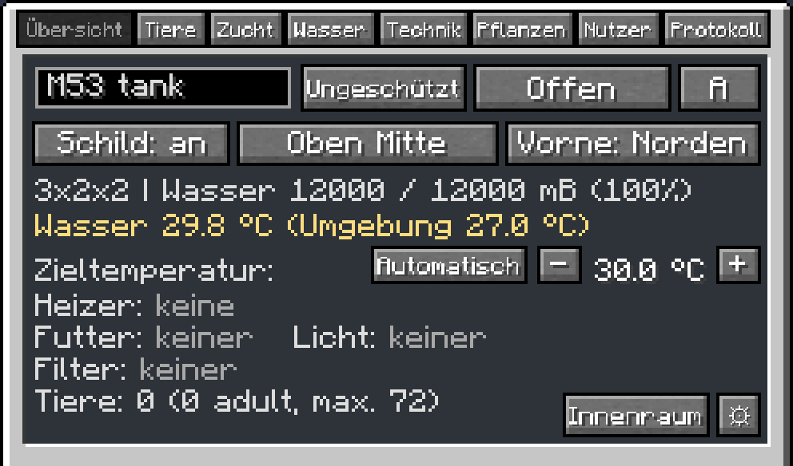
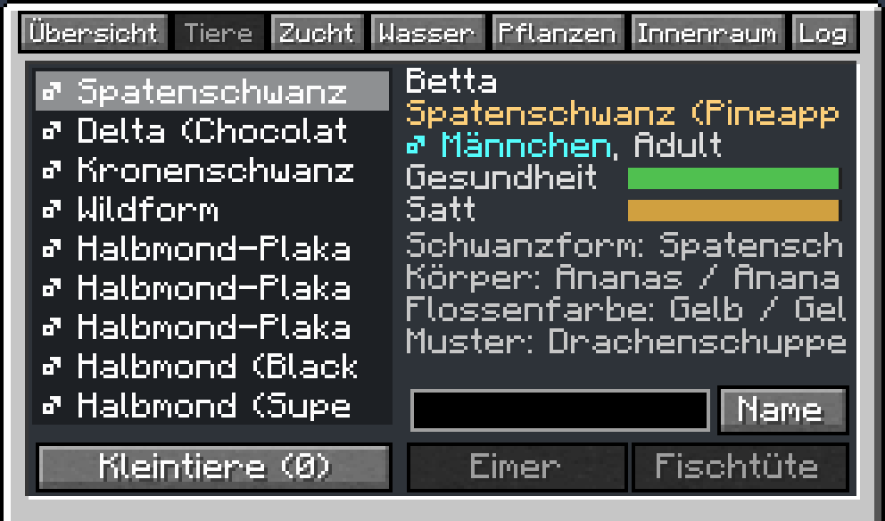
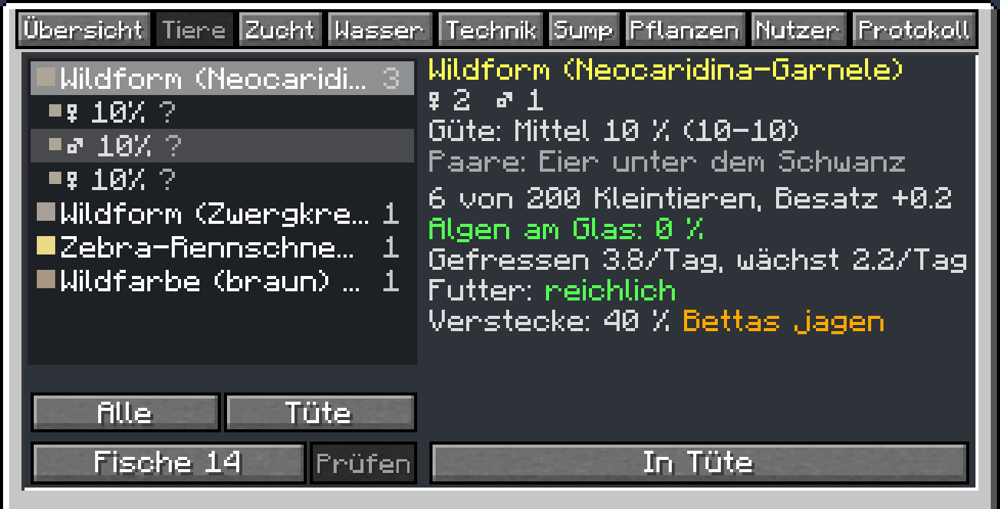
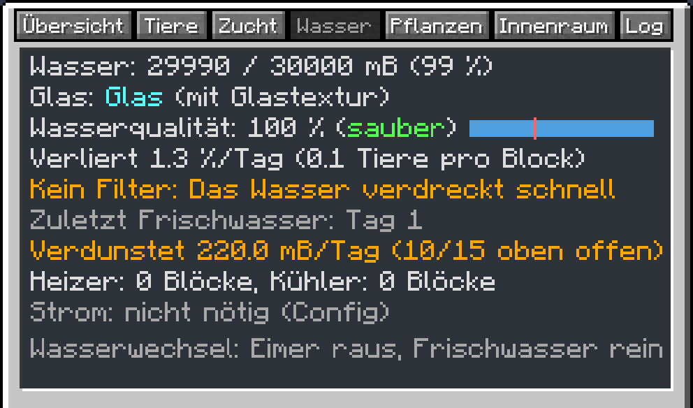
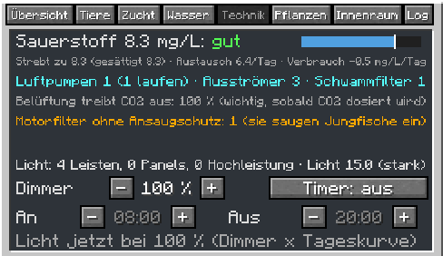
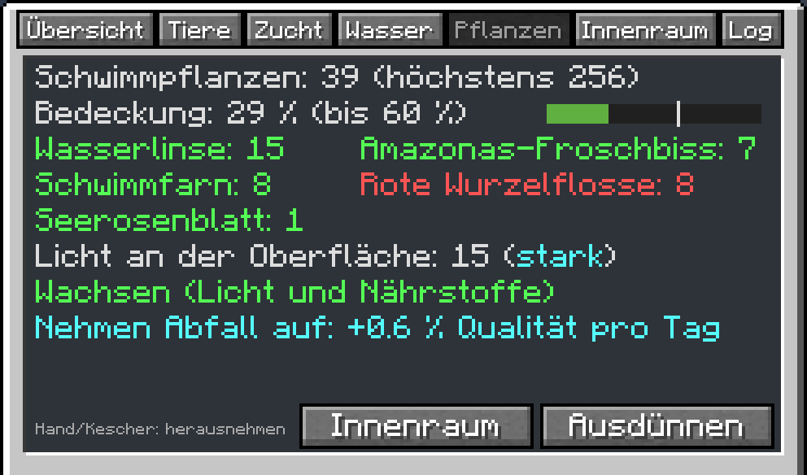
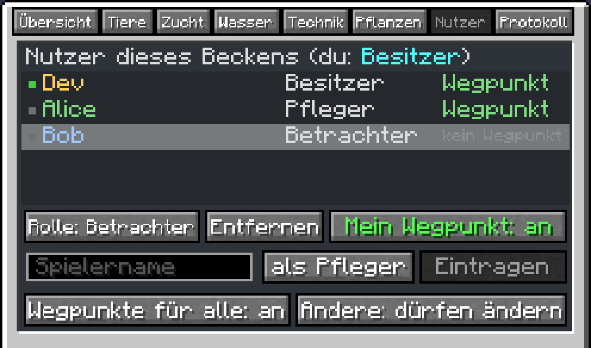

---
navigation:
  title: Aquarium-Menü
  icon: minecraft:name_tag
  parent: aquarium.md
  position: 70
---

# Aquarium-Menü, Namensschild und Sperre

**Rechtsklicke** ein Aquarium mit leerer Hand, um sein Menü zu öffnen. (**Schleichen + Rechtsklick** betritt stattdessen
den [Innenraum](../interior.md).)

## Übersicht

* **Name** (bis 32 Zeichen) und **Namensschild**: an oder aus, seine Position (oben oder unten, links, Mitte oder
  rechts) und die **Vorderseite** des Aquariums, auf der es sitzt. Das Schild ist schwarz mit weißer Schrift und 0,12 Blöcke
  hoch (jeder Spieler kann es mit der Client-Config `render.signScale` größer oder kleiner stellen, 0,5 bis 2); lange
  Namen bekommen eine kleinere Schrift. Der Name steht auch bei ausgeschaltetem Schild im Menü und in Jade.
* **Sperre**: Wer das Aquarium gesetzt hat, ist sein Besitzer. Ist es gesperrt, dürfen nur Besitzer, seine
  Pfleger (Nutzer-Tab, unten) und Operatoren es ändern (Wasser, Tiere, Einstellungen, Innenraum); ansehen dürfen es alle anderen.
* **Bruchschutz** (der Knopf zwischen Name und Sperre; nur Besitzer und Operatoren, bei neuen Aquarien aus): solange er an
  ist, kann **niemand das Aquarium abbauen**, auch der Besitzer nicht und auch nicht im Kreativmodus: das Glas, den
  Deckel, das Licht und die Futterautomaten darauf, den Klemm-Futterautomaten an der Scheibe und den Schrank darunter.
  Wer es versucht, bekommt den Hinweis „Bruchschutz ist an“. Explosionen und Kolben lassen es ebenfalls in Ruhe
  (Server-Config `tank.protectFromExplosionsAndPistons`, standardmäßig an). Schalter für die ganze Funktion:
  `features.equipment.breakProtection`.
* **A** (rechts neben der Sperre; nur Besitzer und Operatoren): welche [angestellten Aquaristen](../getting_started/hired_aquarist.md)
  an diesem Aquarium arbeiten dürfen: **A** der des Besitzers (und seines Teams, mit FTB Teams), **A+** die aller Spieler
  (freigegeben für Freunde, die ihren Aquaristen teilen), **A-** keiner. Ein gesperrtes Aquarium fasst kein Aquarist an.
  Unsichtbar, solange `features.aquaristNpc.enabled` aus ist.
* Größe, Wassermenge, Wasser- und Umgebungstemperatur, die **Zieltemperatur** (– / +).
* Heizstäbe (oder Kühler, wenn das Ziel unter der Umgebung liegt), Futterautomat, Licht und Filter, die Zahl der Tiere
  und der Knopf zum Betreten des Innenraums (sein Tooltip zeigt den Innenraum: Maßstab und Größe, Blöcke in der Miniatur,
  Bodengrund, Heizer und Filter darin). Die letzte Zeile warnt vor mäßigem Wasser oder fehlendem Strom.
* Das **Zahnrad** rechts neben dem Innenraum-Knopf öffnet die **Client-Einstellungen** von Bettacraft (dieselben wie in
  der Config-Datei `bettacraft-client.toml` und in der Mod-Liste): darunter **Alarm-Wegpunkte aller Becken**
  (`map.showAlarmWaypoints`) und welche Karten-Mods sie zeigen (`map.journeyMap`, `map.xaerosMinimap`, `map.ftbChunks`).

## Tiere

Die Liste aller Tiere mit Name, Typ, Geschlecht und Stufe. Zum ausgewählten Fisch: Gesundheits- und Satt-Balken,
Fortschritt der Stufe, der Genotyp (Schwanzform, Körper, Flossen, Muster; alle neun Loci im Tooltip), sobald er mit der
[Lupe](../equipment/magnifier.md) analysiert ist (Knopf **Analysieren**), die Generation, ein Namensfeld und die Knöpfe
zum Entnehmen mit Eimer oder Fischtüte. Ein Zwergkrallenfrosch zeigt Gesundheit,
Futter und Luft.

Der Knopf **Kleintiere** wechselt zu den [Garnelen, Krebsen und Schnecken](../invertebrates.md): jede Sorte (Art und
Farbe) mit Anzahl, Geschlechtern, Jungtieren, Weibchen mit Eiern und Güte; für das ganze Aquarium der Besatz, die Algen
am Glas, wie viel die Putzkolonne frisst, das Futter und die Verstecke. Ein Klick auf eine Sorte klappt die Liste ihrer
Tiere auf: jedes einzelne mit Geschlecht, Alter, Güte und Genen (sobald analysiert); wähle eins, um es genau zu sehen,
es zu **Analysieren** oder genau dieses zu **Entnehmen**. Mit einer gewählten Sorte holt **Entnehmen** das Tier mit der
besten Güte (Umschalt: das schlechteste, Strg: eine volle Tüte bzw. einen vollen Eimer) des gewählten Geschlechts (Knopf
unter der Liste: beliebig, Männchen, Weibchen) in eine Fischtüte oder einen Eimer (der zweite Knopf). **Gelege weg**
nimmt die Gelege der Apfelschnecken vom Glas.

## Zucht

Warnungen, das Schaumnest, die Zuchtbedingungen mit ✔ und ✘, die Jungtiere, die Eltern und die erwarteten Nachkommen.
Siehe [Zucht](../bettas/breeding.md).

## Wasser

Wasservolumen, die [Wasserqualität](water_quality.md) mit einem Balken (die rote Marke zeigt, ab wann die Bettas
leiden), wie schnell sie sinkt und warum (Tiere pro Wasserblock, wie viel die Filter entfernen), das letzte Frischwasser,
Verdunstung und offene obere Blöcke, Heizer und Kühler und der gespeicherte [Strom](../equipment/power.md), wenn der
Server ihn verlangt.

## Technik

Der [Sauerstoff](oxygen.md) mit Balken (der weiße Strich ist die Sättigung), wohin er strebt und warum (Austausch und
Verbrauch), die [Luftpumpen](../equipment/air_pump.md), [Ausströmer](../equipment/air_stone.md) und
[Schwammfilter](../equipment/sponge_filter.md), wie viel CO2 die Belüftung austreibt, wie viele Motorfilter keinen
[Ansaugschutz](../equipment/intake_sponge.md) haben, die Lichter des Aquariums mit der Lichtstärke und **Dimmer** und
**Tageslicht-Timer** mit ihren Knöpfen (siehe [Licht](../equipment/light.md)).

## Pflanzen

Die [Schwimmpflanzen](../plants/floating_plants.md) des Aquariums: Anzahl je Art, Bedeckung, Licht, Wachstum, Abfallaufnahme, die
Warnung bei dichter Decke und der Knopf **Ausdünnen**.

## Nutzer

Der Nutzer-Tab (er hat in 1.43.0 den Innenraum-Tab ersetzt) zeigt, wer an diesem Aquarium was darf:

| Rolle | Darf |
|---|---|
| **Besitzer** | wer es gebaut hat: alles, auch die Nutzer, die Sperre und den Bruchschutz |
| **Pfleger** | alles, was der Besitzer darf: Pflege, Einstellungen, Tiere, Betreten, die Nutzer und die Sperre |
| **Betrachter** | das Menü öffnen und ansehen; ändert nichts und kann nicht ins Aquarium |
| **Nicht eingetragen** | alle anderen: dürfen es ändern, solange es offen ist, gesperrt nur ansehen |

Besitzer und Pfleger tippen den Namen eines Spielers, der online ist, wählen **als Pfleger** oder **als Betrachter** und
drücken **Eintragen**; ein ausgewählter Nutzer bekommt eine andere Rolle oder wird entfernt (jeder Nutzer kann sich selbst
austragen). Spieler in der FTB-Teams-Gruppe des Besitzers zählen als Pfleger. Der Knopf **Andere** ist die Sperre.
Operatoren dürfen immer alles. Config-Schalter: `features.equipment.tankUsers` (aus: die Liste wird ignoriert, nur
Besitzer und Sperre zählen).

**Alarm-Wegpunkte:** Löst ein [Monitor-Alarm](../equipment/monitor.md) aus (oder warnt der
[angestellte Aquarianer](../getting_started/hired_aquarist.md)), bekommen der Besitzer und die eingetragenen Nutzer einen
roten Wegpunkt am Aquarium in ihrer Karten-Mod (JourneyMap, Xaero's Minimap und World Map, FTB Chunks), nie Spieler, die
nur in der Nähe sind. **Mein Wegpunkt** schaltet deinen eigenen für dieses Aquarium (für den Besitzer standardmäßig an,
für alle anderen Nutzer aus); **Wegpunkte für alle** (Besitzer und Pfleger) schaltet sie für alle ab. Das Zahnrad in der
Übersicht schaltet sie für alle Aquarien und je Karten-Mod.

## Log

Was im Aquarium passiert ist: Fütterungen, Eier, Kämpfe, Krankheiten, Todesfälle und ihre Ursachen, mit dem Ingame-Tag.
Es hält 100 Einträge und lässt sich filtern (alles, Zucht, Gesundheit, Futter).
