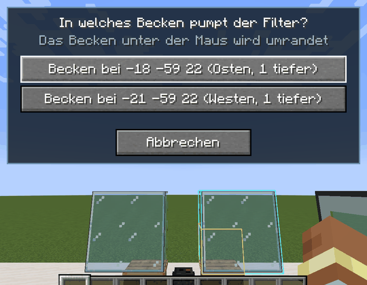

---
navigation:
  title: Filter
  icon: bettacraft:internal_filter
  parent: equipment.md
  position: 30
item_ids:
  - bettacraft:internal_filter
  - bettacraft:external_filter
---

# Filter

Filter bringen Bewegung ins Aquarium: einen Wasserstrahl, Blasen und ein leises Blubbern (abschaltbar in der
Client-Config, `sound.filterSound`). Die Strömung selbst wirkt nicht auf die Fische, aber Filter **halten das Wasser
sauber**: Ein Außenfilter schafft 32 Wasserblöcke, ein Innenfilter unter Wasser 16 (siehe
[Wasserqualität](../aquarium/water_quality.md)).

## Innenfilter

<ItemImage id="bettacraft:internal_filter" scale="2" />

Setze den <ItemLink id="bettacraft:internal_filter" /> in den [Innenraum](../interior.md): Er wird zu einem Filterturm
(2x2x8 Blöcke bei Maßstab 16), dessen Auslass zu dir zeigt. Das Aquarium zeigt an seinem Auslass einen Wasserstrahl.

## Außenfilter

Der <ItemLink id="bettacraft:external_filter" /> steht **neben dem Aquarium** und zeigt darauf: Gegen einen
Aquarium-Block gesetzt dreht er sich zu ihm, an jeder Seitenwand und in jeder Höhe. Ein Schlauch führt über den
Glasrand, ein Strahl plätschert ins Wasser (unter Wasser ist es eine kurze Strömung).

* Er hat **zwei Plätze** für [Heizstäbe](heaters.md) oder [Kühler](coolers.md) beliebiger Größe. Öffne ihn per
  Rechtsklick oder rechtsklicke ihn mit einem Heizstab. Solange der Filter angeschlossen ist, heizen seine Heizstäbe
  und kühlen seine Kühler das Aquarium.
* Sein Menü (seit 1.55.0 größer) zeigt die **Energie** im Speicher seines Beckens (mit einem Balken); der Filter speichert selbst keine.
* Abgebaut behält er seine Heizstäbe im Item (der Tooltip listet sie auf).
* Er passt auch in einen [Aquariumschrank](cabinet.md) unter dem Aquarium.
* Er darf auch **ein oder zwei Blöcke tiefer** als das Becken stehen, neben dem Schrank oder ohne Schrank (siehe unten).
* Er ist die kleine Variante: ein [Multiblock-Außenfilter](multiblock_filter.md) in jeder Größe, mit Filtermedien und
  Rohren, reinigt viel mehr.

Das Aquarium-Menü zeigt „Filter: 1 außen (Heizstäbe: 2), 1 innen“.

### Unter dem Becken

Neben einem Becken verbindet sich der Filter von selbst. **Ein oder zwei Blöcke tiefer** (neben dem Schrank oder auf dem
Boden neben einem Unterbau) rät er nicht, denn bei mehreren Becken nebeneinander läge er leicht falsch: die Anzeige sagt
„Mit keinem Aquarium verbunden“, und beim Setzen erscheint ein Hinweis.

**Shift + Rechtsklick mit leerer Hand auf den Filter**: eine Liste zeigt jedes Becken in Reichweite mit Namen, Position,
Seite und wie weit der Filter darunter steht. Das Becken unter der Maus wird in der Welt **umrandet** (türkis, der
Wandblock, an dem der Schlauch hochgeht, gelb). Klick eines an: der Filter dreht sich dorthin, und der Schlauch läuft den
längeren Weg am Schrank und am Glas hoch. Mit demselben Klick wechselt ein Filter zwischen zwei Becken sein Becken.
Filter älterer Welten direkt an ihrem Becken bleiben angeschlossen. Die Einstellung `features.equipment.filterBelowTank`
erlaubt wieder nur Filter direkt neben einem Becken (ein gewähltes Becken darunter bleibt für später gespeichert).

## Weitere Innenfilter, Jungfische und der Leistungsregler

* Der [Schwammfilter](sponge_filter.md) (luftbetrieben, schonend für Jungfische) und der [Eckfilter](corner_filter.md)
  sind weitere Innenfilter.
* Filter mit Motor (Innen-, Eck-, Außen- und Schrankfilter) **saugen Jungfische ein**, wenn kein
  [Ansaugschutz](intake_sponge.md) angebracht ist.
* Jeder Filter hat einen [Leistungsregler](regulator.md) (0 bis 100 %): weniger Leistung reinigt weniger, braucht
  weniger Energie und ist leiser. Filterauslässe bringen auch etwas **Sauerstoff** ins Wasser (siehe
  [Sauerstoff](../aquarium/oxygen.md)).

## Bezug

Herstellung:

<RecipesFor id="bettacraft:internal_filter" />
<RecipesFor id="bettacraft:external_filter" />
