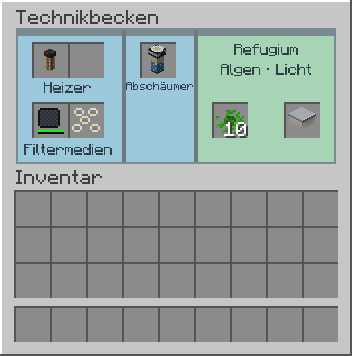
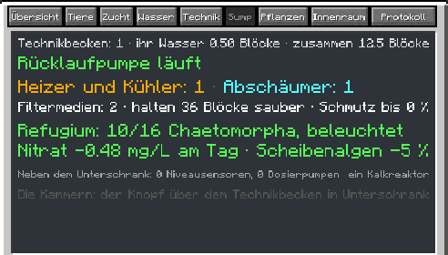

---
navigation:
  title: Technikbecken
  icon: bettacraft:sump
  parent: equipment.md
  position: 81
item_ids:
  - bettacraft:sump
---

# Technikbecken

Ein **Technikbecken** (Sump) ist ein zweites, kleines Becken im [Unterschrank](cabinet.md) unter dem Aquarium. Das Wasser
läuft über einen Überlauf hinunter, eine Rücklaufpumpe bringt es wieder hoch. Das Technikbecken kommt in den
**Technikbecken-Platz** eines Unterschranks (zwischen den Heizer-Plätzen und dem Luftpumpen-Platz).

* **Mehr Wasser:** Jedes Technikbecken fügt dem Becken **0,5 Blöcke Wasser** hinzu (`sump.sumpWaterBlocks`): Abfall, Nitrat
  und dosierte Werte verteilen sich auf mehr Wasser und ändern sich langsamer, und das Becken hat Platz für mehr Tiere.
* **Ein Filter:** Seine Rücklaufpumpe läuft wie ein [Außenfilter](filters.md) (mit FE, wo das Becken Strom braucht); der
  Überlauf saugt keine Jungfische an.
* **Kammern:** Der Knopf **»** über dem Technikbecken-Platz öffnet sie:

| Kammer | |
|---|---|
| Heizer | zwei [Heizer](heaters.md) oder [Kühler](coolers.md), wie im Außenfilter |
| Abschäumer | ein [Abschäumer](../saltwater/protein_skimmer.md): reinigt Meerwasser wie einer an der Scheibe |
| Filtermedien | zwei [Filtermedien](filter_media.md); sie setzen sich zu und werden ausgewaschen wie im Multiblock-Filter |
| [Refugium](refugium.md) | Chaetomorpha und ein Beckenlicht: nimmt Nitrat auf |

* **Geräte neben dem Unterschrank:** Ein [Niveausensor](level_sensor.md) oder eine [Dosierpumpe](../saltwater/dosing_pump.md)
  neben dem Unterschrank eines Technikbeckens versorgt das Becken darüber, ebenso ein
  [Kalkreaktor](../saltwater/calcium_reactor.md): Sie brauchen keinen Platz am Becken.
* Das Beckenmenü bekommt den Tab **Sump**: das Wasser der Technikbecken, die Pumpe, die Kammern, das Refugium und die Geräte
  neben den Unterschränken.

Alte Unterschränke bekommen den neuen Platz leer; für ein Becken ohne Technikbecken ändert sich nichts. Schalter:
`features.sump.enabled`.

## Bezug

Herstellung:

<RecipesFor id="bettacraft:sump" />
