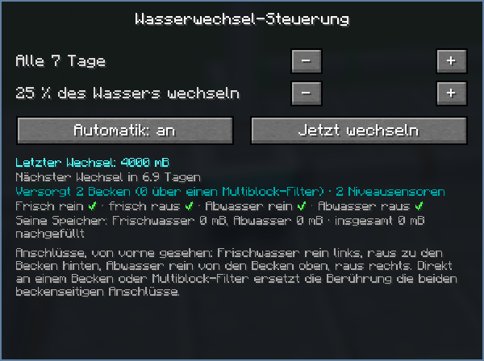

---
navigation:
  title: Wasserwechsel-Steuerung
  icon: bettacraft:water_change_controller
  parent: equipment/water_system.md
  position: 6
item_ids:
  - bettacraft:water_change_controller
---

# Wasserwechsel-Steuerung

<GameScene zoom="4" interactive={true}>
  <Block id="bettacraft:water_change_controller" p:facing="south" />
</GameScene>

Aquarien brauchen **Wasserwechsel**, weil sich [Nitrat](../aquarium/nitrate.md) anreichert. Von Hand: mit einem leeren
Eimer Wasser abschöpfen und frisches einfüllen (25 % eines 4-Block-Aquariums sind ein Eimer). Frischwasser hat die
Temperatur der Umgebung, ein großer Wechsel ist also ein kühler Wasserwechsel (Panzerwelse lieben ihn).

Die <ItemLink id="bettacraft:water_change_controller" /> macht das selbst, und sie **füllt** verdunstetes Wasser **nach**.
Rechtsklicken:

* **Abstand** 1 bis 60 Tage (Vorgabe: was die Schwierigkeit verlangt, 14 Tage) und **Anteil** 5 bis 50 % (Vorgabe 25 %);
* **Automatik an/aus** und **jetzt wechseln**;
* die Aquarien, die sie versorgt (und wie viele davon über einen Multiblock-Filter), die Niveausensoren, die sie liest, ihre
  vier Anschlüsse, ihre Speicher und Warnungen.

## Die vier Anschlüsse

Von vorne gesehen (das Bedienfeld zeigt beim Setzen zu dir) ist jeder Anschluss ein Stutzen mit seiner Farbe und einem Pfeil:

| Anschluss | Wo | Verbindet |
|---|---|---|
| Frischwasser **rein** | links | ein [Rohr](pipes.md) von einem [Vorratsbehälter](reservoir.md), einer Wasserpumpe an einer Wasserquelle, einer Umkehrosmose-Anlage oder dem Tank einer anderen Mod |
| Frischwasser **raus** | hinten | die Leitung zu den Aquarien |
| Abwasser **rein** | oben | die Leitung von den Aquarien |
| Abwasser **raus** | rechts | ein [Abfluss](drain.md), ein Vorratsbehälter oder der Tank einer anderen Mod, direkt am Anschluss oder über ein Rohr |

Vorne und unten ist kein Anschluss. Jede Leitung bekommt ihre Aufgabe von ihrem Anschluss und zeigt sie mit einem grünen
(Frischwasser) oder braunen (Abwasser) Ring. Frischwasser rein und Frischwasser raus an einer Leitung, oder eine Leitung, die
auch den Einlass oder Auslass eines Filters erreicht, ist ein **Kurzschluss**: die Steuerung steht still.

**Frischwasser kommt immer durch ein Rohr.** Was nur neben der Steuerung steht (ein Vorratsbehälter, eine Wasserquelle, der
Tank einer anderen Mod), gibt ihr nichts. Pumpen und Rohre anderer Mods dürfen Wasser in den Frischwasser-Einlass drücken,
und Rohre anderer Mods dürfen aus dem Abwasser-Ausgang ziehen.

## Welche Aquarien sie versorgt

* **Berührung:** an ein Aquarium gesetzt (beim Setzen auf das Aquarium schauen: ihr Rücken liegt am Glas), ersetzt die
  Berührung beide beckenseitigen Anschlüsse; dann reichen zwei Rohre: Frischwasser rein und Abwasser raus.
* **Über ihre Leitungen:** frei aufgestellt füllt die Leitung Frischwasser raus die Aquarien, an denen sie andockt, die
  Leitung Abwasser rein entleert sie. Beide Leitungen dürfen am selben Beckenblock andocken: als [Bündel](pipe_bundle.md) an
  einer Fläche, an zwei Flächen eines Kanten- oder Eckblocks, oder an verschiedenen Blöcken desselben Aquariums.
* **Am Multiblock-Filter:** berührt sie eine Filterkammer oder den Pumpenkopf, oder enden ihre beckenseitigen Leitungen dort,
  versorgt sie **alle Aquarien des Filters** (aufgeteilt nach dem, was jedes braucht; das Frischwasser geht über den Rücklauf
  des Filters hinein). Ihre Leitungen nicht an Einlass oder Auslass des Filters anschließen: das ist ein Kurzschluss.

Ein Wasserwechsel braucht ein Aquarium, das befüllt **und** entleert wird; das Nachfüllen braucht nur das Befüllen.

## Ein Wasserwechsel

Ist der Abstand um (oder auf „jetzt wechseln“), arbeitet sie in Schritten von einer halben Sekunde: jeder Schritt holt
Frischwasser aus ihrer Leitung, lässt **genau so viel** aus den Aquarien ab (nie mehr, als sie nachfüllen kann, und nie unter
halb voll, solange Tiere darin leben) und füllt das Frischwasser ein. Ein Schritt bewegt, was ihre Leitungen tragen: Glas
500 mB, Edelstahl 2.500 mB; Berührung hat keine Grenze. Ein großer Wechsel über Glasrohre dauert also ein paar Schritte. Das
alte Wasser geht in ihren Abwasserspeicher (4.000 mB) und weiter durch ihren Abwasser-Ausgang; ohne Abfluss wartet sie und
sagt es. Das Logbuch notiert jeden Wechsel.

Wo sie ein Aquarium entleert, hält ein **Ansaugschutz** innen die Jungtiere drin; ohne ihn saugt der Wechsel den
abgelassenen Anteil der Jungfische, Junggarnelen und Kaulquappen ein (siehe [Schutzaufsätze](guards.md)).

## Nachfüllen

Zwischen den Wasserwechseln füllt sie jedes Aquarium nach, das sie befüllt und das einen [Niveausensor](level_sensor.md) hat:
sie liest den Sensor ohne Kabel und gibt dazu, was fehlt (ab 50 mB, bis zu 1.000 mB je Schritt). **Nur Süßwasser:** eine
salzige Quelle wird abgelehnt, so bleibt das Salz eines [Riffbeckens](../saltwater.md), wo es war. Ohne Sensor wechselt sie
nur Wasser; ohne Steuerung misst ein Sensor nur.

Mit Stromkosten (`power.costs` `EASY` oder `HARD`) braucht sie FE (8 FE je 100 mB). Schalter:
`features.pipes.autoWaterChange`, `topOff`, `filterWater` (einen Multiblock-Filter versorgen).

## Bezug

Herstellung:

<RecipesFor id="bettacraft:water_change_controller" />
