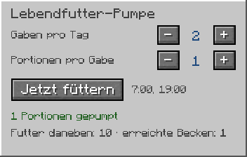

---
navigation:
  title: Lebendfutter-Pumpe
  icon: bettacraft:live_food_pump
  parent: food/live_food.md
  position: 50
item_ids:
  - bettacraft:live_food_pump
---

# Lebendfutter-Pumpe

<ItemImage id="bettacraft:live_food_pump" scale="2" />

Die Lebendfutter-Pumpe füttert deine Becken von selbst mit Lebendfutter. Stelle sie **neben eine Zuchtanlage**
(Daphnien-Fass, Artemia-Zuchtbecken, Larvenbottich oder Tubifex-Zuchtschale) und verbinde sie mit den
[Rohren](../equipment/pipes.md), die zu den Becken führen, oder stelle sie direkt neben ein Becken. Sie holt das Futter aus
der Zuchtanlage und pumpt jede Portion als 250 mB **Lebendfutter-Suspension** (das Fluid `bettacraft:live_food`) in die
Becken. Dort zählt sie als Lebendfutter: die hungrigsten Tiere fressen zuerst, Lebendfutter konditioniert die Zuchtfische,
was keiner braucht, sinkt zu den Garnelen und Schnecken.

Rechtsklick öffnet ihr Fenster:

* **Gaben pro Tag** (0 bis 8, gleichmäßig ab 7:00; 0 = nur per Knopf) und **Portionen pro Gabe** (1 bis 8).
* **Jetzt füttern** pumpt sofort eine Gabe.
* Was sie zuletzt getan hat, das Futter in den Zuchtanlagen daneben und die Becken, die sie erreicht.

Ein Becken nimmt die Suspension nur, wenn dort jemand dieses Futter frisst (erwachsene Bettas zum Beispiel keine
Artemia-Nauplien); dann bleibt das Futter in der Zuchtanlage. Eine Gabe, die nicht hinaus kann, wartet bis zur nächsten,
sie sammelt sich nie an. Die leere Flasche eines Flaschenfutters (Artemia-Nauplien) geht zurück in das Zuchtbecken, das
sie für die nächste Runde braucht. Ein Redstone-Signal pausiert die Pumpe; mit Stromkosten (`power.costs` `EASY` oder `HARD`) braucht jede
Portion FE (`liveFood.pumpFePerPortion`). Tanks und Speicher anderer Mods (AE2, Refined Storage) halten die Suspension wie
jedes Fluid.

## Bezug

Herstellung:

<RecipesFor id="bettacraft:live_food_pump" />
