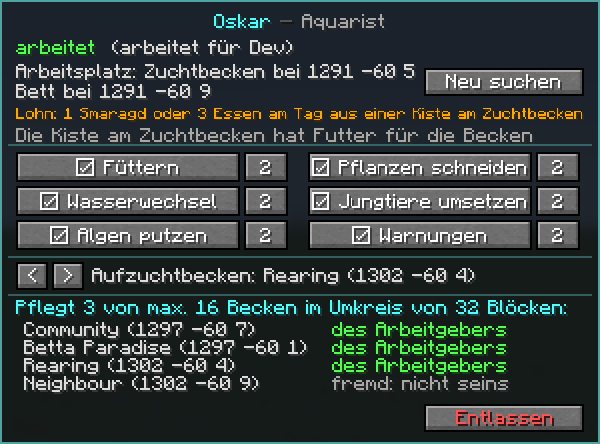

---
navigation:
  title: Angestellter Aquarist
  icon: minecraft:emerald
  parent: getting_started.md
  position: 40
item_ids:
  - bettacraft:hired_aquarist
feature: aquaristNpc.enabled
---

# Angestellter Aquarist

Hast du ein paar Aquarien und etwas gezüchtet, kommt ein **Aquarist** vorbei und bietet dir an, deine Becken zu pflegen.
Er ist eine eigene Person (kein Dorfbewohner, nicht der [Aquarianer](aquarist.md), der nur handelt): ein Mann oder eine
Frau mit türkiser Gummischürze, blauen Handschuhen und Gummistiefeln, mit einem Vornamen. Eingestellt wohnt er in einem Bett
nahe einem Zuchtbecken, nimmt jeden Morgen seinen Lohn und **läuft wirklich zu deinen Becken**, um zu füttern, Wasser zu
wechseln, zu putzen, zu schneiden und Jungtiere umzusetzen.

## Wann er kommt

* Jeder Spieler bekommt seinen eigenen Aquaristen. Er kommt, wenn **du** mindestens **3 Becken** besitzt und **etwas
  gezüchtet** hast (ein Zucht-Fortschritt: ein Betta-Laichen, ein Wurf, junge Garnelen, ein Gelege ...), bei Tag, 10 bis 20
  Blöcke von dir entfernt; er läuft zu dir.
* Er bietet seine Arbeit im Chat an, mit zwei Knöpfen **[Einstellen]** und **[Nein, danke]**; ein Rechtsklick auf ihn
  zeigt dasselbe Angebot in seinem Fenster. Er wartet einen Spieltag auf die Antwort.
* **Abgelehnt** (oder ohne Antwort) geht er. Der nächste kommt nach **5 bis 10 Spieltagen und einer weiteren Zucht**.
  Dasselbe gilt, wenn ein angestellter Aquarist geht (kein Lohn, kein Zuhause, entlassen).
* `/bettacraft aquarist status` sagt dir, warum noch keiner gekommen ist.

## Zuhause und Lohn

* Er braucht ein **freies Bett** und ein **freies [Zuchtbecken](aquarist.md)** (seinen Arbeitsplatz) im Umkreis von 32
  Blöcken um die Stelle, an der er beim Einstellen steht. Er nimmt sie für sich (kein Dorfbewohner benutzt sie dann). „Neu
  suchen“ in seinem Menü lässt ihn um die Stelle herum suchen, an der er gerade steht.
* **Kisten neben dem Zuchtbecken** (an jeder Seite, auch schräg; auch Fässer und Speicher anderer Mods) halten, was er
  braucht: das **Futter** für die Becken, die **Stecklinge**, die er zurückbringt, und seinen **Lohn**.
* Das Wasser für den Wasserwechsel kommt aus einem **Reservoir**, einem Rohr, einem Tank einer anderen Mod oder einer
  Wasserquelle **neben dem Zuchtbecken** (Salzwasser für Salzbecken).
* **Lohn:** jeden Morgen **1 Smaragd**, oder **3 Stück Essen** (Brot, gebratener Fisch ...), wenn kein Smaragd da ist. Der
  erste Tag ist frei. Ohne Lohn arbeitet er **halb so schnell**; nach **3 Tagen** ohne Lohn (oder ohne Bett und
  Zuchtbecken) geht er.
* Nachts schläft er in seinem Bett. Er kann nicht verletzt werden (nur `/kill` entfernt ihn), läuft vor Monstern weg, lässt
  sich nicht schieben, anleinen oder fangen, und nur du (oder ein Operator) kannst sein Menü benutzen. Ein Namensschild
  benennt ihn um (nur deines).

## Seine Aufgaben

Rechtsklick auf ihn: Sein Menü zeigt Status, Zuhause, Lohn und die sechs Aufgaben. Ein Klick auf den Namen einer Aufgabe
schaltet sie an oder aus, die Zahl stellt ihre Stufe 1 bis 3:

| Aufgabe | Was er tut | Stufe 1 / 2 / 3 |
|---|---|---|
| Füttern | nimmt Futter aus den Kisten (Lebendfutter zuerst, mehrere Sorten im Wechsel) und füttert jedes Becken; nicht Becken mit eigenem Futterautomaten | einmal / zweimal / dreimal am Tag |
| Wasserwechsel | trägt Wasser aus dem Reservoir am Zuchtbecken heran und wechselt es, wenn der Abstand des [Wasserwechsel-Reglers](../equipment/water_change.md) um ist oder das Wasser schlecht | 15 / 25 / 35 % |
| Algen putzen | kratzt die Algen von der Scheibe | ab 50 / 30 / 15 % Algen |
| Pflanzen schneiden | dünnt Schwimmpflanzen aus und schneidet ausgewachsene Aquarienpflanzen zurück; Pflanzen und Stecklinge kommen in die Kiste | ab 90 / 75 / 60 % Bedeckung, ausgewachsene / fast / halb gewachsene Pflanzen |
| Jungtiere umsetzen | trägt junge Bettas, junge Beifische und Jungfrösche in das **Aufzuchtbecken**, das du in seinem Menü wählst (die Pfeile) | 2 / 4 / 8 je Gang |
| Warnungen | sagt dir im Chat, was nicht stimmt (mit JourneyMap auch als Wegpunkt am Becken) | kranke Tiere und zu wenig Wasser / auch Temperatur, Wasser, Hunger, Überbesatz / auch die Zuchtwarnungen |

Er pflegt bis zu **16 Becken im Umkreis von 32 Blöcken** um sein Zuchtbecken (die nächsten zuerst), und nur Becken, die
**geladen** sind. Jede Runde holt er am Zuchtbecken, was er braucht, geht von Becken zu Becken und bringt Stecklinge und
übriges Futter zurück. Alles, was er trägt, legt er zurück, wenn er geht; Jungtiere kommen zurück in ihr Becken, wenn das
Aufzuchtbecken sie nicht nimmt (voll, falsches Wasser), oder als gefüllter Fischbeutel in eine Kiste, wenn auch das nicht
geht.

## Wessen Becken (Mehrspieler)

Er arbeitet nur an Becken, die er anfassen darf; das prüft er vor jeder Arbeit noch einmal:

* an **deinen eigenen** Becken (Besitzer ist, wer das Becken gesetzt hat; ein Becken ohne Besitzer bekommt der nächste
  Spieler, der es öffnet);
* mit **FTB Teams** an den Becken der Mitglieder deiner Gruppe (Server-Config `hiredAquarist.ftbTeams`);
* an Becken anderer Spieler nur, wenn ihr Besitzer sie **freigegeben** hat: der Knopf **A** im [Beckenmenü](../aquarium/menu.md)
  (Besitzer oder Operator) wechselt zwischen „der Aquarist des Besitzers“ (A), „die Aquaristen aller Spieler“ (A+, für
  Freunde, die die Arbeit ihres Aquaristen teilen) und „kein Aquarist“ (A-);
* **nie an gesperrten Becken** (die Sperre des Beckenmenüs) und nie an Becken Fremder.

Sein Menü listet die Becken um seinen Arbeitsplatz und ob sie dem Arbeitgeber, dem Team gehören, freigegeben, fremd,
gesperrt oder unerwünscht sind.

## Einstellungen

Config `features.aquaristNpc.enabled` (standardmäßig an). Aus: es kommt kein Aquarist, angestellte warten nur (sie arbeiten
wieder, wenn es an ist), das Beckenmenü zeigt den Knopf nicht. Server-Config `hiredAquarist.*`: nötige Becken
(`minOwnTanks`, 3), die Wartezeit nach einer Ablehnung (`returnDaysMin` 5, `returnDaysMax` 10), wie lange er auf eine
Antwort wartet (`offerDays`, 1), Becken und Umkreis (`maxTanksCared` 16, `workRadius` 32, `homeRadius` 32), der Lohn
(`wage`, `wageEmeralds` 1, `wageFood` 3, `unpaidDaysUntilLeave` 3, `unpaidWorkSpeed` 0,5) und FTB Teams (`ftbTeams`).
Operatoren: `/bettacraft aquarist arrive [Spieler]` lässt sofort einen kommen.

