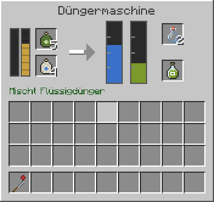

---
navigation:
  title: Düngermaschine
  icon: bettacraft:fertilizer_maker
  parent: plants.md
  position: 13
feature: fertilizer.enabled
item_ids:
  - bettacraft:fertilizer_maker
---

# Düngermaschine

<ItemImage id="bettacraft:fertilizer_maker" scale="2" />

Die Düngermaschine mischt **ein <ItemLink id="bettacraft:kelp_meal" />, ein <ItemLink id="bettacraft:nutrient_salt" />
und 250 mB Wasser** zu **250 mB [Flüssigdünger](fertilizer.md)** (eine Flasche) in 10 Sekunden.

* **Wasser:** ein Wassereimer (auch Osmose- oder Meerwasser), ein Rohr oder die Tanks anderer Mods füllen ihren
  Wassertank (4000 mB, die blaue Anzeige).
* **Flaschen:** leere Glasflaschen im Flaschenplatz werden aus dem Düngertank (die grüne Anzeige) gefüllt.
* **Rohre:** solange keine Flasche wartet, geht der Dünger von selbst in ein Rohr oder ein Aquarium daneben; ein Aquarium
  nimmt ihn nur bis 100 %. Rohre und Tanks anderer Mods können ihn auch abpumpen (Flüssigkeit `bettacraft:fertilizer`).
* **Antrieb:** ohne Strom läuft sie mit einer Feder: mit der [Kurbel](../equipment/crank.md) aufziehen (fünf Sekunden für
  einen Tag). Mit Stromkosten braucht sie beim Arbeiten `fertilizer.fertilizerFePerTick` FE pro Tick und, wenn das
  FE fehlt, ihre Feder. Auch eine Welle von **Create**, die auf sie zeigt, treibt sie an (64 U/min für volle Arbeit).
* Ein Redstone-Signal pausiert sie; ein Komparator liest, wie voll der Düngertank ist. Trichter, AE2 und Refined Storage
  legen Seetangmehl, Nährsalz und Flaschen hinein und nehmen die vollen Flaschen heraus.

## Bezug

Herstellung:

<RecipesFor id="bettacraft:fertilizer_maker" />
