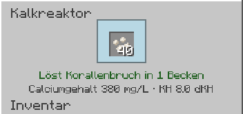

---
navigation:
  title: Kalkreaktor
  icon: bettacraft:calcium_reactor
  parent: saltwater/technique.md
  position: 45
item_ids:
  - bettacraft:calcium_reactor
  - bettacraft:coral_rubble
---

# Kalkreaktor

Der **Kalkreaktor** ist neben der [Dosierpumpe](dosing_pump.md) der andere Weg, den Steinkorallen zu geben, was sie
verbrauchen: Das Beckenwasser läuft durch eine geschlossene Säule aus **Korallenbruch**; **CO2** macht es sauer, der Bruch
(Calciumcarbonat) löst sich, und das Wasser kommt mit **Calcium und Alkalinität** im Verhältnis zurück, in dem die Korallen
sie verbrauchen.

* **Aufstellen** neben einem Meerwasserbecken, neben dem [Unterschrank seines Technikbeckens](../equipment/sump.md) oder an
  einem [Rohr](../equipment/pipes.md) zu den Becken (Rohre schließen an jeder Seite außer der Vorderseite an).
* **CO2:** eine [CO2-Gasflasche](../equipment/co2.md) mit Gas daneben (jede Seite); er nimmt etwas Gas, solange er läuft.
* **Korallenbruch:** von Hand oder per Trichter in seinen Platz. Ein toter Korallenblock gibt 4, ein Calcitblock 2.
* Er fügt **40 mg/L Calcium am Tag** in einem Block Wasser hinzu (`sump.calciumReactorCalciumPerDay`; die Alkalinität folgt)
  und verbraucht 2 Korallenbruch am Tag (`sump.calciumReactorRubblePerDay`). Er hält das Calcium bei etwa **440 mg/L**:
  darüber schließt sein Ventil.
* Rechtsklick: sein Fenster mit dem Korallenbruch, was er tut, und Calcium und KH des Beckens. Ein Komparator liest, wie voll
  die Säule ist.

Schalter: `features.sump.calciumReactor` (braucht Korallen und CO2 eingeschaltet).

## Bezug

Herstellung:

<RecipesFor id="bettacraft:calcium_reactor" />
<RecipesFor id="bettacraft:coral_rubble" />
