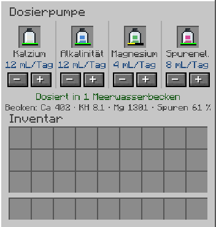

---
navigation:
  title: Dosierpumpe
  icon: bettacraft:dosing_pump
  parent: saltwater/technique.md
  position: 40
item_ids:
  - bettacraft:dosing_pump
  - bettacraft:dosing_canister
  - bettacraft:calcium_canister
  - bettacraft:alkalinity_canister
  - bettacraft:magnesium_canister
  - bettacraft:trace_canister
---

# Dosierpumpe

<GameScene zoom="4" interactive={true}>
  <Block id="bettacraft:tank" x="0" p:east="true" p:fill="14" />
  <Block id="bettacraft:tank" x="1" p:west="true" p:fill="14" />
  <Block id="bettacraft:dosing_pump" x="2" p:facing="west" />
</GameScene>

Die Dosierpumpe hält die [Riffchemie](reef_chemistry.md) eines Meerwasserbeckens stabil: vier Kanäle, jeder mit einem
Kanister Lösung und eigener Menge mL pro Tag. Sie dosiert jede Sekunde ein wenig, Tag und Nacht, und braucht keinen
Strom.

* **Neben ein Meerwasserbecken stellen** (beliebige Seite) oder **an Rohre hängen**, die in Becken führen: Rohre
  schließen an jeder Seite außer der Vorderseite an (die [Rohre](../equipment/pipes.md) des Aquariums). Mehrere Becken
  teilen sich die Dosis.
* **Rechtsklick**: die Kanister in die vier Fächer setzen (jeder Kanister in jeden Kanal) und die mL pro Tag jedes
  Kanals mit **-** und **+** einstellen (Schleichen: um 10; 0 = aus). Das Fenster zeigt, was die Pumpe tut, und
  Kalzium, Alkalinität, Magnesium und Spurenelemente des Beckens.
* Sie **dosiert nur in Meerwasser** (ab 20 ‰). Süß- und Brackwasserbecken bleiben unberührt.
* Ein Kanister fasst 500 mL (`dosing.canisterMl`). Leer wird er zum leeren Kanister: im Werkbankraster nachfüllen.
  Trichter setzen volle Kanister ein und holen leere heraus; ein Komparator liest, wie voll der leerste Kanister ist.

## Wie viel?

Ein mL Lösung hebt einen Block Wasser um 2 mg/L Kalzium, 0,07 °dKH Alkalinität, 4 mg/L Magnesium oder 15 %
Spurenelemente (`dosing.*PerMl`): Ein Becken mit 40 Wasserblöcken bekommt mit 10 mL Kalzium am Tag 0,5 mg/L am Tag.
Ein paar Tage die Werte im Fenster oder im [Beckenmenü](../aquarium/menu.md) beobachten und nachstellen:

* **Kalzium und Alkalinität** in etwa **gleichen mL**: Die Steinkorallen verbrauchen sie in diesem Verhältnis.
* **Magnesium**: ein paar mL am Tag reichen.
* **Spurenelemente**: so viel, dass sie über 60 % bleiben, für die kräftigen Farben.

Zu viel schadet den Tieren nicht, ist aber verschwendet.

## Bezug

Herstellung:

<RecipesFor id="bettacraft:dosing_pump" />
<RecipesFor id="bettacraft:dosing_canister" />
<RecipesFor id="bettacraft:calcium_canister" />
<RecipesFor id="bettacraft:alkalinity_canister" />
<RecipesFor id="bettacraft:magnesium_canister" />
<RecipesFor id="bettacraft:trace_canister" />
