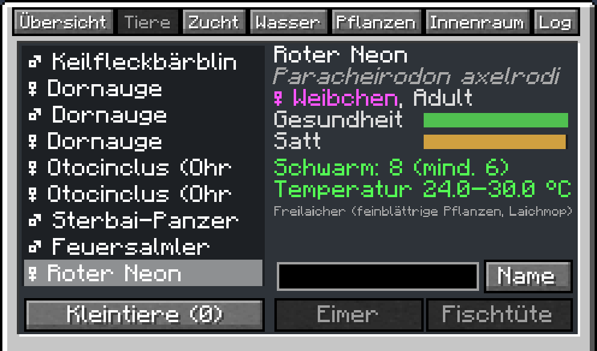

---
navigation:
  title: Beifische
  icon: bettacraft:neon_tetra_bucket
  position: 50
feature: tankmates.enabled
---

# Beifische

Beliebte Aquarienfische können ein Becken mit den Bettas teilen (oder ohne sie leben): **Salmler**,
**Bärblinge**, **Panzerwelse**, **Harnischwelse**, **Otocinclus**, **Schmerlen**, die **Lebendgebärenden** Guppy,
Endler, Platy, Molly und Schwertträger, die **Guramis**, die **Regenbogenfische**, die **Buntbarsche** (Schmetterlingsbuntbarsche, Apistogramma, Skalar, Diskus), die **Barben** und die **Kugelfische**. Sie sind echte Tiere wie die Bettas, schwimmen in der Wasserzone ihrer Art,
schwärmen mit ihresgleichen, ruhen am Boden oder saugen sich ans Glas, und jede Art vermehrt sich so wie in der Natur.

## Kurz gesagt

* Sie kommen in einem **Eimer** ihrer Art oder in einer **Fischtüte** (ein ganzer Schwarm passt in eine Tüte).
  Rechtsklick auf das Becken setzt sie ein; das Menü nimmt sie einzeln wieder heraus.
* Ein Schwarmfisch allein oder in zu kleiner Gruppe ist **gestresst** und wird nach einer Weile krank: Halte mindestens
  die Mindestzahl. Das [Tank-Menü](aquarium/menu.md) nennt jeden zu kleinen Schwarm mit seinen Fischen und der Mindestzahl
  („Neonsalmler: 3 von 6“: in der Übersicht, im Tab Zucht und in den Info-Overlays), seine Fische stehen orange in der
  Tierliste.
* Jede Art hat ihren **Temperaturbereich**; das klassische Betta-Becken (26-28 °C) passt für Roten Neon, Feuersalmler,
  Keilfleckbärbling, Moskitobärbling, Sterbai-Panzerwels, Dornauge und die L-Welse, nicht für Neonsalmler,
  Panda-Panzerwels oder Platy.
* **Betta-Männchen jagen Guppy-, Zwergfadenfisch- und Mosaikfadenfisch-Männchen**. Jeder Erwachsene frisst Jungfische und Eier, die er
  erreicht.
* Das [Tank-Menü](aquarium/menu.md) zeigt jeden Fisch mit Schwarm, Temperatur und Zuchtstand, der Tab Zucht die Gelege
  jeder Art; Jade, The One Probe und WTHIT listen die Beifische.

## Alle Arten

| Art | °C | Schwarm | Betta-Becken | Zucht |
|---|---|---|---|---|
| <ItemImage id="bettacraft:neon_tetra_bucket" /> [Neonsalmler](tankmates/neon_tetra.md) | 20–27 | 6 | zu kühl | Freilaicher (feinblättrige Pflanzen, Laichmop) |
| <ItemImage id="bettacraft:cardinal_tetra_bucket" /> [Roter Neon](tankmates/cardinal_tetra.md) | 24–30 | 6 | ja | Freilaicher (feinblättrige Pflanzen, Laichmop) |
| <ItemImage id="bettacraft:green_neon_tetra_bucket" /> [Grüner Neon](tankmates/green_neon_tetra.md) | 24–30 | 6 | ja | Freilaicher (feinblättrige Pflanzen, Laichmop) |
| <ItemImage id="bettacraft:ember_tetra_bucket" /> [Feuersalmler](tankmates/ember_tetra.md) | 22–29 | 6 | ja | Freilaicher (feinblättrige Pflanzen, Laichmop) |
| <ItemImage id="bettacraft:glowlight_tetra_bucket" /> [Glühlichtsalmler](tankmates/glowlight_tetra.md) | 23–28 | 6 | ja | Freilaicher (feinblättrige Pflanzen, Laichmop) |
| <ItemImage id="bettacraft:harlequin_rasbora_bucket" /> [Keilfleckbärbling](tankmates/harlequin_rasbora.md) | 22–28 | 6 | ja | Freilaicher (feinblättrige Pflanzen, Laichmop) |
| <ItemImage id="bettacraft:mosquito_rasbora_bucket" /> [Moskitobärbling](tankmates/mosquito_rasbora.md) | 22–28 | 8 | ja | Freilaicher (feinblättrige Pflanzen, Laichmop) |
| <ItemImage id="bettacraft:pygmy_cory_bucket" /> [Pygmäen-Panzerwels](tankmates/pygmy_cory.md) | 22–27 | 8 | zu kühl | klebt Eier ans Glas (nach kühlem Wasserwechsel) |
| <ItemImage id="bettacraft:panda_cory_bucket" /> [Panda-Panzerwels](tankmates/panda_cory.md) | 20–26 | 6 | zu kühl | klebt Eier ans Glas (nach kühlem Wasserwechsel) |
| <ItemImage id="bettacraft:sterbai_cory_bucket" /> [Sterbai-Panzerwels](tankmates/sterbai_cory.md) | 24–30 | 6 | ja | klebt Eier ans Glas (nach kühlem Wasserwechsel) |
| <ItemImage id="bettacraft:green_gold_cory_bucket" /> [Gelbflossen-Panzerwels](tankmates/green_gold_cory.md) | 22–27 | 6 | zu kühl | klebt Eier ans Glas (nach kühlem Wasserwechsel) |
| <ItemImage id="bettacraft:leopard_frog_pleco_bucket" /> [L134 Leopard-Frosch-Wels](tankmates/leopard_frog_pleco.md) | 25–30 | – | ja | laicht in Höhlen, das Männchen bewacht |
| <ItemImage id="bettacraft:zebra_pleco_bucket" /> [L046 Zebra-Harnischwels](tankmates/zebra_pleco.md) | 26–31 | – | ja | laicht in Höhlen, das Männchen bewacht |
| <ItemImage id="bettacraft:bristlenose_pleco_bucket" /> [Antennenwels](tankmates/bristlenose_pleco.md) | 21–28 | – | ja | laicht in Höhlen, das Männchen bewacht |
| <ItemImage id="bettacraft:otocinclus_bucket" /> [Otocinclus (Ohrgitter-Harnischwels)](tankmates/otocinclus.md) | 21–27 | 5 | zu kühl | klebt Eier ans Glas (nach kühlem Wasserwechsel) |
| <ItemImage id="bettacraft:kuhli_loach_bucket" /> [Dornauge](tankmates/kuhli_loach.md) | 24–30 | 5 | ja | Freilaicher (feinblättrige Pflanzen, Laichmop) |
| <ItemImage id="bettacraft:clown_loach_bucket" /> [Prachtschmerle](tankmates/clown_loach.md) | 25–30 | 5 | zu groß | vermehrt sich nicht im Aquarium |
| <ItemImage id="bettacraft:guppy_bucket" /> [Guppy](tankmates/guppy.md) | 22–28 | 3 | nur Weibchen | lebendgebärend |
| <ItemImage id="bettacraft:endler_guppy_bucket" /> [Endler-Guppy](tankmates/endler_guppy.md) | 23–30 | 3 | ja | lebendgebärend |
| <ItemImage id="bettacraft:platy_bucket" /> [Platy](tankmates/platy.md) | 20–27 | 3 | zu kühl | lebendgebärend |
| <ItemImage id="bettacraft:dwarf_gourami_bucket" /> [Zwergfadenfisch](tankmates/dwarf_gourami.md) | 24–29 | – | nein | baut ein Schaumnest |
| <ItemImage id="bettacraft:ram_cichlid_bucket" /> [Schmetterlingsbuntbarsch](tankmates/ram_cichlid.md) | 25–31 | – | mit Vorsicht (großes Becken) | Offenbrüter: das Paar laicht auf Stein, Blatt oder Scheibe und bewacht die Brut |
| <ItemImage id="bettacraft:bolivian_ram_bucket" /> [Bolivianischer Schmetterlingsbuntbarsch](tankmates/bolivian_ram.md) | 22–29 | – | mit Vorsicht (großes Becken) | Offenbrüter: das Paar laicht auf Stein, Blatt oder Scheibe und bewacht die Brut |
| <ItemImage id="bettacraft:cockatoo_cichlid_bucket" /> [Kakadu-Zwergbuntbarsch](tankmates/cockatoo_cichlid.md) | 22–29 | – | mit Vorsicht (großes Becken) | Höhlenbrüter: das Weibchen laicht in einer kleinen Höhle und bewacht die Brut |
| <ItemImage id="bettacraft:agassiz_dwarf_cichlid_bucket" /> [Agassiz-Zwergbuntbarsch](tankmates/agassiz_dwarf_cichlid.md) | 24–29 | – | mit Vorsicht (großes Becken) | Höhlenbrüter: das Weibchen laicht in einer kleinen Höhle und bewacht die Brut |
| <ItemImage id="bettacraft:angelfish_bucket" /> [Skalar](tankmates/angelfish.md) | 24–30 | – | nein (groß, zupft Flossen) | Offenbrüter: das Paar laicht auf Stein, Blatt oder Scheibe und bewacht die Brut |
| <ItemImage id="bettacraft:discus_bucket" /> [Diskus](tankmates/discus.md) | 27–32 | 3 | zu warm | Offenbrüter: das Paar laicht auf Stein, Blatt oder Scheibe und bewacht die Brut |
| <ItemImage id="bettacraft:dwarf_puffer_bucket" /> [Erbsenkugelfisch](tankmates/dwarf_puffer.md) | 22–29 | – | nein (zupft Flossen) | Freilaicher (feinblättrige Pflanzen, Laichmop) |
| <ItemImage id="bettacraft:red_eye_puffer_bucket" /> [Roter Zwergkugelfisch](tankmates/red_eye_puffer.md) | 23–29 | – | nein (zupft Flossen) | Freilaicher (feinblättrige Pflanzen, Laichmop) |
| <ItemImage id="bettacraft:green_spotted_puffer_bucket" /> [Grüner Kugelfisch](tankmates/green_spotted_puffer.md) | 24–29 | – | zu groß | vermehrt sich nicht im Aquarium |
| <ItemImage id="bettacraft:tiger_barb_bucket" /> [Sumatrabarbe](tankmates/tiger_barb.md) | 20–28 | 6 | nein (zupft Flossen) | Freilaicher (feinblättrige Pflanzen, Laichmop) |
| <ItemImage id="bettacraft:odessa_barb_bucket" /> [Odessabarbe](tankmates/odessa_barb.md) | 18–26 | 6 | zu kühl | Freilaicher (feinblättrige Pflanzen, Laichmop) |
| <ItemImage id="bettacraft:cherry_barb_bucket" /> [Kirschflecken-Barbe](tankmates/cherry_barb.md) | 22–28 | 6 | ja | Freilaicher (feinblättrige Pflanzen, Laichmop) |
| <ItemImage id="bettacraft:dwarf_chain_loach_bucket" /> [Zwergschmerle](tankmates/dwarf_chain_loach.md) | 24–29 | 6 | ja | vermehrt sich nicht im Aquarium |
| <ItemImage id="bettacraft:reticulated_loach_bucket" /> [Netzschmerle](tankmates/reticulated_loach.md) | 24–30 | 5 | ja | vermehrt sich nicht im Aquarium |
| <ItemImage id="bettacraft:garra_rufa_bucket" /> [Saugschmerle](tankmates/garra_rufa.md) | 18–32 | 5 | ja | Freilaicher (feinblättrige Pflanzen, Laichmop) |
| <ItemImage id="bettacraft:zebra_danio_bucket" /> [Zebrabärbling](tankmates/zebra_danio.md) | 18–27 | 6 | zu kühl | Freilaicher (feinblättrige Pflanzen, Laichmop) |
| <ItemImage id="bettacraft:celestial_pearl_danio_bucket" /> [Perlhuhnbärbling](tankmates/celestial_pearl_danio.md) | 20–26 | 6 | zu kühl | Freilaicher (feinblättrige Pflanzen, Laichmop) |
| <ItemImage id="bettacraft:forktail_rainbow_bucket" /> [Gabelschwanz-Regenbogenfisch](tankmates/forktail_rainbow.md) | 23–28 | 6 | ja | Freilaicher (feinblättrige Pflanzen, Laichmop) |
| <ItemImage id="bettacraft:neon_dwarf_rainbow_bucket" /> [Neon-Zwergregenbogenfisch](tankmates/neon_dwarf_rainbow.md) | 23–28 | 6 | ja | Freilaicher (feinblättrige Pflanzen, Laichmop) |
| <ItemImage id="bettacraft:honey_gourami_bucket" /> [Honigfadenfisch](tankmates/honey_gourami.md) | 22–28 | – | ja | baut ein Schaumnest |
| <ItemImage id="bettacraft:chocolate_gourami_bucket" /> [Schokoladengurami](tankmates/chocolate_gourami.md) | 25–30 | 4 | ja | maulbrütend |
| <ItemImage id="bettacraft:pearl_gourami_bucket" /> [Mosaikfadenfisch](tankmates/pearl_gourami.md) | 24–30 | – | nein | baut ein Schaumnest |
| <ItemImage id="bettacraft:emperor_tetra_bucket" /> [Kaisersalmler](tankmates/emperor_tetra.md) | 23–27 | 6 | zu kühl | Freilaicher (feinblättrige Pflanzen, Laichmop) |
| <ItemImage id="bettacraft:rummy_nose_tetra_bucket" /> [Rotkopfsalmler](tankmates/rummy_nose_tetra.md) | 24–29 | 8 | ja | Freilaicher (feinblättrige Pflanzen, Laichmop) |
| <ItemImage id="bettacraft:black_phantom_tetra_bucket" /> [Schwarzer Phantomsalmler](tankmates/black_phantom_tetra.md) | 22–28 | 6 | ja | Freilaicher (feinblättrige Pflanzen, Laichmop) |
| <ItemImage id="bettacraft:black_molly_bucket" /> [Black Molly](tankmates/black_molly.md) | 22–30 | 3 | ja | lebendgebärend |
| <ItemImage id="bettacraft:swordtail_bucket" /> [Schwertträger](tankmates/swordtail.md) | 22–28 | 3 | ja | lebendgebärend |
| <ItemImage id="bettacraft:bronze_cory_bucket" /> [Metallpanzerwels](tankmates/bronze_cory.md) | 20–28 | 6 | ja | klebt Eier ans Glas (nach kühlem Wasserwechsel) |
| <ItemImage id="bettacraft:panda_garra_bucket" /> [Panda-Saugschmerle](tankmates/panda_garra.md) | 20–26 | 5 | zu kühl | Freilaicher (feinblättrige Pflanzen, Laichmop) |
| <ItemImage id="bettacraft:archerfish_bucket" /> [Schützenfisch](brackish/archerfish.md) | 24–30 | 3 | nein (groß, zupft Flossen) | vermehrt sich nicht im Aquarium |

## In diesem Kapitel

<SubPages icons={true} />
