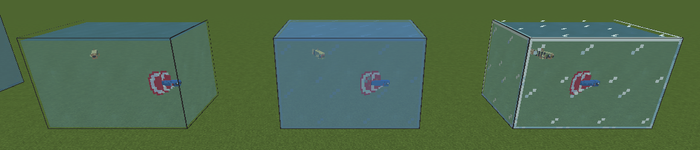

---
navigation:
  title: Aquarium
  icon: bettacraft:tank
  position: 20
item_ids:
  - bettacraft:tank
---

# Aquarium

The <ItemLink id="bettacraft:tank" /> is the heart of Bettacraft: a glass block that joins with its neighbours into one
aquarium of real water.

All six glass blocks of the recipe must be the same; the aquarium uses that glass. **Any glass works**, including
stained glass, tinted glass and the glass of other mods (`#c:glass_blocks`).

## Two styles

* **Textured**: the aquarium shows the texture of its glass like a window, and the textures are **connected**: the
  frame of the glass texture runs only along the outer edges of the whole aquarium, not between its blocks. This works
  with the glass of other mods, too. The top stays open (no glass over the water); a [lid](equipment/tank_lid.md) is a block
  of its own.
* **Clear glass**: perfectly clear glass without any texture, only the thin dark edge lines. Craft it from 6 vanilla
  glass with an **iron nugget** in the middle instead of the iron ingot (4 aquariums).
* A single vanilla-glass aquarium converts between both styles in the crafting grid (it turns into the other style).
* The two styles never join: a clear aquarium next to a textured one stays a separate aquarium.
* Aquariums from older versions are textured. The style and the glass are shown in Jade, The One Probe, WTHIT (sneaking) and on
  the water tab of the tank menu.

<GameScene zoom="3" interactive={true}>
  <Block id="bettacraft:tank" x="0" p:east="true" p:fill="12" />
  <Block id="bettacraft:tank" x="1" p:west="true" p:east="true" p:fill="12" />
  <Block id="bettacraft:tank" x="2" p:west="true" p:fill="12" />
</GameScene>

## Building

* Place tank blocks next to each other: blocks of the **same glass** join into one aquarium.
* An aquarium can have **any shape** (L, T, steps ...) whose blocks touch face to face, from 1 block up to a bounding
  box of 16x16x16 blocks (servers can allow up to 64). See [Shapes](aquarium/shapes.md).
* Two aquariums only join if they are made of the same glass in the same style and have the same
  [interior scale](interior.md).
* Thin dark edge lines are drawn only on the outer edges of the whole aquarium, never between its blocks (their width
  and the connected textures can be changed in the client settings).
* A new aquarium faces the player who placed it; the front (for the name sign) can be changed in the menu.
* Pistons cannot push tank blocks; they are as blast resistant as glass.

## Breaking

You can break tank blocks like glass, **except while animals live in the aquarium**, the bubble nest still holds eggs
or larvae, or a player is in its [interior](interior.md): the message tells you what is still inside. Take the animals out first, they would die on land.

The water in a broken block simply disappears (nothing floods), the rest of the aquarium keeps its share. The interior
blocks behind the broken block drop as items (more than 27 stacks come packed into chests). Breaking a block in the
middle can split the aquarium into several smaller ones; each keeps the water and the interior of its own blocks.

## In this chapter

<SubPages icons={true} />

## Obtaining

Crafting:

<RecipesFor id="bettacraft:tank" />
