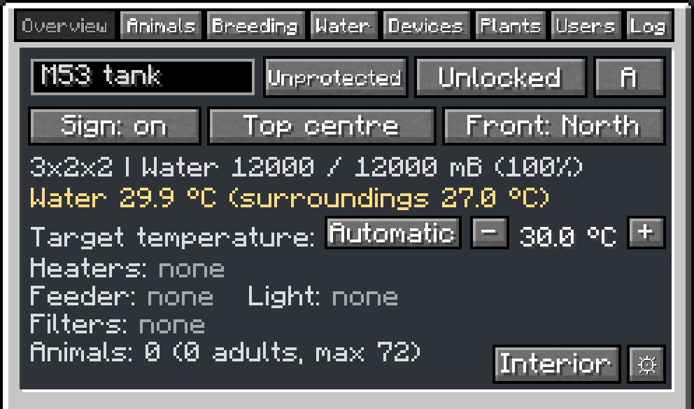
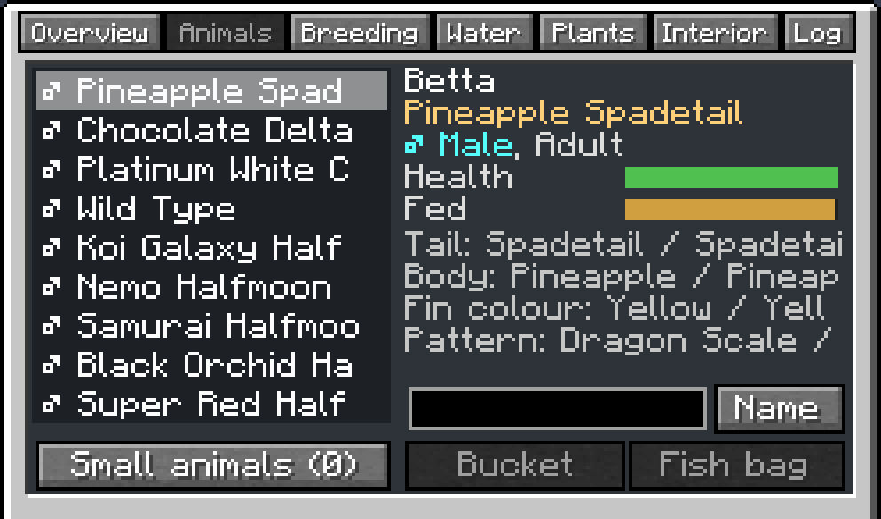
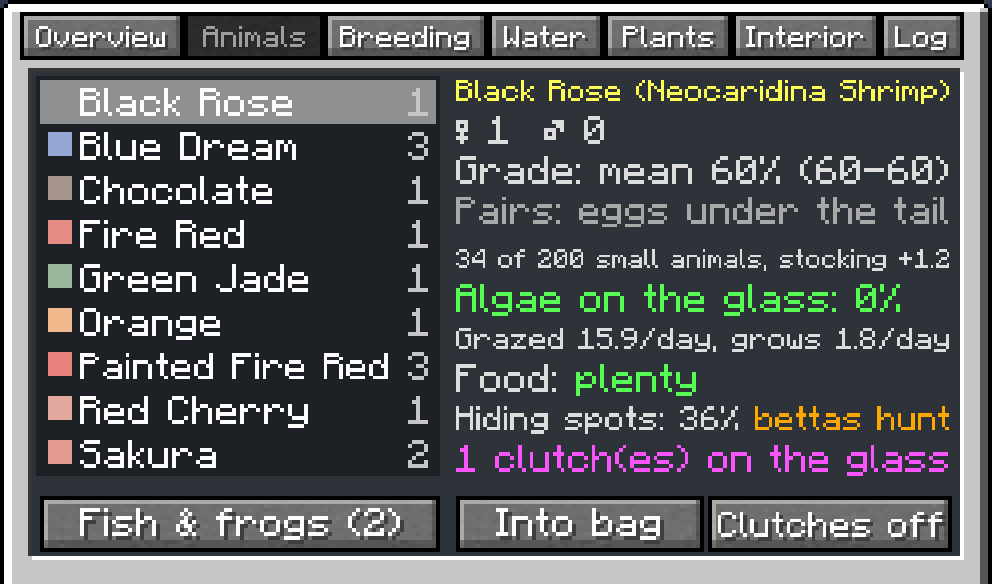
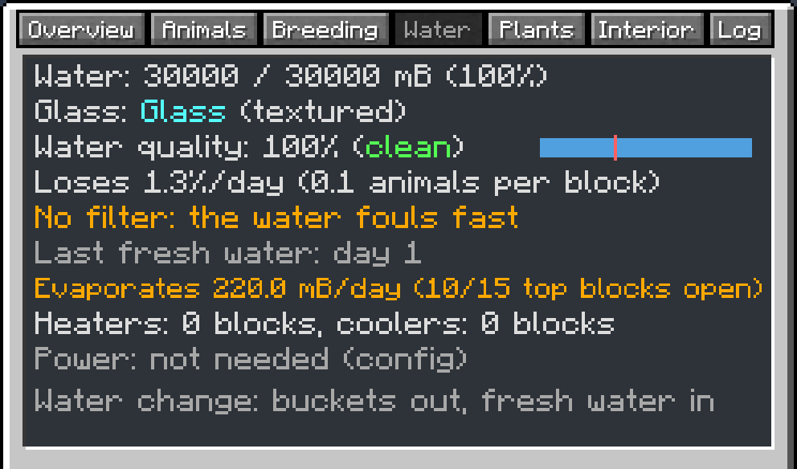
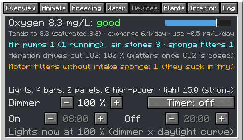
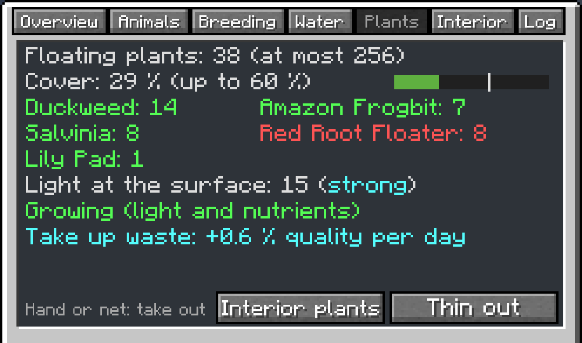
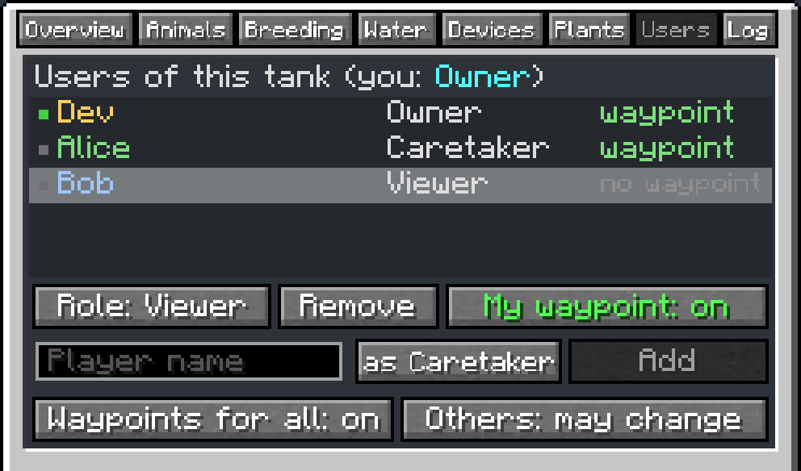

---
navigation:
  title: Tank menu
  icon: minecraft:name_tag
  parent: aquarium.md
  position: 70
---

# Tank menu, name sign and lock

**Right-click** an aquarium with an empty hand to open its menu. (**Sneak + right-click** enters the
[interior](../interior.md) instead.)

## Overview

* **Name** (up to 32 characters) and the **name sign**: on or off, its position (top or bottom, left, centre or
  right) and the **front** of the aquarium it is drawn on. The sign is black with white text, 0.12 blocks high (each player
  can make it bigger or smaller with the client config `render.signScale`, 0.5 to 2); long names get a smaller font. The name also shows in the menu and in Jade when the sign is off.
* **Lock**: the player who placed the aquarium is its owner. When it is locked, only the owner, its
  caretakers (users tab, below) and operators can change it (water, animals, settings, interior); everyone else can still look.
* **Break protection** (the button between the name and the lock; owner and operators only, off for a new aquarium):
  while it is on **nobody can break the aquarium**, not even the owner and not in creative mode: the glass, the lid, the
  light and the feeders on it, the clip-on feeder on its glass and the cabinet under it. Trying it shows "Break
  protection is on". Explosions and pistons leave it alone too (server config `tank.protectFromExplosionsAndPistons`,
  on by default). Config switch of the whole feature: `features.equipment.breakProtection`.
* **A** (right of the lock; owner and operators only): which [hired aquarists](../getting_started/hired_aquarist.md) may
  work at this aquarium: **A** the owner's (and his team's, with FTB Teams), **A+** every player's (released for friends
  who share their aquarist), **A-** none. A locked aquarium is never touched by an aquarist. Hidden while
  `features.aquaristNpc.enabled` is off.
* Size, water volume, water and surrounding temperature, the **target temperature** (– / +).
* Heaters (or coolers, when the target is below the surroundings), feeder, light and filters, the number of animals
  and the button to enter the interior (its tooltip shows the interior: scale and size, blocks in the miniature,
  substrate, heaters and filters inside). The last line warns about poor water or missing power.
* The **gear** right of the interior button opens Bettacraft's **client settings** (the same as in the config file
  `bettacraft-client.toml` and in the mod list): among them **Alarm waypoints of all tanks** (`map.showAlarmWaypoints`) and
  which map mods show them (`map.journeyMap`, `map.xaerosMinimap`, `map.ftbChunks`).

## Animals

The list of all animals with name, type, sex and stage. The details of the selected fish: health and fed bars, stage
progress, the genotype (tail, body, fins, pattern; all nine loci in the tooltip) once it is analysed with the
[magnifier](../equipment/magnifier.md) (button **Analyse**), the generation, a name field and the buttons to take it out
with a bucket or a fish bag. A dwarf clawed frog shows its health, its food and its air.

The button **Small animals** switches to the [shrimp, crayfish and snails](../invertebrates.md): every kind (species
and colour) with its count, sexes, young, females with eggs and grade; for the whole aquarium the stocking, the algae
on the glass, how much the cleaning crew grazes, the food and the hiding spots. Click a kind to fold open the list of
its animals: every single one with its sex, age, grade and genes (once analysed); select one to see it in detail,
**Analyse** it or **Take out** exactly that one. With a kind selected, **Take out** takes the animal with the best grade
(Shift: the worst, Ctrl: a full bag or bucket) of the chosen sex (button under the list: any, males, females), into a
fish bag or a bucket (the second button). **Clutches off** takes the apple snail clutches off the glass.

## Breeding

Warnings, the bubble nest, the breeding conditions with ✔ and ✘, the young fish, the parents and the expected offspring.
See [Breeding](../bettas/breeding.md).

## Water

Water volume, the [water quality](water_quality.md) with a bar (the red mark is where the bettas start to suffer), how
fast it drops and why (animals per water block, how much the filters remove), the last fresh water, evaporation and
open top blocks, heaters and coolers, and the stored [power](../equipment/power.md) when the server needs it.

## Devices

The [oxygen](oxygen.md) with a bar (the white mark is saturation), what it tends to and why (exchange and use), the
[air pumps](../equipment/air_pump.md), [air stones](../equipment/air_stone.md) and
[sponge filters](../equipment/sponge_filter.md), how much CO2 the aeration drives out, how many motor filters have no
[intake sponge](../equipment/intake_sponge.md), the lights of the aquarium with the light strength, and the
**dimmer** and the **daylight timer** with their buttons (see [Light](../equipment/light.md)).

## Plants

The [floating plants](../plants/floating_plants.md) of the aquarium: number per species, cover, light, growth, waste uptake, the
warning for a dense cover and the **Thin out** button.

## Users

The users tab (it replaced the interior tab in 1.43.0) lists who may do what at this aquarium:

| Role | May |
|---|---|
| **Owner** | the player who built it: everything, also the users, the lock and the break protection |
| **Caretaker** | everything the owner may: care, settings, animals, going in, the users and the lock |
| **Viewer** | open the menu and look; changes nothing and cannot go into the aquarium |
| **Not listed** | everyone else: may change it while it is open, only look while it is locked |

The owner and the caretakers type the name of an online player, choose **as Caretaker** or **as Viewer** and press
**Add**; a selected user gets another role or is removed (every user may take himself off the list). Players in the
owner's FTB Teams party count as caretakers. The button **Others** is the lock. Operators may always do everything.
Config switch: `features.equipment.tankUsers` (off: the list is ignored, only the owner and the lock count).

**Alarm waypoints:** when a [monitor alarm](../equipment/monitor.md) goes off (or the
[hired aquarist](../getting_started/hired_aquarist.md) warns), the owner and the listed users get a red waypoint at the
aquarium in their map mod (JourneyMap, Xaero's Minimap and World Map, FTB Chunks), never players who are merely near.
**My waypoint** switches your own one for this aquarium (on by default for the owner, off for every other user);
**Waypoints for all** (owner and caretakers) switches them off for everybody. The gear in the overview switches them
for all aquariums and per map mod.

## Log

What happened in the aquarium: feeding, eggs, fights, sickness, deaths and their causes, with the in-game day. It keeps
100 entries and can be filtered (all, breeding, health, feeding).
