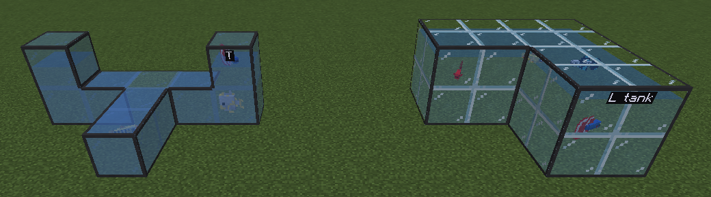
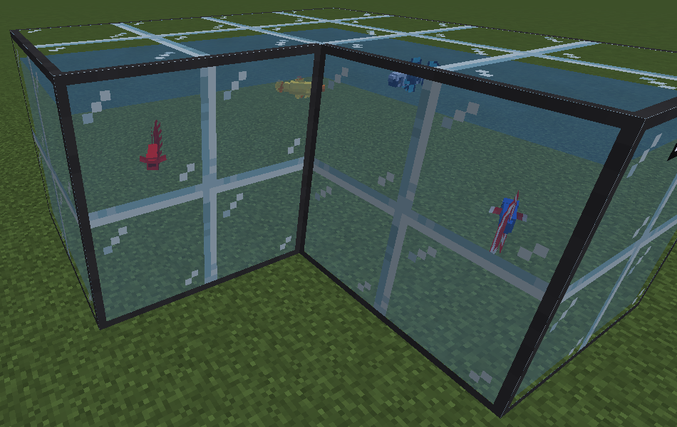
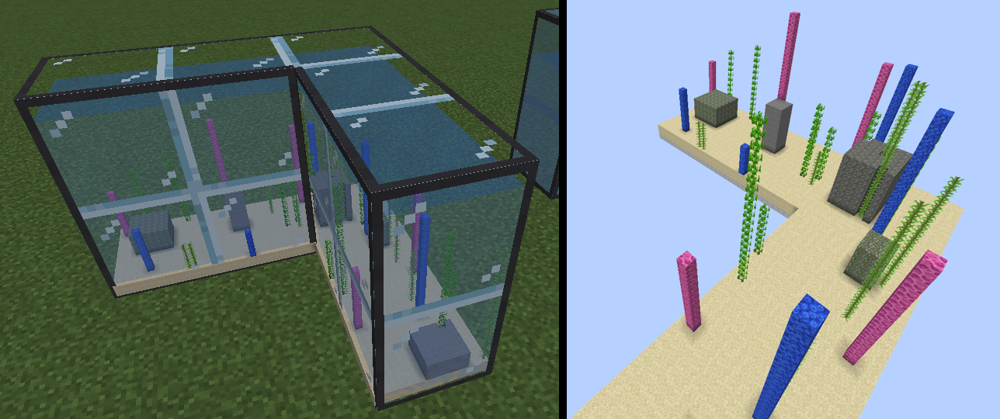

---
navigation:
  title: Shapes
  icon: bettacraft:tank
  parent: aquarium.md
  position: 10
---

# Aquarium shapes

An aquarium does not have to be a box. **Any shape works** as long as its blocks touch each other face to face: an L
around a corner, a T, a U, steps, a tower on a wide tank.

<GameScene zoom="3" interactive={true}>
  <Block id="bettacraft:tank" x="0" z="0" p:east="true" p:south="true" p:fill="12" />
  <Block id="bettacraft:tank" x="1" z="0" p:west="true" p:fill="12" />
  <Block id="bettacraft:tank" x="0" z="1" p:north="true" p:fill="12" />
</GameScene>

## Building

* A new block joins **every** neighbouring aquarium of the same glass and scale; a block between two aquariums
  connects them into one.
* The **bounding box** of the shape must fit the maximum size (16x16x16 blocks by default, servers can allow up to
  64). A block that would make the aquarium larger stays a separate aquarium ("Connecting would exceed the maximum
  tank size").
* Blocks that only touch at an edge or a corner do not connect.
* The dark edge lines run along every outer edge, also along the **inner corner** of an L.
* Servers can switch free shapes off (`tank.freeShapes = false`): then aquariums are cuboids, as before.

## Water

The water fills the aquarium **layer by layer** from the bottom: every block of a layer has the same water height.
In a step-shaped aquarium the lower part is full before the water rises in the higher part. The volume is 1000 mB per
block, whatever the shape.

* Breaking a block takes away only the water of that block. If the rest falls apart into several pieces, each piece
  keeps the water of its own blocks.
* Water evaporates through every open top that the water reaches: also through the top of a lower step. A
  [lid](water_quality.md), the feeder, a light or any full block on top covers it.

## Animals and equipment

* Fish swim only in the water of the actual shape. They never try to reach the empty corner of an L, food lands in
  the water you clicked, and the bubble nest is built at the surface.
* The **feeder**, **lights** and **lids** can stand on any open top, also on a lower step.
* An **external filter** can hang on any outer wall, also on the wall of the inner corner. Its hose goes over the rim
  of the column it hangs on. **Cabinets** work under every block that has no tank block below it.
* The **name sign** sits on the widest flat part of the front, in the top or bottom row of blocks.

## Interior

The [interior](../interior.md) covers the bounding box of the aquarium. The parts outside the shape are closed off by
invisible walls and have no floor, so you build only where the aquarium really is, and the miniature shows exactly
that.

* The floor (and with it the [substrate](../interior/substrate.md)) lies under the lowest layer of the aquarium. A
  raised part of the shape stands on an invisible wall there.
* Breaking a block drops the interior part behind it. If the aquarium splits, every piece keeps the interior of its own
  blocks.
