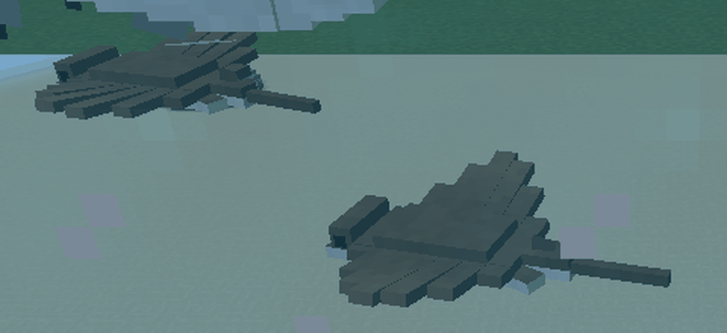

---
navigation:
  title: Cownose ray
  icon: bettacraft:cownose_ray_spawn_egg
  parent: big_tanks.md
  position: 90
item_ids:
  - bettacraft:cownose_ray_spawn_egg
---

# Cownose ray

A brown ray with a square head notched in front like a cow's nose, pointed wings and a white underside, the ray of the
touch pools. It migrates along the coasts in big schools. The disc grows to about 0.9 m across, 1 m in the game.

**Origin:** the western Atlantic, from New England to Brazil, and the Gulf of Mexico.

## Profile

| | |
|---|---|
| Group | Rays |
| Scientific name | *Rhinoptera bonasus* |
| Size | about 1 m (2 blocks in the game) |
| Tank | at least 12 × 6 blocks, 3 high, 100 water blocks each |
| Temperature | 18–28 °C |
| Breeding temperature | 23–27 °C |
| Water | sea water, normal |
| Water chemistry | pH 7.8–8.6 |
| Shoal | from 3 fish |
| Swims | in the middle |
| Stocking | counts as 25 fish |
| Breeding | Bears live young, 1 young |
| Special | eats snails, eats shrimp and only the tiniest fish, flies through open water with slow wing beats |

## Keeping

* A big animal for the **sea water** tank: at least 12 × 6 blocks and 3 blocks of height, 100 water blocks **each**
  ([size rule](../big_tanks.md)). It is a **schooling** animal: keep three or more, so the tank needs room for three.
* The school flies through the open water with slow wing beats, the others following the leader a little behind and
  beside it.
* It cracks clams and snails and eats shrimp; only the tiniest fish are in danger. 18–28 °C: it also lives in lukewarm water.
* Wild cownose rays spawn rarely, in small schools of two or three.

## Breeding

Cownose rays are **livebearing**: a female carries **one** big pup for a long time (about four times as long as the small
livebearers) and gives birth to it fully formed. Like the [motoro stingray](motoro_stingray.md) she only gets pregnant
while the tank has room for one more adult by the [size rule](../big_tanks.md).

## Obtaining

* **[Large net](large_net.md)** in warm oceans (coral reefs): 0.57 % per swing (about 1 in 175 swings), into an empty transport tub (config `features.bigTanks.bigAnimals`).
* **[Steel leader](steel_leader.md)** (fishing) in warm oceans (coral reefs): 0.71 % per catch (about 1 in 140 catches), into an empty transport tub (config `features.bigTanks.bigAnimals`).
* **[Large net](large_net.md)** in lukewarm oceans: 2.7 % per swing (about 1 in 38 swings), into an empty transport tub (config `features.bigTanks.bigAnimals`).
* **[Steel leader](steel_leader.md)** (fishing) in lukewarm oceans: 3.3 % per catch (about 1 in 30 catches), into an empty transport tub (config `features.bigTanks.bigAnimals`).
* **Wild** in warm oceans (coral reefs), in groups of 2–3 (spawn weight 1) (config `features.bigTanks.bigAnimals`).
* **Wild** in lukewarm oceans, in groups of 2–3 (spawn weight 2) (config `features.bigTanks.bigAnimals`).
* **[Breeding](../big_tanks.md)**: Bears live young.

The biomes of biome mods count too ([biome tags](../settings.md)).
