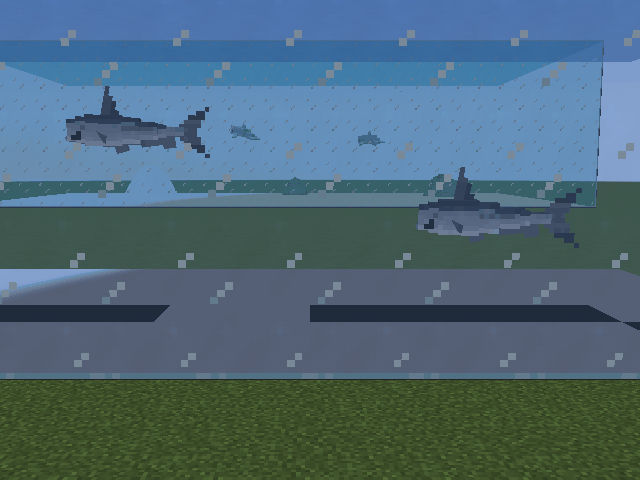

---
navigation:
  title: Pangasius
  icon: bettacraft:pangasius_spawn_egg
  parent: big_tanks.md
  position: 10
item_ids:
  - bettacraft:pangasius_spawn_egg
---

# Pangasius

The iridescent shark catfish: a restless, silvery giant with a dark back, a high, sickle-shaped dorsal fin and a deeply
forked tail. In a home tank it grows to about one metre.

**Origin:** the Mekong and the big rivers of South-East Asia.

## Profile

| | |
|---|---|
| Group | Catfish |
| Scientific name | *Pangasianodon hypophthalmus* |
| Size | about 1 m (2 blocks in the game) |
| Tank | at least 12 × 6 blocks, 3 high, 100 water blocks each |
| Temperature | 22–30 °C |
| Water | fresh water, hardy |
| Water chemistry | pH 6.0–8.4, TDS 0–700 ppm |
| Shoal | alone or as a pair |
| Swims | in the middle |
| Stocking | counts as 25 fish |
| Breeding | Does not breed in a tank |
| Betta tank | no (eats them) |
| Special | eats small fish, bettas and shrimp, swims wide curves |

## Keeping

* A big animal: it needs a tank of at least 12 × 6 blocks and 3 blocks of height, and 100 water blocks of its own
  ([size rule](../big_tanks.md)).
* It cruises the whole tank in wide curves and turns slowly; keep the middle of the tank free of tall decoration.
* It eats every food and, once grown, small fish, young bettas and shrimp. It does not breed in a tank.

## Obtaining

* **[Large net](large_net.md)** in rivers: 3 % per swing (about 1 in 33 swings), into an empty transport tub (config `features.bigTanks.bigAnimals`).
* **[Steel leader](steel_leader.md)** (fishing) in rivers: 3.8 % per catch (about 1 in 27 catches), into an empty transport tub (config `features.bigTanks.bigAnimals`).
* **[Large net](large_net.md)** in jungle water: 1.1 % per swing (about 1 in 88 swings), into an empty transport tub (config `features.bigTanks.bigAnimals`).
* **[Steel leader](steel_leader.md)** (fishing) in jungle water: 1.4 % per catch (about 1 in 70 catches), into an empty transport tub (config `features.bigTanks.bigAnimals`).
* **Wild** in rivers, alone (spawn weight 3) (config `features.bigTanks.bigAnimals`).
* **Wild** in jungle water, alone (spawn weight 2) (config `features.bigTanks.bigAnimals`).

The biomes of biome mods count too ([biome tags](../settings.md)).
