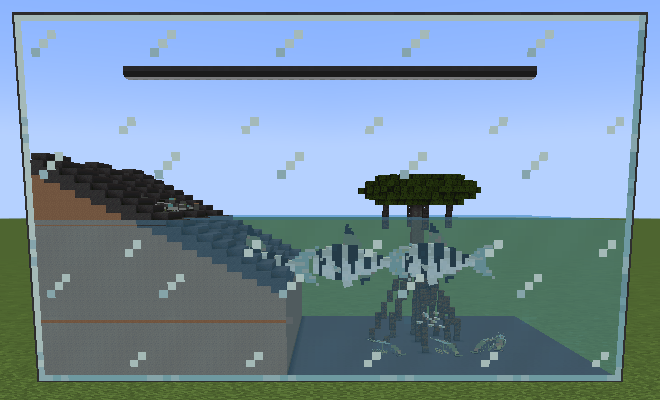

---
navigation:
  title: Brackish water
  icon: bettacraft:archerfish_bucket
  position: 76
feature: brackish.enabled
---

# Brackish water and mangroves

Where rivers meet the sea, in the **mangroves**, the water is **brackish**: a little salty, between fresh and sea water.
A tank becomes brackish with a little [sea salt](saltwater.md) (or sea water mixed into fresh water): **2 to 20 ‰**.

## In short

* **Salinity:** sea salt or sea water into a freshwater tank until the water tab shows *brackish* (2–20 ‰). Evaporation
  leaves the salt behind: top up with fresh water.
* **The animals of this chapter:** the [archerfish](brackish/archerfish.md) shoots insects above the water, the
  [mudskipper](brackish/mudskipper.md) lives on the mud of a paludarium, the [Amano shrimp](brackish/amano_shrimp.md)
  needs brackish water for its larvae.
* **The plants:** a [mangrove](brackish/mangroves.md) grows from a propagule in the tank, its crown over the water; the
  mangrove stilt roots are the decoration for it.
* **More brackish water animals elsewhere:** the [green spotted puffer](tankmates/green_spotted_puffer.md) (brackish
  only), the [black molly](tankmates/black_molly.md) and the [swordtail](tankmates/swordtail.md) (fresh to brackish), the
  nerite snails (fresh to brackish, see [snails](invertebrates/snails.md)).
* A paludarium for the mudskipper: land in the [interior](interior.md) above the water ([terrarium chapter](terrarium.md)).

All of it can be switched off: `features.brackish.enabled` and its sub-switches (see [Settings](settings.md)).

## In this chapter

<SubPages icons={true} />
