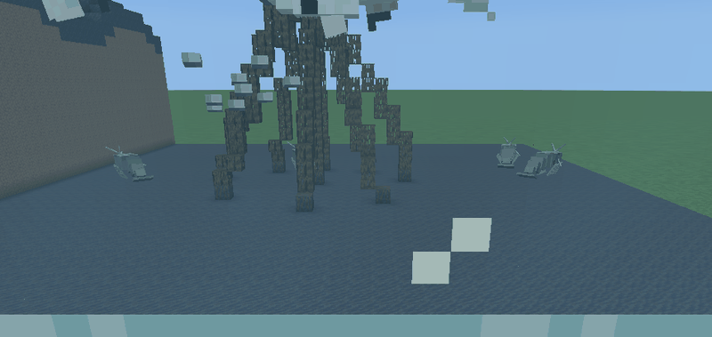

---
navigation:
  title: Amano shrimp
  icon: bettacraft:fish_bag
  parent: brackish.md
  position: 30
---

# Amano shrimp

The Amano shrimp (*Caridina multidentata*, about 5 cm) from the coastal rivers of Japan and Taiwan: grey and translucent
with a dotted line along the side, the **strongest algae eater** of the small shrimp.

## Profile

| | |
|---|---|
| Group | Shrimp |
| Size in the game | about 5 cm (0.42 blocks) |
| Temperature | 18–28 °C |
| Water | fresh or brackish water, sensitive |
| Water chemistry | pH 6.5–8.2, TDS 50–600 ppm |
| Breeding | male and female; the female carries the eggs, the young hatch fully formed, 8–18 young |
| Growing up | about 6 days |
| Algae | grazes 0.5 glass faces a day |
| Climbs the glass | yes |
| Stocking | 25 count as one fish |

## Breeding with brackish larvae

In nature the Amanos mate in the rivers, and their larvae drift down to the sea. In the game:

1. The shrimp mate in **fresh water** (not in brackish water); the female carries her eggs for 3 days.
2. Then she lets out a **cloud of larvae** (8–18; tiny pale specks in the water). In fresh water they die after a day
   (`brackish.amanoFreshLarvaDays`).
3. Aim the [aquarium net](../equipment/tank_net.md) at the cloud with an **empty fish bag** in your inventory: the larvae go
   into the bag. Right-click a **brackish tank** (2 ‰ or more, sea water works too) with the bag to let them out.
4. After **3 days** (`brackish.amanoLarvaDays`) a part of them settle as young shrimp: 35 % on their own
   (`brackish.amanoLarvaSurvival`), twice as many with [phytoplankton](../food/plankton.md) in the water (at most 80 %).
5. Take the young back into fresh water: there they grow up and breed again.

## Obtaining

* **[Aquarium net](../equipment/tank_net.md)** in mangrove swamps: 2.8–4.7 % per swing (about 1 in 21–35 swings), 1–3 at a time (config `features.brackish.amanoShrimp`).
* **Wild** in mangrove swamps, in groups of 2–5 (spawn weight 1) (config `features.brackish.amanoShrimp`).
* **Wandering trader** (usual offers): 3 for 5 emeralds.
* **Breeding** in the aquarium (male and female).

The biomes of biome mods count too ([biome tags](../settings.md)).
