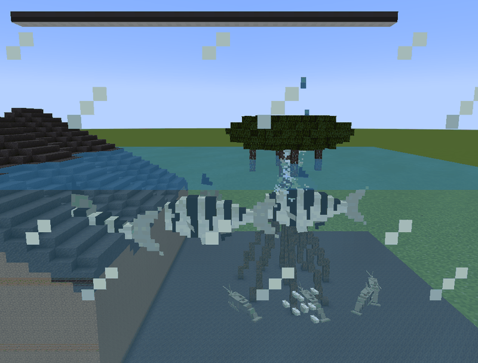
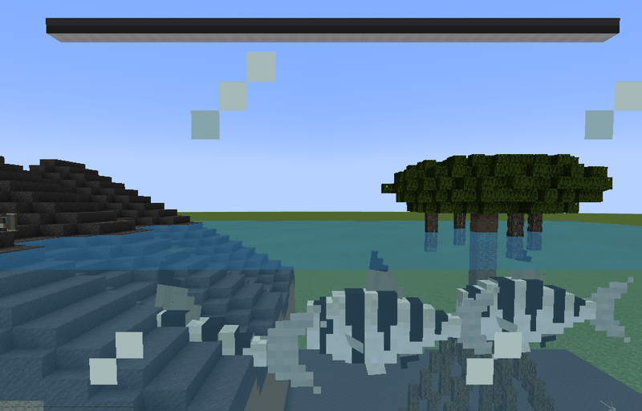

---
navigation:
  title: Archerfish
  icon: bettacraft:archerfish_bucket
  parent: brackish.md
  position: 10
item_ids:
  - bettacraft:archerfish_bucket
  - bettacraft:archerfish_spawn_egg
---

# Archerfish

The banded archerfish (*Toxotes jaculatrix*) of the mangroves from India to northern Australia: silver-white with four or
five black wedge bars, big eyes and a pointed head. It swims just under the surface and **shoots insects off the leaves
above the water with a jet of water** from its mouth.

## Profile

| | |
|---|---|
| Group | Archerfish |
| Scientific name | *Toxotes jaculatrix* |
| Size in the game | about 12 cm (1 blocks) |
| Temperature | 24–30 °C |
| Water | fresh or brackish water, normal |
| Water chemistry | pH 7.2–8.6 |
| Shoal | from 3 fish |
| Swims | near the surface |
| Stocking | counts as 2 fish |
| Breeding | Does not breed in a tank |
| Betta tank | no (big, nips fins) |
| Special | eats small fish and shrimp |

## Shooting

* It needs an **open top**: no lid, light, feeder or full block over the water where it shoots (a light over the back of the
  tank leaves the front open).
* **Fruit flies:** right-click the tank with [fruit flies](../terrarium/feeder_insects.md): they are let out above the
  water (6 per item, at most 24) and the archerfish shoots them down one by one, a meal each.
* **Insects at the plants:** by day insects come to plants above an open tank: leaves, flowers or saplings on top of the
  tank, the crown of a [mangrove](mangroves.md) over the water, the land of a paludarium (`brackish.archerfishInsectsPerDay`).
* Now and then it **splashes a player** whose head is over its open tank: harmless, it only puts out a fire
  (`brackish.archerfishSplashChance`).
* It also takes pellets and live food like the other fish.

## Obtaining

* **[Aquarium net](../equipment/tank_net.md)** in mangrove swamps: 3.8–4.5 % per swing (about 1 in 22–27 swings), 1–4 at a time.
* **Wild** in mangrove swamps, in groups of 3–3 (spawn weight 3) (config `features.brackish.archerfish`).
* **Wandering trader** (rare offers): 6 for 15 emeralds; one of 14 in this offer.

The biomes of biome mods count too ([biome tags](../settings.md)).
