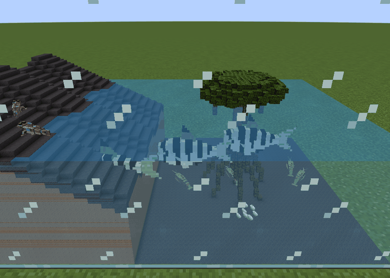

---
navigation:
  title: Mangroves
  icon: minecraft:mangrove_propagule
  parent: brackish.md
  position: 40
item_ids:
  - bettacraft:decor_mangrove_stilt_roots
---

# Mangroves

A **mangrove propagule** of Minecraft grows into a small mangrove in a tank, at the scale of the
[interior](../interior.md): a trunk on arching **stilt roots** stands in the water, its **crown** of leaves grows over the
surface as far as the tank leaves room.

* **Planting:** right-click the tank with a mangrove propagule (it takes root on the floor under the spot you look at), or
  place the propagule on the floor inside the interior. One mangrove per four floor blocks of the tank, not too close to
  another.
* **Growth:** six stages, one every 1.5 days in light (`brackish.mangroveStageDays`), a third faster in **brackish
  water**, slowly in the dark. It needs water in the tank. The blocks of the tree are the mangrove roots, logs and leaves of
  Minecraft; they only fill water and air, nothing in the way is replaced.
* **Over the water:** the crown is land for the tank (a paludarium) and the place where insects gather for the
  [archerfish](archerfish.md); [mudskippers](mudskipper.md) climb on the roots. The leaves count as plants for the nitrate
  ([plants of Minecraft](../plants/foreign_plants.md)), the wood lowers the pH a little like driftwood.
* Breaking the foot of the tree in the interior ends its growth.

## Stilt root decoration

The **mangrove stilt roots** are a tall decoration (14 × 18 × 10 pixels of the tank): a trunk high up on long arching
roots that stands out of the water of a paludarium. Place it in the interior like any [decoration](../interior.md).

## Obtaining

Crafting:

<RecipesFor id="bettacraft:decor_mangrove_stilt_roots" />
