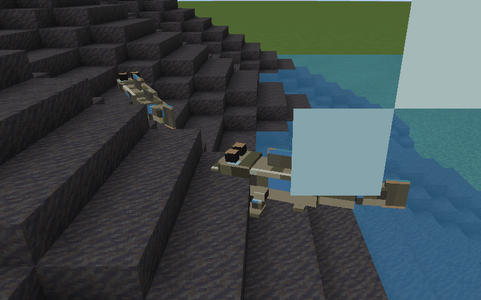

---
navigation:
  title: Mudskipper
  icon: bettacraft:mudskipper_box
  parent: brackish.md
  position: 20
item_ids:
  - bettacraft:mudskipper_box
  - bettacraft:mudskipper_spawn_egg
---

# Mudskipper

The Atlantic mudskipper (*Periophthalmus barbarus*, about 12 cm) of the West African mangroves is a goby that lives on
land: it breathes through its wet skin, **skips over the mud** on its strong pectoral fins and **climbs roots** and even the
glass. Its eyes sit high on the head like a frog's.

## Care

| | |
|---|---|
| Tank | a [paludarium](../terrarium.md) with **30 to 80 % land** and **brackish water** (2–20 ‰; fresh water stresses it) |
| Air | **24 to 32 °C**, humidity 70 % or more ([mister](../terrarium/mister.md)) |
| Water | 24 to 30 °C |
| Food | [crickets and fruit flies](../terrarium/feeder_insects.md) |
| Stocking | 1 betta |

* It walks the land, goes into the water to wet its skin, and **climbs**: up the glass, the stilt roots of a
  [mangrove](mangroves.md) and the mangrove stilt root decoration.
* It digs its burrows in the mud to breed, which never works in a tank: it does not breed.
* It travels in a terrarium box; the box catches it in mangrove swamps.

## Obtaining

* <ItemLink id="bettacraft:mudskipper_box" />: **Wild** in mangrove swamps, alone (spawn weight 6) (config `features.brackish.mudskipper`).
* <ItemLink id="bettacraft:mudskipper_box" />: **Wandering trader** (rare offers): 1 for 6 emeralds (config `features.brackish.mudskipper`).
