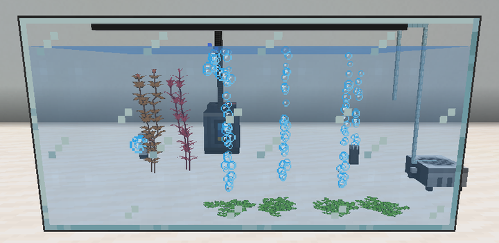

---
navigation:
  title: Air pump
  icon: bettacraft:air_pump
  parent: equipment.md
  position: 32
item_ids:
  - bettacraft:air_pump
  - bettacraft:air_hose
---

# Air pump

<GameScene zoom="4" interactive={true}>
  <Block id="bettacraft:air_pump" p:facing="north" />
</GameScene>

The <ItemLink id="bettacraft:air_pump" /> is a small membrane pump. Place it **next to an aquarium** (at any side) or
**on its top**: its air hose runs over the glass rim into the water. It drives the [air stones](air_stone.md) and the
[sponge filters](sponge_filter.md) in the [interior](../interior.md) of that aquarium. It can also sit **in the
[aquarium cabinet](cabinet.md)** under the aquarium (its own slot in the cabinet menu): its hose then goes up together
with the filter hose at the cabinet's outlet side.

The hose runs down the inside of the glass to the floor and ends there (it does not lie across the floor to the air stones
and sponge filters).

* One pump drives **4 air stones or sponge filters** at full strength. With more, they share the air and bubble less
  (a second pump helps).
* It runs while something in the aquarium needs air and stands still otherwise. Its quiet hum is off by default
  (client config `sound.airPumpSound`).
* **Power regulator:** right-click it (or sneak + mouse wheel while looking at it) to set 0 to 100 %. Less power gives
  less air, needs less energy and is quieter (see [Power regulator](regulator.md)).
* **Energy:** without power mods it simply runs. A server can make it need FE
  (`aeration.airPumpRequiresEnergy`): 2 FE/t per air stone, delivered like for the other equipment (see
  [Power](power.md)).

The <ItemLink id="bettacraft:air_hose" /> is only a crafting part (dried kelp or slime balls).

Air stones and sponge filters bring **oxygen** into the water, see [Oxygen](../aquarium/oxygen.md).

## Obtaining

Crafting:

<RecipesFor id="bettacraft:air_pump" />
<RecipesFor id="bettacraft:air_hose" />
