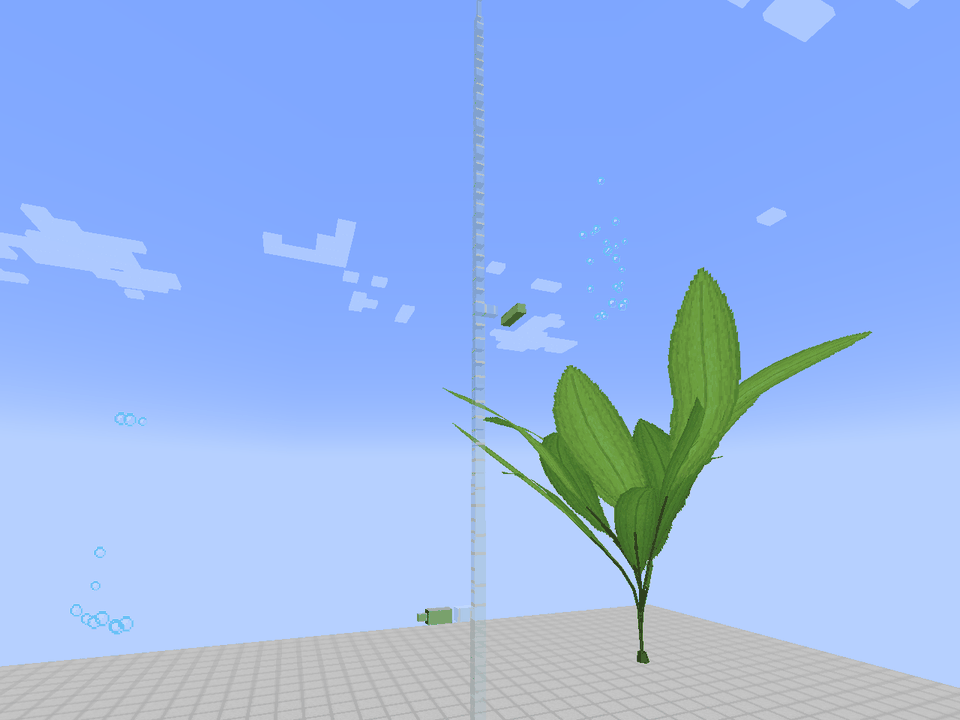
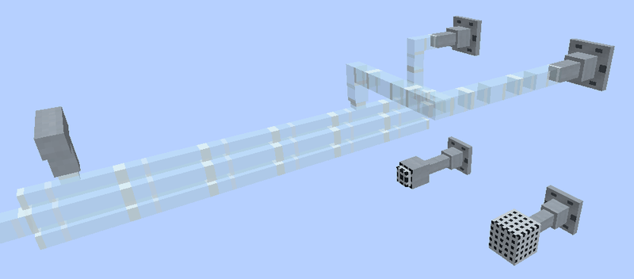

---
navigation:
  title: Pipe docks and interior pipes
  icon: bettacraft:bulkhead
  parent: equipment/water_system.md
  position: 4
item_ids:
  - bettacraft:bulkhead
  - bettacraft:intake_strainer
  - bettacraft:lily_pipe
  - bettacraft:nozzle
  - bettacraft:spray_bar
---

# Pipe docks and interior pipes

Inside an aquarium (its [interior](../interior.md), 16 blocks for every tank block) water comes in and goes out where you
want it: through **pipe docks**, **interior pipes** and **outlets**.

## Pipe docks

* **Filter lines and the controller's waste water line:** where such a line docks on the glass outside (any side, the top or
  the bottom), a **pipe dock** appears inside, on that very face, with the colour ring of its line. A single pipe docks in
  the middle of the face; a [pipe bundle](pipe_bundle.md) gets one dock per line, behind each line's flange.
* **Bulkhead:** use a <ItemLink id="bettacraft:bulkhead" /> on a **floor block** of the aquarium (from outside). Its
  connection appears on the interior floor in the middle of that block, and a pipe **under** that floor block puts water in
  through the outlets and takes it out through the strainers. Without outlets the bulkhead stays closed.
* A plain water line at the glass rim takes and gives water without a dock.

## Interior pipes

Place a <ItemLink id="bettacraft:glass_pipe" /> or a stainless steel pipe **inside** the aquarium and it is an **interior
pipe** there: one interior block thin (one pixel in the miniature outside), glass or steel to look at, the same work. Lay
them from a dock to where the water should go in or out. A pipe that leads **into the aquarium and out again** is not
allowed (it would only be a pipe through the aquarium): it cannot be placed, and if one is built anyway both docks stay
closed.

**Interior bundles:** sneak + right-click an interior pipe with another pipe and it becomes an **interior bundle** of two
lanes; more pipes go in the same way, up to four. One bundle takes one kind (all glass or all steel); sneak + right-click
with an empty hand takes the last lane out again. The lanes never mix:

* the **middle lane** runs along the bundle and goes on into a single pipe, dock, guard or outlet at both ends;
* the **side lanes** each leave the run on their **own side** only;
* along the run every lane joins the same lane of the next bundle **in the same direction**; bundles of another direction
  do not join, so a run has no corners: split the lines, lead them round the corner one by one and bundle them again.

## Outlets

End the interior pipes (or put them right at a dock) in **outlets**; they point the way you look when you place them:

* <ItemLink id="bettacraft:lily_pipe" />: a glass outlet that spreads the water softly under the surface;
* <ItemLink id="bettacraft:nozzle" />: a narrow, strong jet;
* <ItemLink id="bettacraft:spray_bar" />: a wide, soft current along a wall;
* <ItemLink id="bettacraft:intake_strainer" />: the intake, where water leaves the aquarium.

While water flows, the outlets **show their stream** and their **current acts where they sit**: seahorses, corals and
floating plants feel it, and fish swim into it now and then. Every dock of a filter line or a waste water line needs a
[guard](guards.md) at its end; the strainer counts as an intake guard, the lily pipe, nozzle and spray bar as outlet guards.

## Obtaining

Crafting:

<RecipesFor id="bettacraft:bulkhead" />
<RecipesFor id="bettacraft:intake_strainer" />
<RecipesFor id="bettacraft:lily_pipe" />
<RecipesFor id="bettacraft:nozzle" />
<RecipesFor id="bettacraft:spray_bar" />
