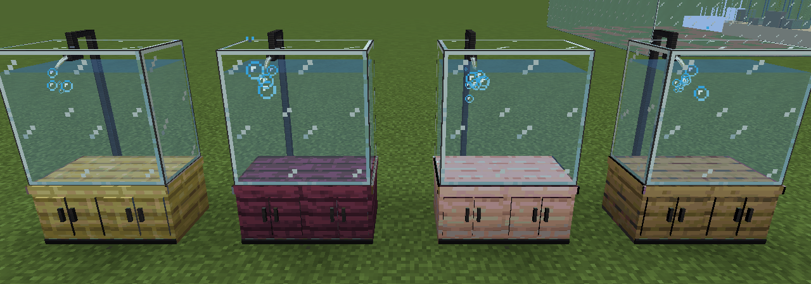
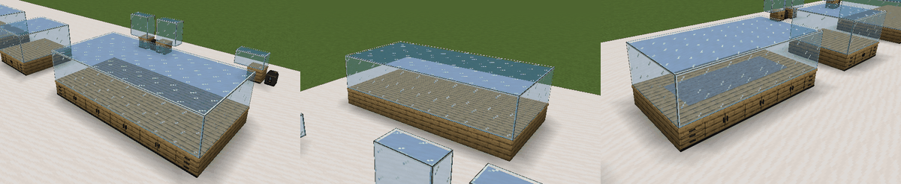
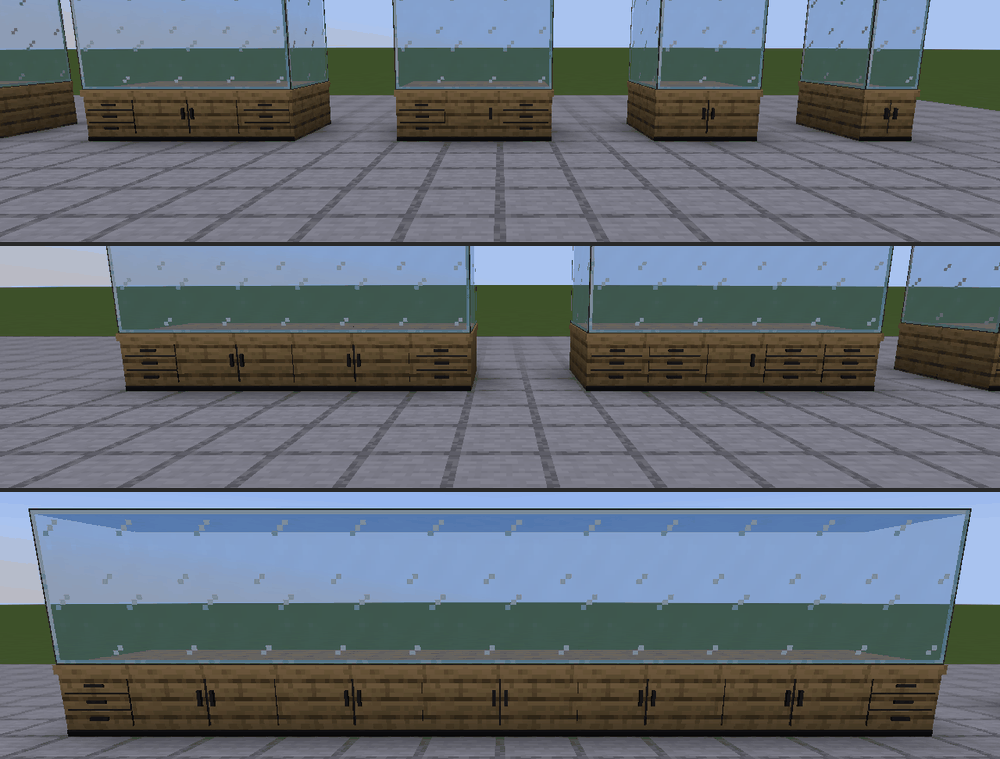
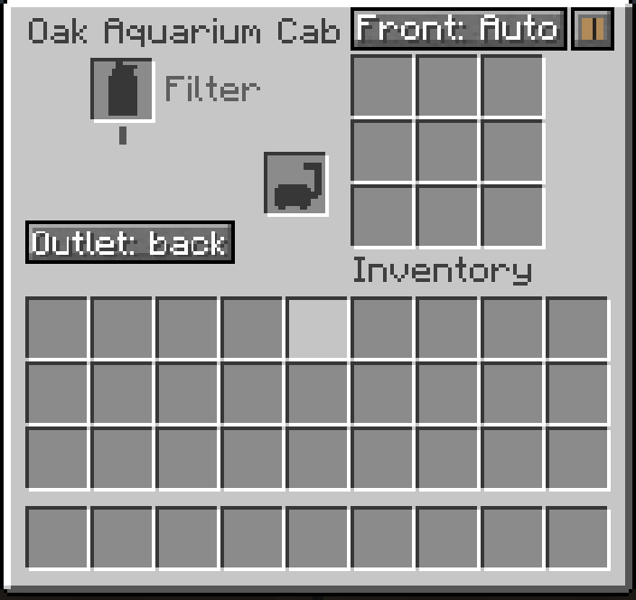
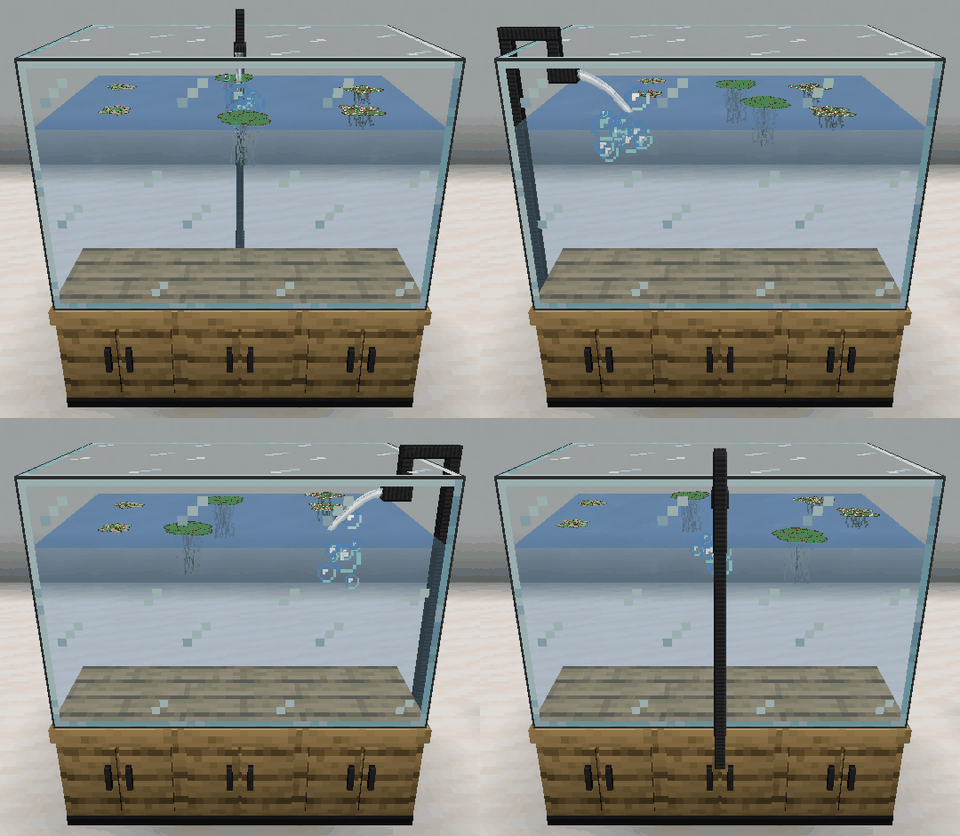
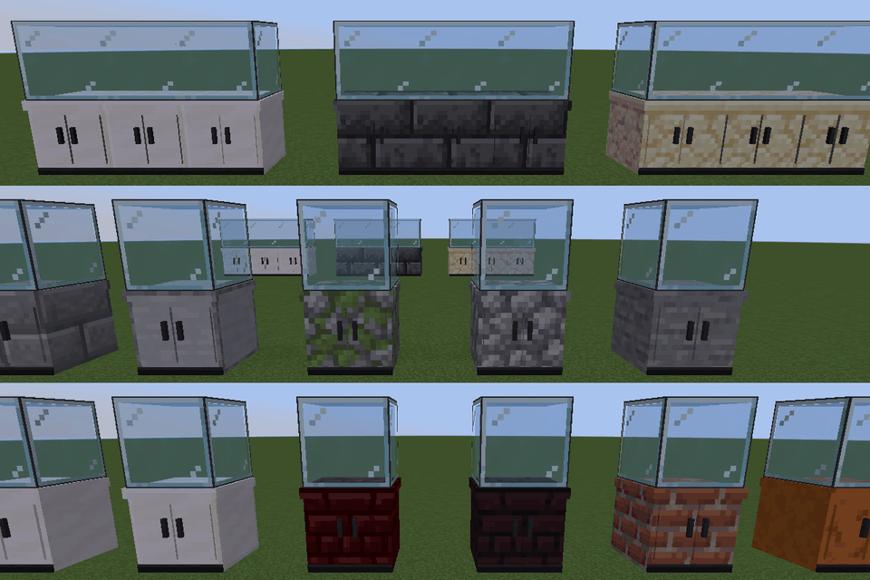

---
navigation:
  title: Cabinet
  icon: bettacraft:cabinet
  parent: equipment.md
  position: 80
item_ids:
  - bettacraft:cabinet
---

# Aquarium cabinet

The <ItemLink id="bettacraft:cabinet" /> is a stand for the aquarium, made of **any wood**: five planks of one kind
(also from other mods), three wooden slabs and a wooden chest. The cabinet takes the look of its planks.

* Cabinets next to each other that face the same way join into one long cabinet with a continuous top, and also to the
  back: a whole area under a big tank becomes one under-cabinet (see below).
* **Filter slot:** put an [external filter](filters.md) in. A cabinet directly under the aquarium then counts as an
  attached external filter; the hose runs up the wall of its **outlet side** (see below; the back wall unless you
  choose another). The two heater slots of the cabinet menu are the heater slots of that filter.
* **Air pump slot:** an [air pump](air_pump.md) in the cabinet drives the air stones and sponge filters of the
  aquarium above, like one beside it; its air hose goes up next to the filter hose at the outlet side.
* **Nine storage slots** for food and other things. Hoppers can use them, and the [feeder](feeder.md) on the aquarium
  takes food from the cabinets under it.
* Broken, the cabinet drops its contents like a chest and keeps its wood, its outlet side and its front.

## Under the whole tank

Cabinets join **to the back** as well, so even a 10 x 5 tank stands on one continuous under-cabinet:

* The **front row** shows the fronts (drawers at the ends, doors between them), the sides of the outer cabinets the plain
  side panels. Every cabinet with another one **in front of it** (the back rows and the inside of the area) is a plain
  carcass: no doors, the counter top and the sides run through.
* You may also build the whole area of cabinets (a 4 x 4 with the four inside ones) or only a **ring** of cabinets with
  **normal blocks in the middle** (cheaper): from outside it still looks like one piece.
* A cabinet placed against the side, back or front of another one takes **its facing**, so you can build the area from
  any side. Placed on the ground it faces you as before.
* The setting `features.equipment.cabinetArea` switches this off: cabinets then join only left and right and every one
  shows its front.

**One spring for the whole under-cabinet.** With power and winding on (see [Crank](crank.md)) all cabinets under a tank
and all cabinets joined to them form **one spring store**: also two cabinets that do not touch, for example one at each
end of a long tank. The store grows with every cabinet block; one click of the crank at any of them winds the whole store
(by one cabinet's step), and every cabinet's window and the overlay show the store ("Shared by 4 cabinets"). A broken
cabinet hands its share to the others as far as they have room. Cabinets of older worlds keep their winding: their springs
simply form the store. The setting `features.power.cabinetSharedSpring` gives every cabinet its own spring again.

## Fronts

A row of cabinets side by side (facing the same way) shows **one front** instead of two narrow doors on every block:

* **1 block:** the two doors as always. **2 blocks:** one double door.
* **3 and more:** a block of **drawers at both ends** and **double doors** over two blocks between them. An odd row gets a
  **single door** with its handle at the side in the middle (in rows of 5, 9, 13 ... with a drawer block on each side of
  it, so the row stays symmetric).
* The fronts follow the row by themselves when you place, break or turn a cabinet, for rows up to 32 blocks (longer rows
  get double doors all along). Two rows meeting at a corner keep their own fronts.

The cabinet menu is bigger since 1.55.0 (the text of the front button fits). Under the heater row it shows the **energy** stored in the
store of the tank the cabinet's filter feeds (with a bar): the filter keeps no energy of its own, what flows into it goes into that store,
and all the devices of the tank draw from it (see [Power](power.md)).

The button **"Front: Auto"** at the top right of the cabinet menu fixes the front of this one cabinet: **Auto** (from the
row, the default), **double door, left leaf**, **double door, right leaf**, **single door**, **drawers** or **two doors
(old)**. Click for the next, sneak + click for the previous one. The small button next to it switches the thin **dark
joints** between the doors and drawers (on by default; off: planks only). Broken and placed again, the cabinet keeps both
(its item shows them). Cabinets of older worlds become Auto with joints. The setting `features.equipment.cabinetFronts`
switches the fronts off: every cabinet then shows its two doors like before and the buttons are hidden (the settings are
kept).

## Outlet side

The button **"Outlet: back"** in the cabinet menu chooses the tank wall the filter hose goes up, seen from the cabinet
door: **back** (the default), **left**, **right** or **front** (unusual, but possible). Each cabinet has its own side,
also several cabinets under one big tank. Click for the next side, sneak + click for the previous one.

* Hose, outlet, water jet and bubbles move to that wall (and the air hose of an air pump in the cabinet with them).
* The **current** comes from there: floating plants drift away from the outlet, and in front of it the water moves
  faster than in the rest of the tank (up to almost twice the tank's flow, fading over eight blocks).
  [Seahorses](../saltwater/seahorses.md) there are stressed by the flow sooner, so put the outlet on the other side of
  their hitching posts; corals in front of it get more flow (good for acropora, too much for mushroom corals).
* Broken and placed again, the cabinet keeps the side (its item shows it). Cabinets of older worlds stay on the back
  wall. The setting `features.equipment.cabinetOutletSide` switches the button off (every cabinet then uses the back wall and the
  flow is even again).

## Create shaft

With **Create** a cabinet takes a turning shaft that powers the aquarium above it, like a
[drive adapter](drive_adapter.md): the button with the shaft icon left of the filter slot chooses the side (**none**,
back, left, right, front or bottom; click for the next one, sneak + click for the previous one), a brass flange marks it.
A shaft, cogwheel or gearbox there charges the tank's FE buffer and costs stress in Create's network; with winding on, the
rest winds the cabinet's spring. The cabinet keeps the side on its item. Servers can switch it off
(`features.compat.create.cabinetDrive`) or allow only some sides (`createDrive.cabinetSides`).

## Stone cabinets

A cabinet can also be made of **stone**: five blocks of one stone, three **slabs of the same stone** and a wooden chest
(stone bricks with stone brick slabs, sandstone with sandstone slabs ...). Every stone with its own slabs works: stone,
cobblestone, granite, diorite, andesite, deepslate, tuff, blackstone, sandstone, bricks, nether bricks, quartz, terracotta
with slabs and the stones of other mods. Metal and copper blocks, glass, purpur, end stone, prismarine, concrete and mud
bricks do not.

<Recipe id="bettacraft:stone_cabinet" />

* The stone cabinet looks like its stone and can do the same as a wooden one (filter, heaters, storage, joined counters).
* It is mined like its stone: with a **pickaxe** (by hand it drops nothing but its contents), as hard and as blast
  resistant as the stone.
* Modpacks can add stones with the item tag `#bettacraft:cabinet_stones` and rule some out with
  `#bettacraft:cabinet_excluded`. The setting `features.equipment.stoneCabinets` switches the stone recipe off.

## Obtaining

Crafting:

<RecipesFor id="bettacraft:cabinet" />
