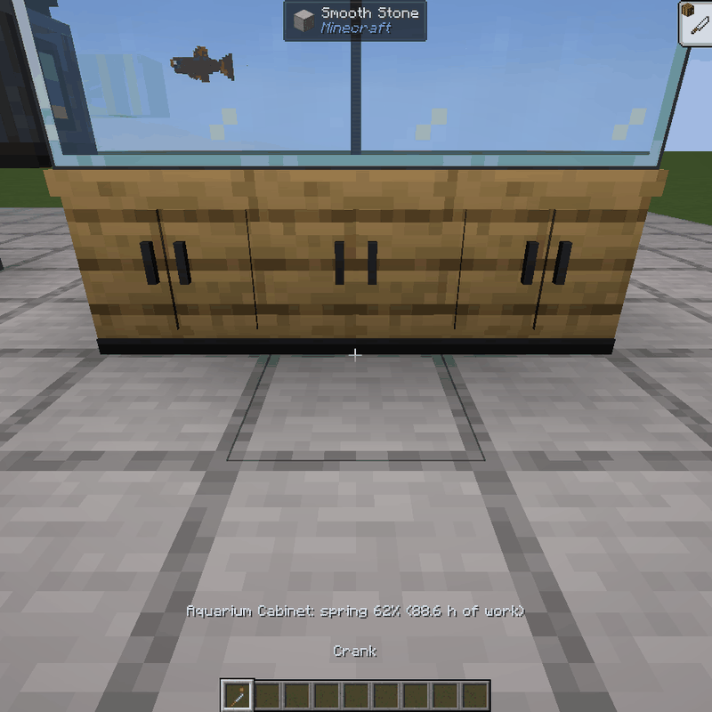

---
navigation:
  title: Crank and winding
  icon: bettacraft:crank
  parent: equipment.md
  position: 91
item_ids:
  - bettacraft:crank
---

# Crank and winding

<ItemImage id="bettacraft:crank" scale="2" />

The crank winds devices that have a **spring**. Right-click the device with the crank in your hand: every click winds a
step and the ratchet clicks a little higher. **Hold the button** to keep winding: one **charge** (one in-game day of
one device's work) takes about **five seconds**. The action bar shows how far the spring is wound.

## Which devices take the crank

**Without the power options** only two machines need it: they have no other drive.

* [Food maker](../food/food_maker.md) and [fertilizer maker](../plants/fertilizer_maker.md): a full spring works for a day.
* Every other device simply runs, without power and without winding.

**With a power option on** (see [Power](power.md)) every device that needs FE can also be wound instead
(`features.power.winding`): so you can keep a tank without any generator.

| Device | Power option | Spring |
|---|---|---|
| [Food maker](../food/food_maker.md), [fertilizer maker](../plants/fertilizer_maker.md) | any | 1 charge; FE first, then the spring |
| [External filter](filters.md) | `power.filterRequiresEnergy` or `heaterRequiresEnergy` | 1 charge; it also drives the heaters and coolers in it |
| [Multiblock filter](multiblock_filter.md) (wind any part) | `pipes.pumpsRequireEnergy` | 6 charges, takes six times as long to wind |
| [Cabinet](cabinet.md) under a tank | any `power.*` option | 6 charges for **every device of its tank** |
| [Reverse osmosis unit](reverse_osmosis.md) | any | 1 charge for the pressure pump (four times the water) |
| [Water change controller](water_change.md), [water pump](pipes.md) | `pipes.pumpsRequireEnergy` | 1 charge: a day of a pump's work |

Internal and corner filters, lights, the feeder, the dosing pump, misters and heat mats have no spring of their own:
wind the **cabinet** under the tank. It stores the winding and gives it to every device of its tank that needs FE: its
filter and air pump, the external and internal filters, heaters and coolers, heat mats, misters, lights and air pumps.
Each working device uses one device-tick per tick, so **the more devices, the faster it runs down**: one filter runs six
days on a full cabinet, six devices one day.

* **FE always goes first.** The spring only runs while the FE is short, so a battery and a spring back each other up.
* A spring only runs down while its chunk is loaded; time in unloaded chunks does not count.
* Without FE and without a wound spring a filter does not clean, but the animals live on (as always without power).
* The window of the [external filter](filters.md), the cabinet and the machines shows the spring as a brass gauge; Jade,
  The One Probe and WTHIT show it too. The **Water** tab says how many devices the springs drive right now.

The settings are in the server config section `winding`: `ticksPerCharge` (24000), `clicksPerCharge` (25) and the charges
of each device (`externalFilterCharges` 1, `multiblockFilterCharges` 6, `cabinetCharges` 6, ...).

## Obtaining

Crafting:

<RecipesFor id="bettacraft:crank" />
