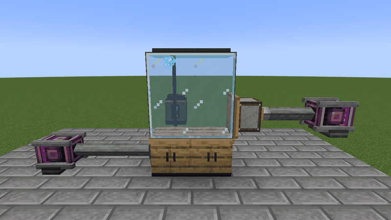
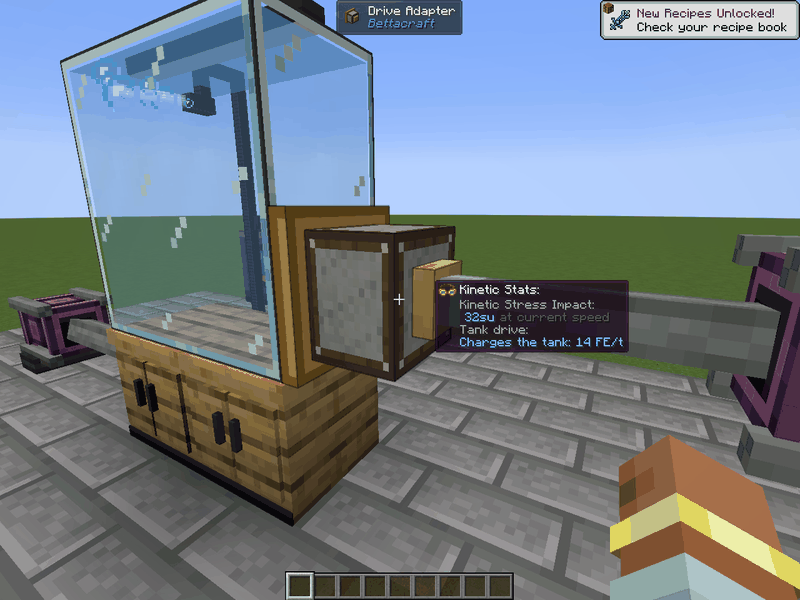
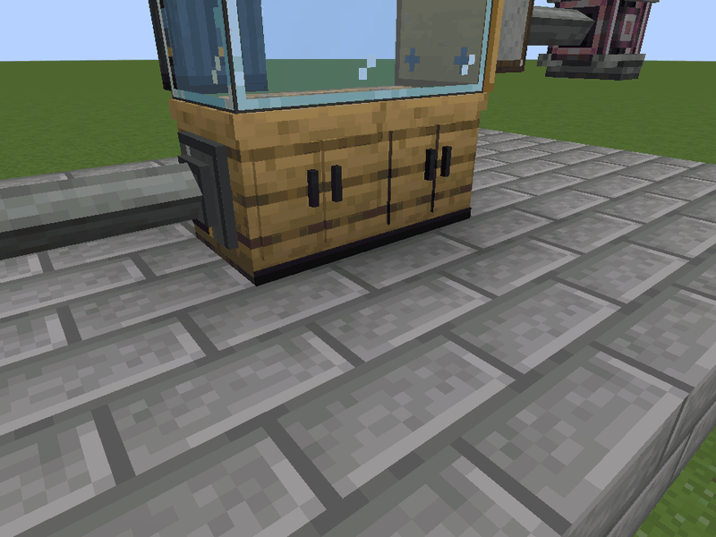

---
navigation:
  title: Drive adapter (Create)
  icon: minecraft:grindstone
  parent: equipment.md
  position: 92
item_ids:
  - bettacraft:drive_adapter
feature: compat.create.drive
mod: create
---

# Drive adapter (Create)

<ItemImage id="bettacraft:drive_adapter" scale="2" />

Only with **Create**. The drive adapter turns Create's rotation into the [power](power.md) of an aquarium: a shaft at it
charges the tank's FE buffer, and every device that takes the tank's FE runs on it, without a single FE cable: filters,
flow pumps and skimmers, heaters, coolers and heat mats, lights, air pumps and misters. Machines that stand on their own
(water pump, filter pump head, water change controller, reverse osmosis unit, food maker, fertilizer
maker) keep their own shaft as before (see [Create](../settings/create.md)).

## Placing

* Set it on a **tank wall** or **under a tank**: its brass plate goes on the glass, the shaft points away from the
  tank. Placed next to a tank it turns towards it by itself (the tank above first).
* Connect a Create **shaft, cogwheel, gearbox or motor** to its shaft. The adapter is part of Create's network: the
  shaft stub turns with it, and the engineer's goggles show its stress and what it gives the tank.
* The aquarium needs power costs on the server (`power.costs` `EASY` or `HARD`): without them no device takes FE, and
  the adapter only idles.

## Power

* **64 RPM** (either direction) give an adapter its full power, **256 FE per tick**, slower proportionally (32 RPM:
  128 FE/t). Faster gives no more.
* The adapter gives what the tank needs: what its devices took in the last second, plus what fills its buffer. A full
  buffer and a few devices take only a little.
* **Several adapters** on one tank share the work and add up, to at most **1024 FE per tick** per tank.

## Stress

The adapter costs **real stress** in Create's network, by its load: **2 SU for every FE per tick** it gives (a tank
taking 64 FE/t costs 128 SU), at least **0.5 SU per RPM** while it turns without load. While a tank's buffer fills
up, the adapter runs at full load. An **overstressed** network gives the tank nothing (the goggles say so); the
devices then fall back on the FE in the tank's store (which the [crank](crank.md) charges too).

## The cabinet takes a shaft too

A [cabinet](cabinet.md) under the tank does the same as an adapter: choose the side in the cabinet menu (the button
with the shaft left of the filter slot: none, back, left, right, front or bottom) and connect a shaft there. A brass
flange marks the side. It fills the same energy store of the tank. Overlays (Jade, The One Probe, WTHIT) show
on the cabinet and the tank what the shaft gives.

## Settings

The switches `features.compat.create.drive` (the adapter and the cabinet shaft) and `features.compat.create.cabinetDrive`
(only the cabinet shaft); the numbers in the server config section `createDrive`: full speed, FE per input, the limit
per tank, the stress per FE and when idle and the sides a cabinet may use (`cabinetSides`).

## On the road

Glued to a tank on a Create contraption, the adapter travels along. No Create network turns there, so it turns with the
trip itself: the faster it moves (`createTravel.dynamoFullSpeed`, 8 blocks per second for the full power), the more it
charges the tank's buffer for the filters and heaters that travel along. On a bearing an adapter at the axis does not move
and gives nothing. On a Create Aeronautics airship it works as on the ground, on a shaft a generator of the ship turns. See
[Moving tanks with Create](../settings/create.md).

## Obtaining

Crafting:

<RecipesFor id="bettacraft:drive_adapter" />
