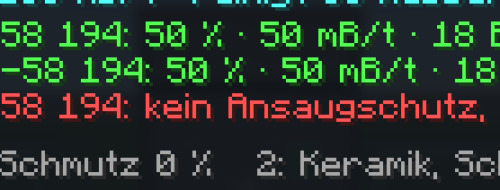
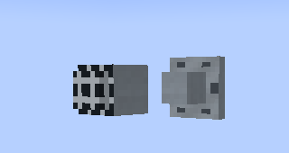

---
navigation:
  title: Filter lines and guards
  icon: bettacraft:filter_inlet_pipe
  parent: equipment/multiblock_filter.md
  position: 1
item_ids:
  - bettacraft:filter_inlet_pipe
  - bettacraft:filter_outlet_pipe
  - bettacraft:pipe_tee
  - bettacraft:intake_guard
  - bettacraft:outlet_guard
---

# Filter lines and guards

<GameScene zoom="3" interactive={true}>
  <Block id="bettacraft:filter_inlet_pipe" p:west="true" p:east="true" />
  <Block id="bettacraft:filter_inlet_pipe" x="1" p:west="true" p:east="true" p:up="true" p:junction="true" />
  <Block id="bettacraft:filter_inlet_pipe" x="2" p:west="true" p:east="true" />
  <Block id="bettacraft:filter_inlet_pipe" x="1" y="1" p:down="true" p:up="true" />
  <Block id="bettacraft:filter_outlet_pipe" z="1" p:west="true" p:east="true" />
  <Block id="bettacraft:filter_outlet_pipe" x="1" z="1" p:west="true" p:east="true" />
  <Block id="bettacraft:filter_outlet_pipe" x="2" z="1" p:west="true" p:east="true" />
</GameScene>

One [multiblock filter](multiblock_filter.md) serves **several aquariums** through its own pipes:

* <ItemLink id="bettacraft:filter_inlet_pipe" /> (blue): the **intake line**, from the aquariums to the filter's inlet.
* <ItemLink id="bettacraft:filter_outlet_pipe" /> (orange): the **return line**, from the filter's outlet back into the
  aquariums.

A filter pipe joins only pipes of its own line, its connector on the filter and aquarium blocks. A plain pipe joins **at
most two neighbours** (a straight run or a bend; first the block you place it against). Use a
<ItemLink id="bettacraft:pipe_tee" /> on a pipe to make it a **branch**: it then joins every neighbour of its line, up to all
six sides, so one filter reaches several aquariums. Breaking a branch gives the pipe and the T-piece back.

An aquarium counts for the filter when **both lines** reach it. The filter's cleaning and its flow are **shared by the
water volume** of its aquariums: a big filter is enough for several small aquariums. Each aquarium keeps its own water; the
filter screen lists every aquarium with its share, its flow and its cleaned water blocks, or the reason it is not filtered.

## Docking anywhere

The filter pipes dock on **any side, the top or the bottom** of an aquarium. Where a pipe docks outside, a **pipe dock**
appears inside, in the middle of that very face (on the wall, under the lid or on the floor; at a
[bulkhead](bulkhead.md) its own connection is used). From the dock you lay [interior pipes](bulkhead.md) on to where the
water should come in or go out. A pipe that leads **into the aquarium and out again** is not allowed (it would only be a
pipe through the aquarium): it cannot be placed, and if one is built anyway both docks stay closed.

## Guards

Every dock needs a **guard** in the aquarium so no animal is sucked in:

* <ItemLink id="bettacraft:intake_guard" />: a fine mesh on the intake line (an intake strainer counts too).
* <ItemLink id="bettacraft:outlet_guard" />: a mesh cap on the return line (a lily pipe, nozzle or spray bar counts too).

Place the guard inside at the dock or at the end of the interior pipes, or use it from outside on the glass where the
pipe docks: it goes straight in front of the dock. **Without its guard the filter does not filter that aquarium**: a red
line in the aquarium menu (water tab), in Jade / The One Probe / WTHIT and in the filter screen says what is missing.

A guard placed next to a pipe or dock turns its mesh away from it by itself (sneak while placing to face where you look);
sneak + right-click on a guard with an empty hand turns it to its next free side.

## Filters built before the update

**Important:** the guards are needed by **every** multiblock filter, also by those built before this version. After
the update an old filter keeps its media, regulator and power, but **stops filtering until its aquariums have their
guards**; players nearby get a chat message with its position, and the filter screen shows a red note. Fit an intake
guard and an outlet guard where its pipes enter the aquarium, and it filters again.

Server owners who do not want this can switch the filter lines off: `features.pipes.filterLines = false` in the common
config. Then a filter serves one aquarium as before, without guards, and the filter pipes carry nothing.

## Obtaining

Crafting:

<RecipesFor id="bettacraft:filter_inlet_pipe" />
<RecipesFor id="bettacraft:filter_outlet_pipe" />
<RecipesFor id="bettacraft:pipe_tee" />
<RecipesFor id="bettacraft:intake_guard" />
<RecipesFor id="bettacraft:outlet_guard" />
