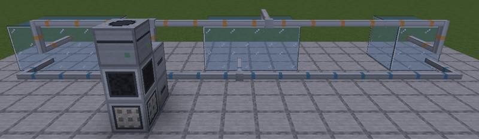

---
navigation:
  title: Filter lines and guards
  icon: bettacraft:stainless_steel_pipe
  parent: equipment/multiblock_filter.md
  position: 1
item_ids:
  - bettacraft:pipe_wrench
  - bettacraft:intake_guard
  - bettacraft:outlet_guard
---

# Filter lines and guards

<GameScene zoom="3" interactive={true}>
  <Block id="bettacraft:stainless_steel_pipe" p:west="true" p:east="true" p:ring="intake" />
  <Block id="bettacraft:stainless_steel_pipe" x="1" p:west="true" p:east="true" p:up="true" p:ring="intake" />
  <Block id="bettacraft:stainless_steel_pipe" x="2" p:west="true" p:east="true" p:ring="intake" />
  <Block id="bettacraft:stainless_steel_pipe" x="1" y="1" p:down="true" p:up="true" p:ring="intake" />
  <Block id="bettacraft:glass_pipe" z="1" p:west="true" p:east="true" p:ring="return" />
  <Block id="bettacraft:glass_pipe" x="1" z="1" p:west="true" p:east="true" p:ring="return" />
  <Block id="bettacraft:glass_pipe" x="2" z="1" p:west="true" p:east="true" p:ring="return" />
</GameScene>

One [multiblock filter](multiblock_filter.md) serves **several aquariums** through [pipes](pipes.md). There are no special
filter pipes: any glass or stainless steel pipe that reaches the filter's **inlet** is its **intake line** (blue rings at the
block borders), any that reaches its **outlet** is its **return line** (orange rings). The role comes from the connector the
line reaches; a pipe without one is a plain water line without a ring.

A pipe joins **every neighbour that fits, on every side**, so a line branches by itself to every aquarium it reaches. Where
two lines run next to each other, keep them apart with the <ItemLink id="bettacraft:pipe_wrench" />: right-click the side of
a pipe to close it (a closed side shows a cap; right-click again to open it). A line that reaches the inlet **and** the
outlet is a **short circuit** (red rings): the filter stops and says so in its screen and in Jade / The One Probe / WTHIT.

A line carries at most what its **weakest pipe** carries: a glass pipe 50 mB/t, a stainless steel pipe 250 mB/t. The pump
head moves up to 100 mB/t, so on glass lines the filter runs at half. Several intake and return lines (more inlets and
outlets on the filter) **add up**: two glass lines each way give it its full flow again. Two lines may also run through one
block, a [pipe bundle](pipe_bundle.md).

An aquarium counts for the filter when **both lines** reach it. The filter's cleaning and its flow are **shared by the
water volume** of its aquariums: a big filter is enough for several small aquariums. Each aquarium keeps its own water; the
filter screen lists every aquarium with its share, its flow and its cleaned water blocks, or the reason it is not filtered.

## Docking anywhere

The filter pipes dock on **any side, the top or the bottom** of an aquarium. Where a pipe docks outside, a **pipe dock**
appears inside, in the middle of that very face (on the wall, under the lid or on the floor; at a
[bulkhead](bulkhead.md) its own connection is used). From the dock you lay [interior pipes](bulkhead.md) on to where the
water should come in or go out. A pipe that leads **into the aquarium and out again** is not allowed (it would only be a
pipe through the aquarium): it cannot be placed, and if one is built anyway both docks stay closed.

## Guards

Every dock needs a **guard** in the aquarium so no animal is sucked in:

* <ItemLink id="bettacraft:intake_guard" />: a fine mesh on the intake line (an intake strainer counts too).
* <ItemLink id="bettacraft:outlet_guard" />: a mesh cap on the return line (a lily pipe, nozzle or spray bar counts too).

Place the guard inside at the dock or at the end of the interior pipes, or use it from outside on the glass where the
pipe docks: it goes straight in front of the dock. **Without its guard the filter does not filter that aquarium**: a red
line in the aquarium menu (water tab), in Jade / The One Probe / WTHIT and in the filter screen says what is missing.

A guard placed next to a pipe or dock turns its mesh away from it by itself (sneak while placing to face where you look);
sneak + right-click on a guard with an empty hand turns it to its next free side.

## Filters built before the update

**Important:** the guards are needed by **every** multiblock filter, also by those built before this version. After
the update an old filter keeps its media, regulator and power, but **stops filtering until its aquariums have their
guards**; players nearby get a chat message with its position, and the filter screen shows a red note. Fit an intake
guard and an outlet guard where its pipes enter the aquarium, and it filters again.

The filter pipes of older versions (all four lines), their T-pieces and the filter's fresh and waste water ports are
**stainless steel pipes** now, with exactly the connections they had (the sides they were not joined on are closed, as with
the wrench); bundles keep their lines. In inventories and chests they turn into stainless steel pipes, the interior pipe into
a glass pipe.

Server owners who do not want this can switch the filter lines off: `features.pipes.filterLines = false` in the common
config. Then a filter serves one aquarium as before, without guards, and its pipes are plain water pipes.

## Obtaining

Crafting:

<RecipesFor id="bettacraft:pipe_wrench" />
<RecipesFor id="bettacraft:intake_guard" />
<RecipesFor id="bettacraft:outlet_guard" />
