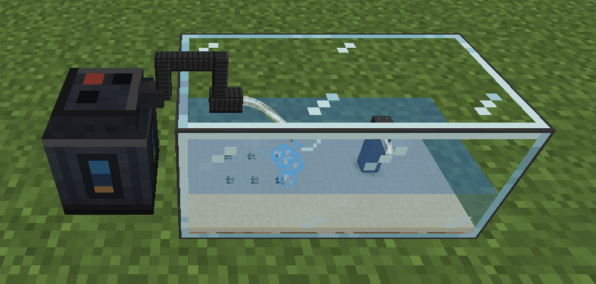

---
navigation:
  title: Filters
  icon: bettacraft:internal_filter
  parent: equipment.md
  position: 30
item_ids:
  - bettacraft:internal_filter
  - bettacraft:external_filter
---

# Filters

Filters bring movement into the aquarium: a water jet, bubbles and a quiet bubbling sound (can be turned off in the
client config, `sound.filterSound`). The flow itself has no effect on the fish, but filters **keep the water clean**:
an external filter handles 32 water blocks, an internal filter under water 16 (see
[Water quality](../aquarium/water_quality.md)).

## Internal filter

<ItemImage id="bettacraft:internal_filter" scale="2" />

Place the <ItemLink id="bettacraft:internal_filter" /> in the [interior](../interior.md): it becomes a filter tower
(2x2x8 blocks at scale 16) whose outlet faces you. The aquarium shows a water jet at its outlet.

## External filter

The <ItemLink id="bettacraft:external_filter" /> stands **next to the aquarium** and points at it: placed against a
tank block it turns towards it, at any height of any side wall. A hose runs over the glass rim and a jet pours into the
water (under water it is a short current).

* It has **two slots** for [heaters](heaters.md) or [coolers](coolers.md) of any size. Open it with a right-click or
  right-click it with a heater. While the filter is attached, its heaters heat and its coolers cool the aquarium.
* Broken, it keeps its heaters in the item (the tooltip lists them).
* It can also go into an [aquarium cabinet](cabinet.md) under the aquarium.
* It is the small variant: a [multiblock external filter](multiblock_filter.md) of any size, with filter media and
  pipes, cleans much more.

The tank menu shows "Filters: 1 outside (heaters: 2), 1 inside".

## More internal filters, fry and the power regulator

* The [sponge filter](sponge_filter.md) (air-driven, gentle for fry) and the [corner filter](corner_filter.md) are
  further internal filters.
* Filters with a motor (internal, corner, external and cabinet filter) **suck in fry** unless an
  [intake sponge](intake_sponge.md) is fitted.
* Every filter has a [power regulator](regulator.md) (0 to 100 %): less power cleans less, needs less energy and is
  quieter. Filter outlets also bring a little **oxygen** into the water (see [Oxygen](../aquarium/oxygen.md)).

## Obtaining

Crafting:

<RecipesFor id="bettacraft:internal_filter" />
<RecipesFor id="bettacraft:external_filter" />
