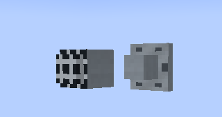
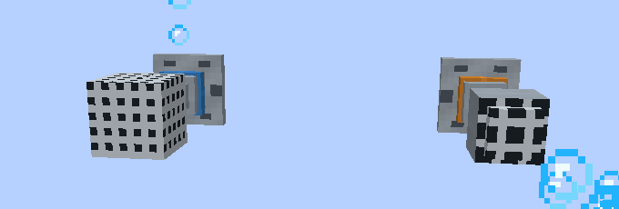

---
navigation:
  title: Guards
  icon: bettacraft:intake_guard
  parent: equipment/water_system.md
  position: 5
item_ids:
  - bettacraft:intake_guard
  - bettacraft:outlet_guard
---

# Guards

Where a line ends in an aquarium, a **guard** keeps the animals out of the pipe:

* <ItemLink id="bettacraft:intake_guard" />: a fine mesh for the lines that **suck**: the intake line of a
  [multiblock filter](multiblock_filter.md) and the waste water line of a [water change controller](water_change.md) (also
  where the controller touches the aquarium). An intake strainer counts too.
* <ItemLink id="bettacraft:outlet_guard" />: a mesh cap for the lines that **bring water**: the return line of a filter. A
  lily pipe, nozzle or spray bar counts too. The controller's fresh water line needs no guard.

## Placing a guard

* **Inside:** at the [pipe dock](bulkhead.md) of the line or at the end of its interior pipes.
* **From outside:** use the guard on the glass where the line docks. On a [pipe bundle](pipe_bundle.md) every line has its
  own small flange: click the flange of the line you mean, and the guard goes straight in front of **that line's** dock (the
  flange nearest to where you click).
* A guard placed next to a pipe or dock turns its mesh away from it by itself (sneak while placing to face where you look);
  sneak + right-click on a guard with an empty hand turns it to its next free side.

Each line has its **own** dock and needs its own guard: an outlet guard on the return line does not guard the intake line
beside it.

## Without a guard

* **Filter:** without both guards in an aquarium the filter **does not filter that aquarium**. A red line in the aquarium
  menu (water tab), in Jade / The One Probe / WTHIT and in the filter screen says what is missing. This holds for every
  multiblock filter, also for those built before guards existed: they filter again once the guards are in.
* **Water change:** the controller still changes the water, but its waste water line **sucks in young animals** (fry, young
  shrimp and tadpoles; not snails, not adults), as many as the share it drains: a 25 % change takes about a quarter of the
  young. Its screen, the aquarium menu (devices and breeding tabs) and the overlays warn "sucks in young animals"; the tank
  log notes every animal lost. This only happens with `features.breeding.fryIntake` on and in a care mode in which animals
  can die.

Server owners who do not want guards for filters switch the filter lines off: `features.pipes.filterLines = false` in the
common config. Then a filter serves one aquarium as before, without guards, and its pipes are plain water pipes.

## Obtaining

Crafting:

<RecipesFor id="bettacraft:intake_guard" />
<RecipesFor id="bettacraft:outlet_guard" />
