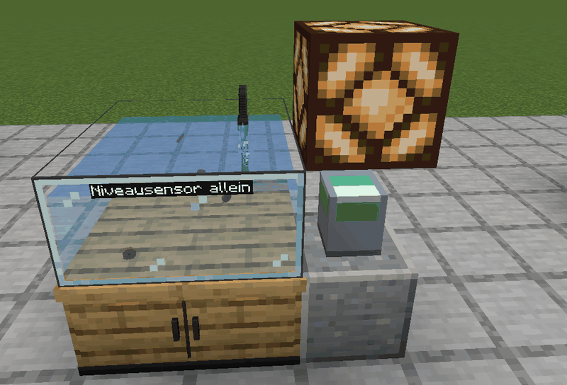

---
navigation:
  title: Level sensor
  icon: bettacraft:level_sensor
  parent: equipment/water_system.md
  position: 7
item_ids:
  - bettacraft:level_sensor
---

# Level sensor

<GameScene zoom="3" interactive={true}>
  <Block id="bettacraft:tank" x="0" p:fill="14" />
  <Block id="bettacraft:level_sensor" x="1" p:facing="east" />
</GameScene>

Open aquariums lose water to evaporation (a [lid](tank_lid.md) helps). The <ItemLink id="bettacraft:level_sensor" /> measures
it, like a float switch:

* Place it **at an aquarium**: beside it or on it (or beside the cabinet of a [sump](sump.md), for the aquarium above).
* Right-click sets its **target**: 100 % (default), 95, 90, 80, 70, 60 or 50 %.
* When the water is 50 mB or more below the target it says so and gives a **redstone signal** (strength 15, on every side),
  for your own circuits or the pumps of other mods. Otherwise it is quiet.
* It **only measures**: no pipe joins it, it moves no water and needs no power.

## Top-off

A [water change controller](water_change.md) that fills this aquarium (touching it, through its fresh water line or through
a multiblock filter) reads every sensor of the aquarium **without a cable** and tops off what is missing through its fresh
water line, between its water changes. **Fresh water only:** when water evaporates, the salt of a
[reef tank](../saltwater.md) stays behind, and topping off with fresh water brings the salinity back exactly where it was; a
salty source is refused.

Without a controller the sensor only measures and gives its signal. Jade, The One Probe and WTHIT show its target, how much
is missing, the signal and whether a controller tops the aquarium off.

With `features.pipes.topOff = false` the sensor does nothing and the controller only changes water.

## Obtaining

Crafting:

<RecipesFor id="bettacraft:level_sensor" />
