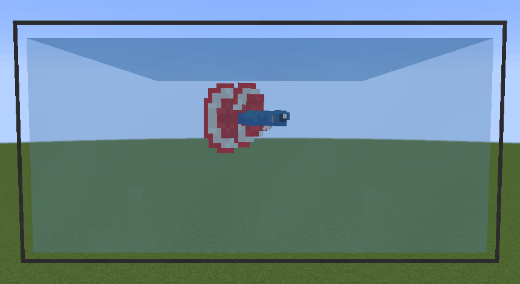

---
navigation:
  title: Mirror stick
  icon: bettacraft:mirror_stick
  parent: equipment/tools.md
  position: 40
item_ids:
  - bettacraft:mirror_stick
---

# Mirror stick

<ItemImage id="bettacraft:mirror_stick" scale="2" />

Hold it in either hand and look at a male betta: every adult male within 6 blocks in front of you that can see the mirror
(also through the glass) flares at his reflection and shows his side. A male that flared during the last in-game day gets
ready for a bubble nest 1.25 times faster (**mirror training**). More: [Fights, flaring and predators](../bettas/fighting.md).

## Obtaining

Crafting:

<RecipesFor id="bettacraft:mirror_stick" />
