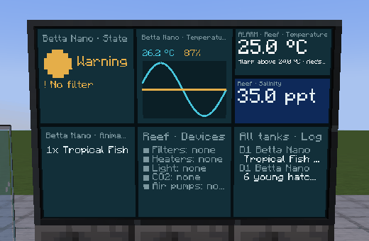
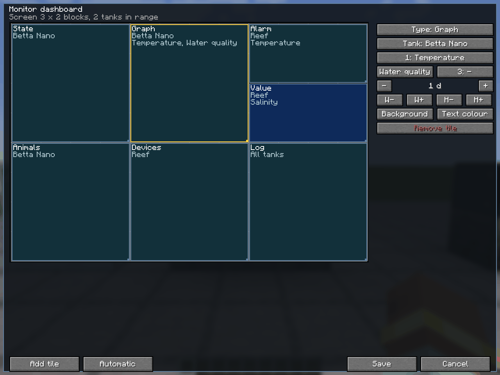

---
navigation:
  title: Monitor
  icon: bettacraft:monitor
  parent: equipment.md
  position: 110
item_ids:
  - bettacraft:monitor
---

# Monitor

<ItemImage id="bettacraft:monitor" scale="2" />

A monitor is a screen for your tanks. Place monitor blocks **next to each other** with their screens facing the same
way: they join into one screen of up to **8 x 5 blocks** with a single frame around it. A monitor placed against the
side, top or bottom of another one takes over its direction. A wall bigger than 8 x 5 is cut into several screens.

The screen finds **every tank within 32 blocks** by itself (`monitor.range`, measured to the nearest point of the tank)
and shows their values on tiles. Each tank is named after its [name sign](../aquarium/menu.md). Out of the box
the screen arranges itself: two tiles per tank, the **temperature** with a small graph of the last day and the
**water quality**. Right-click a monitor to arrange the tiles yourself (the editor, see below); sneak and
right-click to see its size and how many tanks it found.

* A tank that is out of range or in an unloaded chunk shows **"not loaded"** with the last values the screen saw.
* The values only travel to players who can see the monitor (within their render distance); they come every second.
* Every tank keeps a record of its values for the last 7 in-game days (one point per in-game hour), also while no
  monitor looks at it, so a new monitor shows the past right away.
* With power costs on (see [Power](power.md)) a monitor needs **1 FE per tick and block** (`monitor.fePerBlock`);
  without FE it shows "No power". Any block of the screen takes FE.

## Widgets

| Tile | Shows |
|---|---|
| **Value** | one value of a tank, big: temperature, water quality, pH, TDS, salinity, calcium, KH, magnesium, oxygen, CO2, nitrate, water level, animals, algae or the food in the feeder; optionally with a small graph of the last day |
| **Traffic light** | the state of a tank in green, yellow or red with the warnings of its menu: little or bad water, no filter, nitrate, devices without power, overcrowded, sick animals, an empty feeder and the breeding warnings |
| **Graph** | one to three values of a tank over 1 to 7 in-game days, each line in its own colour and scaled to its own range, with the latest values above it; a faint line marks every day |
| **Animals** | how many animals of each species live in the tank (young in brackets), then the bubble nest, eggs, young and berried small animals |
| **Devices** | filters, heaters, coolers, light (with the dimmer), CO2 and air pumps: how many run, red when they lack power; the tank's energy buffer while power costs are on |
| **Alarm** | a value with a limit: the tile blinks red while the value is above (or below) it. It can give a redstone signal (see below) |
| **Log** | the latest logbook entries of one tank or of **all tanks** of the screen, newest on top, with the day |

## The editor

Right-click a monitor to open the editor. On the left is the grid of the screen (4 x 4 cells per block):

* **Click** a tile to pick it, **drag** it to move it and **drag its bottom right corner** to resize it. Tiles never
  overlap. *Add tile* puts a new tile on the first free spot.
* On the right are the settings of the picked tile: the **type**, the **tank** (one of the tanks the screen found,
  by the name of its sign; the log also offers all tanks), the **value** (graphs: up to three lines and the days),
  the alarm's **limit** and **redstone**, the **size** (W-/W+/H-/H+) and the **background** and **text colour**.
  Buttons go backwards with shift.
* **Save** puts the dashboard on the screen for everyone; **Automatic** gives the screen back its automatic layout.

Only players who may build at the monitor can change its dashboard (the server checks it, like breaking a block there),
and only from close by.

## Alarms and redstone

An alarm tile watches one value of one tank. While the value is past its limit the tile blinks; with **redstone** on,
every block of the screen also gives a **redstone signal of 15** to all sides, and a comparator reads the number of
triggered alarms (up to 15). Since 1.25.0 every screen with an alarm tile checks its tanks every second even when
nobody looks. A tank that is not loaded never triggers an alarm.

**Waypoint on the map** (since 1.25.0; JourneyMap, since 1.43.0 also Xaero's Minimap / World Map and FTB Chunks): when an
alarm goes off, the owner of the tank and its listed [users](../aquarium/menu.md#users) get a red waypoint "Tank alarm" at
the tank (each one switches his own in the users tab; on by default only for the owner); it goes away when the last
alarm of the tank clears.
Server switch `features.compat.journeymap`, for yourself `map.showAlarmWaypoints` in the client config. Modpack scripts
get the alarm as an event, see [Modpacks: quests and scripts](../settings/modpacks.md).

## Obtaining

Crafting:

<RecipesFor id="bettacraft:monitor" />
