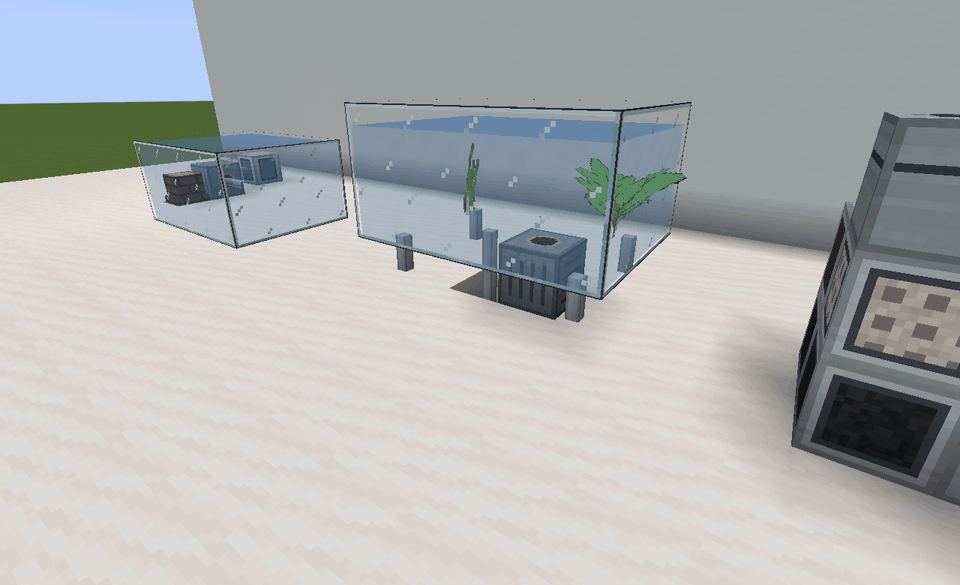

---
navigation:
  title: Multiblock external filter
  icon: bettacraft:filter_pump_head
  parent: equipment.md
  position: 38
item_ids:
  - bettacraft:filter_chamber
  - bettacraft:filter_pump_head
  - bettacraft:filter_inlet
  - bettacraft:filter_outlet
---

# Multiblock external filter

<GameScene zoom="3" interactive={true}>
  <Block id="bettacraft:filter_chamber" p:medium="sponge" />
  <Block id="bettacraft:filter_chamber" y="1" p:medium="ceramic" />
  <Block id="bettacraft:filter_pump_head" y="2" p:active="true" />
  <Block id="bettacraft:filter_inlet" x="-1" p:facing="west" />
  <Block id="bettacraft:filter_outlet" x="-1" y="1" p:facing="west" />
</GameScene>

A big external filter you build yourself, in **any size**:

* <ItemLink id="bettacraft:filter_chamber" />: 1 to 16 chambers joined face to face (a column, a 2x2 block ...).
  Each holds one [filter medium](filter_media.md): right-click with it to put it in, with an empty hand to take it out.
* <ItemLink id="bettacraft:filter_pump_head" />: **exactly one**, touching the chambers.
* <ItemLink id="bettacraft:filter_inlet" /> (blue) and <ItemLink id="bettacraft:filter_outlet" /> (orange): at least one
  each, placed against a chamber; their socket faces away and joins a [pipe](pipes.md) or an aquarium block.

The pump head pulls water through the inlet and pushes it out of the outlet (100 mB/t at full power). When **inlet and
outlet lead to the same aquarium** (directly, through pipes or through a [bulkhead](bulkhead.md)), the filter keeps
that aquarium clean: every chamber adds what its medium cleans (sponge 12, ceramic 24, carbon 16, peat 6 water
blocks), less the dirtier the medium is, times the power regulator. Clogged sponges also slow the flow.

Right-click the pump head (or a chamber with an empty hand): the filter's screen with its size, problems, the aquarium
it cleans, the flow and every chamber's medium with its dirt. Sneak + mouse wheel: [power regulator](regulator.md).
With power costs (`power.costs` `EASY` or `HARD`) the pump head needs FE.

**Under the aquarium:** the filter may also stand directly under its aquarium, like a cabinet filter: chambers on the
floor, the inlet and the outlet on top of them with their sockets facing up into the aquarium's floor (or chambers
right under the floor and the connectors at the side with pipes up). With a block in your hand a click on a filter part
places the block instead of opening the screen, so you can build the aquarium on top.

The old one-block [external filter](filters.md) stays the small variant.

## Several aquariums, pipes and water changes

* [Filter lines](filter_lines.md): pipes at the inlet are its intake line (blue), at the outlet its return line (orange);
  they branch to every aquarium they reach, and each aquarium needs an intake and an outlet [guard](guards.md) inside. The
  screen says "Serves 3 tanks:" above the list of its aquariums.
* **Flow:** the pump head moves up to 100 mB/t, but never more than its lines carry (glass 50, stainless steel 250 mB/t;
  several lines add up).
* **Other pipes:** pipes join the chambers and the pump head on every face as plain ends without a role. A pipe at the inlet
  or outlet that also reaches another port is a short circuit.
* **Water changes:** the filter has no fresh or waste water ports. A [water change controller](water_change.md) placed
  against a chamber or the pump head (or with its fresh water out and waste water in lines ending at one) changes the
  water of all the filter's aquariums and tops off those with a [level sensor](level_sensor.md).
* [Water in the tank](water_system.md): example setups with one filter for several aquariums and a central technical room.

**Important for old worlds:** every multiblock filter needs an **intake guard and an outlet guard** in each of its
aquariums, also filters built before guards existed. Until they are fitted the filter **does not filter** (red note in its
screen and in the aquarium menu). Servers can keep the old way with `features.pipes.filterLines = false`.

<SubPages icons={true} />

## Obtaining

Crafting:

<RecipesFor id="bettacraft:filter_chamber" />
<RecipesFor id="bettacraft:filter_pump_head" />
<RecipesFor id="bettacraft:filter_inlet" />
<RecipesFor id="bettacraft:filter_outlet" />
