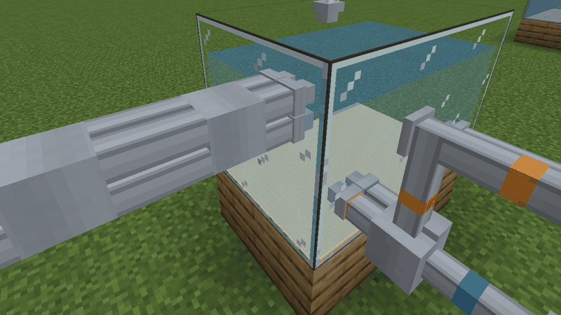

---
navigation:
  title: Pipe bundles
  icon: bettacraft:stainless_steel_pipe
  parent: equipment/water_system.md
  position: 3
---

# Pipe bundles

Up to **four pipes run in one block**, like the conduits of other mods:

* **Sneak + right-click** a pipe with a glass or stainless steel pipe: both run on in a **pipe bundle**. More go in the same
  way, up to four.
* Each pipe of the bundle is **its own line** with its own sides, glass or steel, and its own role and colour ring (from the
  ports its line reaches, see [pipes](pipes.md)). The pipes **never mix**, also two lines of the same role (two intake lines
  side by side are fine).
* **Sneak + right-click with an empty hand** takes the pipe you look at out again; with one pipe left the block is a plain
  pipe again (it keeps its material, sides, ring and cover). Breaking a bundle gives every pipe back.

## Joining

* **Bundle to bundle:** every pipe keeps to its own corner of the steel manifold and joins the pipe in the same corner of the
  next bundle, so a row of bundles carries its lines straight on. Sneak + right-click with the
  [pipe wrench](pipe_wrench.md) moves a pipe to the next corner, to line it up.
* **Bundle to a single pipe, a port or a device:** it meets **one** of the bundle's pipes: the one that already leads there,
  else the one with an open end. Its arm comes out of the middle of the manifold, in line with that pipe.
* **Bundle to an aquarium:** **all** its pipes dock side by side, each with its own small flange on the glass. The wrench
  closes a single pipe's side as on a plain pipe.

## Inside the aquarium: a dock per line

Where a bundle docks, every line of it has its **own pipe dock** inside, behind its flange, with the colour ring of its line
(a bundle with only one line to that face docks in the middle like a single pipe). So an intake line and a return line, or
the fresh water and waste water lines of a [water change controller](water_change.md), can enter through **one aquarium
block**, and each line gets its own guard: inside at its dock, or from outside by using the guard on that line's flange (see
[guards](guards.md)). From the docks the lines go on inside as interior pipes, also as an
[interior bundle](bulkhead.md).

Docks of bundles from older versions, where one dock in the middle served all lines, split into one dock per line by
themselves when the world loads; their guards move to the line they belong to. Where that is not clear (interior pipes behind
the dock lead to both kinds of outlets), the old dock stays shared and works as before.
