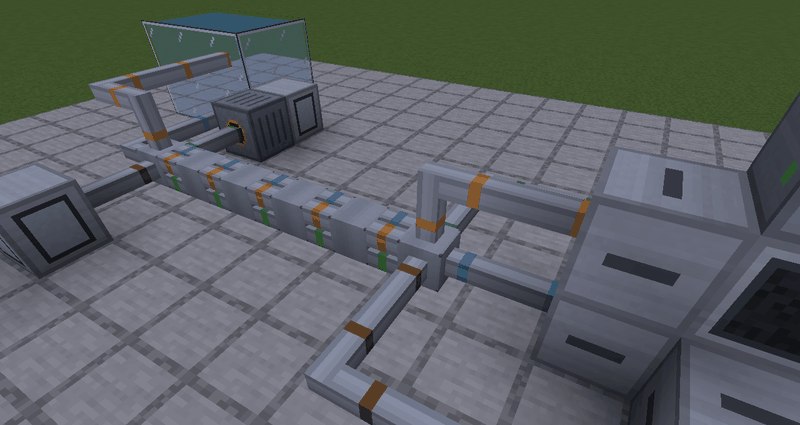
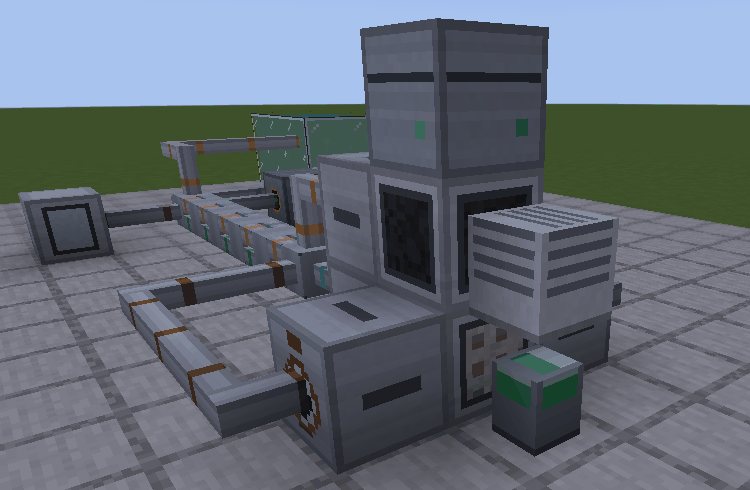

---
navigation:
  title: Pipe bundles, fresh and waste water
  icon: bettacraft:filter_fresh_pipe
  parent: equipment/multiblock_filter.md
  position: 2
item_ids:
  - bettacraft:filter_fresh_pipe
  - bettacraft:filter_waste_pipe
  - bettacraft:filter_fresh_port
  - bettacraft:filter_waste_port
---

# Pipe bundles, fresh and waste water

<GameScene zoom="3" interactive={true}>
  <Block id="bettacraft:filter_fresh_pipe" p:west="true" p:east="true" />
  <Block id="bettacraft:filter_waste_pipe" z="1" p:west="true" p:east="true" />
  <Block id="bettacraft:filter_chamber" x="2" p:medium="ceramic" />
  <Block id="bettacraft:filter_fresh_port" x="1" p:facing="west" />
  <Block id="bettacraft:filter_waste_port" x="2" z="1" p:facing="south" />
</GameScene>

## Pipe bundles

Up to **four filter lines run in one block**, like the conduits of other mods: right-click a filter pipe with the pipe of
**another line** and both run on in a **pipe bundle** (up to four). Sneaking with the pipe in your hand places it beside
instead. Each line in the bundle keeps its own connections and its own T-piece (a T-piece used on a bundle goes on the line
you look at); the lines **never mix**. Sneak-right-click a bundle with an empty hand to take the line you look at out
again: its pipe (and T-piece) come back, and with one line left the block is a plain pipe again. Breaking a bundle gives
the pipe of every line back.

The four lines and their colours: intake (blue) and return (orange) of the [filter lines](filter_lines.md), fresh water
(green) and waste water (brown); each pipe carries a ring of its colour at every block border.

Between two bundles every line keeps to its own corner of the steel manifold, so the bundles line up. Where a line leaves
the bundle into a single pipe (or a filter connector, an aquarium), its arm comes out of the **middle** of the manifold, in
line with that pipe.

## Fresh and waste water

* <ItemLink id="bettacraft:filter_fresh_pipe" /> (green): from a water pump, a [reservoir](pipes.md), an ME or RS export
  bus or the pipes of other mods to the filter.
* <ItemLink id="bettacraft:filter_waste_pipe" /> (brown): from the filter to a reservoir, an aquarium, another mod's pipe
  or storage. Other mods' pipes and pumps may pull the old water from it.
* <ItemLink id="bettacraft:filter_fresh_port" /> and <ItemLink id="bettacraft:filter_waste_port" />: placed against a
  chamber of the filter, their socket facing out. Each holds 8 buckets. A water source block next to the fresh water port
  is endless tap water.

A [level sensor](top_off.md) or a [water change controller](water_change.md) **touching any part of the filter** then
works on **every aquarium the filter serves**: it tops off evaporated water and changes a part of the water of each one,
shared by what each aquarium needs when water is short. The old water goes out of the waste water port, on to the end of
its line; **without a waste water port it is discarded**.

Only the fresh and the waste water line offer their water to other mods (pipes of EnderIO, Pipez, Mekanism, the buses of
Applied Energistics 2 and Refined Storage plug in); the intake and return lines stay inside the filter.

## Obtaining

Crafting:

<RecipesFor id="bettacraft:filter_fresh_pipe" />
<RecipesFor id="bettacraft:filter_waste_pipe" />
<RecipesFor id="bettacraft:filter_fresh_port" />
<RecipesFor id="bettacraft:filter_waste_port" />
