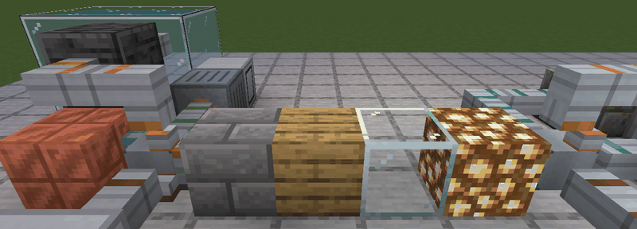
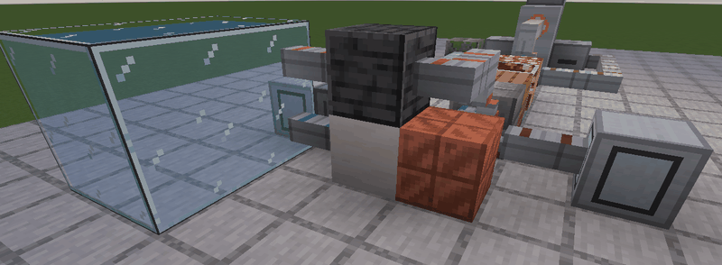

---
navigation:
  title: Pipe cover and facades
  icon: bettacraft:pipe_cover
  parent: equipment/water_system.md
  position: 10
item_ids:
  - bettacraft:pipe_cover
---

# Pipe cover and facades

The <ItemLink id="bettacraft:pipe_cover" /> hides [pipes](pipes.md) and [pipe bundles](pipe_bundle.md):

1. Hold the pipe cover in your **main hand** and a **full block** (stone, planks, bricks, glass, a lamp ...) in your
   **off hand**.
2. Right-click a pipe or a pipe bundle: it is **drawn as that block** (a log lies along the face you click).

The pipe keeps its lines, connections and closed sides and works as before. While covered it is a full block to walk on, and it
shines and sounds like the block. One block is used; it **comes back** when the cover comes off or the
pipe is broken. The pipe cover itself is not used up. A new block on a covered pipe swaps the cover.

**Sneak-right-click with the pipe cover** takes the cover off again. (Sneaking with an empty hand on a bundle still takes
a line out.) Blocks with a block entity (chests, machines), slabs, stairs and other blocks that are not full cubes cannot
cover a pipe.

## Facades of other mods

* **Applied Energistics 2** cable facades, **EnderIO** conduit facades and **Mekanism Covers** can be used on our pipes and
  bundles directly: the pipe is drawn as the facade's block, the facade is kept and comes back like a block
  (sneak-right-click with the pipe cover, or breaking the pipe).
* **Cable Facades**: its facades go on our pipes and bundles like on any cable of another mod (its wrench takes them
  off again); the pipe is hidden under them and keeps working.

## Obtaining

Crafting:

<RecipesFor id="bettacraft:pipe_cover" />
