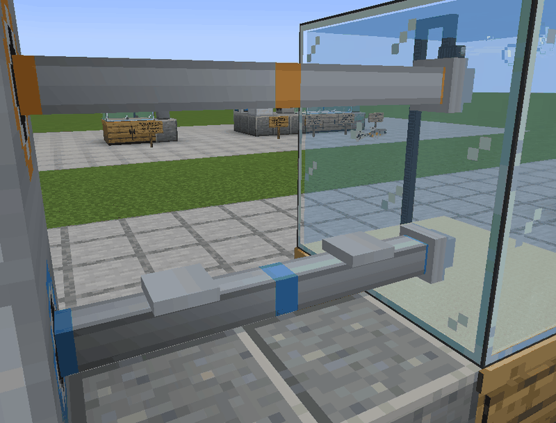

---
navigation:
  title: Pipe wrench
  icon: bettacraft:pipe_wrench
  parent: equipment/water_system.md
  position: 2
feature: pipes.pipeWrench
item_ids:
  - bettacraft:pipe_wrench
---

# Pipe wrench

<GameScene zoom="3" interactive={true}>
  <Block id="bettacraft:stainless_steel_pipe" p:west="true" p:east="true" p:ring="intake" />
  <Block id="bettacraft:stainless_steel_pipe" x="1" p:west="true" p:east="true" p:ring="intake" />
  <Block id="bettacraft:stainless_steel_pipe" x="2" p:west="true" p:east="true" p:ring="intake" />
  <Block id="bettacraft:glass_pipe" z="1" p:west="true" p:east="true" p:ring="return" />
  <Block id="bettacraft:glass_pipe" x="1" z="1" p:west="true" p:east="true" p:ring="return" />
  <Block id="bettacraft:glass_pipe" x="2" z="1" p:west="true" p:east="true" p:ring="return" />
</GameScene>

A [pipe](pipes.md) joins every neighbour that fits. The <ItemLink id="bettacraft:pipe_wrench" /> decides where it does not:

* **Right-click a side** of a pipe (an arm of the pipe, or the face of its middle where a side is closed): that side is
  **closed**. The pipe no longer joins what is there, and a steel **cap** shows it. Right-click again to **open** it.
* A side closed on one of two pipes is enough: they stay apart.
* On a [pipe bundle](pipe_bundle.md) the wrench works on the pipe you look at. **Sneak + right-click** moves that pipe to
  the next spot of the bundle, to line it up with the next bundle.
* The wrench is not used up.

What it is for:

* **Two lines side by side**, as in the scene above: an intake line and a return line in neighbouring blocks would join and
  be a short circuit; close the sides between them and both keep their own role.
* **Moving a joint:** close a side here and open one there, and a branch goes where you want it.
* **Passing by:** a plain water line that runs past a filter chamber, a device or an aquarium joins it; close that side and
  the line passes by.

With `features.pipes.pipeWrench = false` the wrench does nothing; closed sides stay closed.

## Obtaining

Crafting:

<RecipesFor id="bettacraft:pipe_wrench" />
