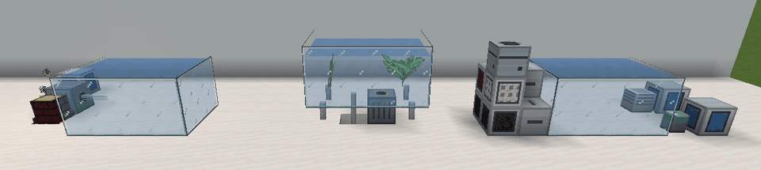

---
navigation:
  title: Pipes and water pump
  icon: bettacraft:glass_pipe
  parent: equipment.md
  position: 41
item_ids:
  - bettacraft:glass_pipe
  - bettacraft:stainless_steel_pipe
  - bettacraft:water_pump
---

# Pipes and water pump

<GameScene zoom="3" interactive={true}>
  <Block id="bettacraft:tank" x="0" p:fill="14" />
  <Block id="bettacraft:glass_pipe" x="1" p:west="true" p:east="true" />
  <Block id="bettacraft:water_pump" x="2" p:facing="east" />
  <Block id="bettacraft:stainless_steel_pipe" x="3" p:west="true" p:east="true" />
  <Block id="bettacraft:reservoir" x="4" />
</GameScene>

Pipes carry **water with all its values**: temperature, salt, quality and nitrate travel with it (and later RO water,
sea water and live food suspensions). Water from a bucket or a water source is fresh normal water.

* <ItemLink id="bettacraft:glass_pipe" />: cheap, carries **50 mB per tick**.
* <ItemLink id="bettacraft:stainless_steel_pipe" />: carries **250 mB per tick**. A network of both kinds carries what
  its weakest pipe carries.
* Jade shows what a pipe carries a second (50 mB per tick = 1,000 mB a second); a pipe stores no water, so it shows no
  stored amount.
* Pipes join each other, every aquarium block, the [reservoir](top_off.md), the
  [multiblock filter](multiblock_filter.md), cauldrons and the **tanks and pipes of other mods** (Mekanism, EnderIO,
  Create, AE2, RS ...: the normal fluid handler).
* Where a pipe (also a filter pipe or a line of a pipe bundle) joins an aquarium, a steel **bulkhead** goes through the
  glass: a flange outside and the same flange inside, with a short stub into the tank, from which the pipes inside the tank
  go on.
* **Pipes do not pump.** Water moves when something pushes it in: the <ItemLink id="bettacraft:water_pump" />, the
  pump head of a [multiblock filter](multiblock_filter.md) or the pump of another mod. It then reaches the blocks at
  the ends of the pipes.

**Water pump:** pulls water from the block behind it and pushes it into the block in front of it, **200 mB per
tick**. When you place it, look where the water should go. Right-click or sneak + mouse wheel: [power
regulator](regulator.md). Redstone stops it. With `pipes.pumpsRequireEnergy` it needs FE (`pumpFePerTick` 8).

An aquarium block takes water from a pipe on any side. From **below**, a floor block with a
[bulkhead](bulkhead.md) lets it in through outlets you place inside the aquarium.

Pipes also carry **live food**: a [live food pump](../food/live_food_pump.md) next to a breeder pushes live food
suspension through them into the tanks.

## Obtaining

Crafting:

<RecipesFor id="bettacraft:glass_pipe" />
<RecipesFor id="bettacraft:stainless_steel_pipe" />
<RecipesFor id="bettacraft:water_pump" />
