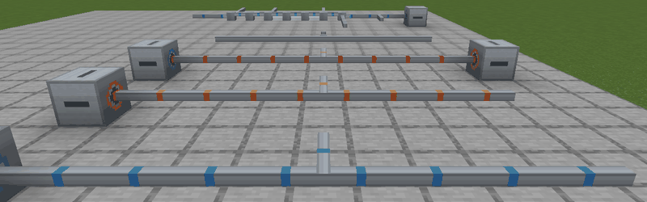

---
navigation:
  title: Pipes and water pump
  icon: bettacraft:glass_pipe
  parent: equipment/water_system.md
  position: 1
item_ids:
  - bettacraft:glass_pipe
  - bettacraft:stainless_steel_pipe
  - bettacraft:water_pump
---

# Pipes and water pump

<GameScene zoom="3" interactive={true}>
  <Block id="bettacraft:tank" x="0" p:fill="14" />
  <Block id="bettacraft:glass_pipe" x="1" p:west="true" p:east="true" />
  <Block id="bettacraft:water_pump" x="2" p:facing="east" />
  <Block id="bettacraft:stainless_steel_pipe" x="3" p:west="true" p:east="true" />
  <Block id="bettacraft:reservoir" x="4" />
</GameScene>

There are **two pipes**, and they are used for everything: plain water lines, the lines of the
[multiblock filter](multiblock_filter.md) and those of the [water change controller](water_change.md), outside and inside
the aquarium. How it all fits together: [water in the tank](water_system.md).

* <ItemLink id="bettacraft:glass_pipe" />: cheap, carries **50 mB per tick**.
* <ItemLink id="bettacraft:stainless_steel_pipe" />: carries **250 mB per tick**.

Pipes carry **water with all its values**: temperature, salt, quality and nitrate travel with it (also reverse osmosis
water, sea water and live food suspension). Water from a bucket or a water source is fresh normal water.

## Joining

A pipe joins **every neighbour that fits, on every side**: other pipes, [pipe bundles](pipe_bundle.md), aquarium blocks,
the [reservoir](reservoir.md), the [drain](drain.md), the chambers and the pump head of a multiblock filter, the ports of the
filter and of the water change controller, devices such as the water pump, the live food pump or the dosing pump, cauldrons
and the **tanks and pipes of other mods** (Mekanism, EnderIO, Create, AE2, RS ...: the normal fluid handler). So a line
branches by itself; no special pieces are needed. To keep a pipe from joining something next to it, close that side with the
[pipe wrench](pipe_wrench.md). Sneak + right-click a pipe with another pipe and both run on in one block, a
[bundle](pipe_bundle.md).

Where a line reaches an aquarium it docks on the glass with a steel flange; for filter lines and the controller's waste
water line a [pipe dock](bulkhead.md) appears inside, from which pipes go on in the interior. A glass or stainless steel pipe
placed **inside** the aquarium is an interior pipe there.

## Roles and colour rings

All pipes joined together are one **line**, and the **port** a line reaches gives it its role, shown by a colour ring at
every block border:

| Port | Line | Ring |
|---|---|---|
| inlet of a multiblock filter | intake line | blue |
| outlet of a multiblock filter | return line | orange |
| fresh water in or out of a water change controller | fresh water line | green |
| waste water in or out of a water change controller | waste water line | brown |
| none | plain water line | none |

A line that reaches ports of **two different roles** is a **short circuit** and turns **red**: an intake line that also
reaches the filter's outlet, or a controller whose fresh water in and fresh water out are on one line (both green, but two
roles). The filter or the controller stops and says so in its screen and in Jade / The One Probe / WTHIT; players nearby get
a chat note. Several ports of the **same** role on one line are fine (two controllers on one fresh water supply).

Filter lines belong to their filter and carry only its water. The controller's lines carry what it moves and what pumps push
into its fresh water inlet; plain lines carry what a pump pushes in.

## Flow

A line carries at most what its **weakest pipe** carries. A multiblock filter pumps up to 100 mB/t, so on a glass line it
runs at half; several lines of one role add up (two glass intake lines and two glass return lines give it its full flow). A
water change moves per step what its lines carry. Jade, The One Probe and WTHIT show a pipe's role and what its line
carries a second (50 mB per tick = 1,000 mB a second); a pipe stores no water.

## Water pump

**Pipes do not pump.** The <ItemLink id="bettacraft:water_pump" /> pulls water from the block behind it and pushes it into
the block in front of it, **200 mB per tick**. When you place it, look where the water should go. Right-click or sneak +
mouse wheel: [power regulator](regulator.md). Redstone stops it. With power costs (`power.costs` `EASY` or `HARD`) it needs FE
(`pumpFePerTick` 8). A pump at a water source with a pipe to the fresh water inlet of a water change controller gives it
endless tap water.

Pipes also carry **live food**: a [live food pump](../food/live_food_pump.md) next to a breeder pushes live food suspension
through them into the tanks.

## Pipes from older versions

Worlds from before 1.57 change by themselves when they load, and nothing is lost: the filter pipes of all four kinds, their
T-pieces and the fresh and waste water ports of the filter are **stainless steel pipes** with exactly the connections they
had (the other sides are closed, as with the wrench); bundles keep their lines. In inventories, chests and the storage of
other mods they turn into stainless steel pipes, the old interior pipe into a glass pipe.

## Obtaining

Crafting:

<RecipesFor id="bettacraft:glass_pipe" />
<RecipesFor id="bettacraft:stainless_steel_pipe" />
<RecipesFor id="bettacraft:water_pump" />
