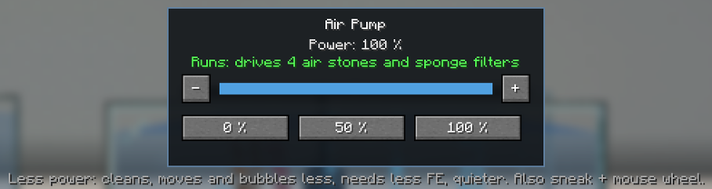

---
navigation:
  title: Power regulator
  icon: minecraft:comparator
  parent: equipment.md
  position: 37
feature: power.regulator
---

# Power regulator

Filters, [air stones](air_stone.md), [air pumps](air_pump.md) and flow pumps can run at **0 to 100 %** (steps of 10 %).

* **Sneak + mouse wheel** while you look at the device changes it by 10 %.
* **Right-click** an air pump, an air stone or a device in the interior (internal, corner or sponge filter, flow pump)
  opens a small regulator window. External filters and cabinet filters have a button in their menu (click +10 %,
  sneak + click -10 %).

Less power means:

* **less effect:** a filter at 50 % cleans half as much water, a flow pump moves half as much, an air stone brings
  half the oxygen; the water jet is shorter;
* **less energy** if the server needs power for it (see [Power](power.md));
* **quieter:** the sound follows the power. Each player can also set the volume per kind of device in the client
  config (`sound.filterVolume`, `airPumpVolume`, `airStoneVolume`, `flowPumpVolume`, `feederVolume`).

At 0 % the device stands still. A server can switch the regulator off (`features.power.regulator`): then everything
runs at 100 %.
