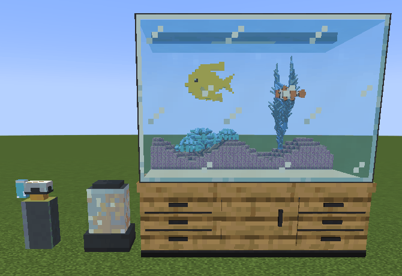
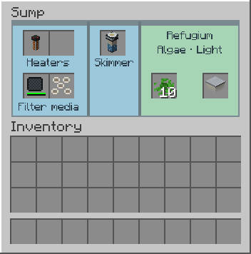
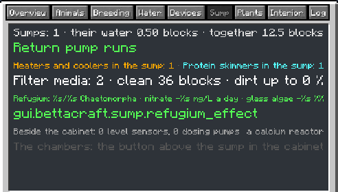

---
navigation:
  title: Sump
  icon: bettacraft:sump
  parent: equipment.md
  position: 81
item_ids:
  - bettacraft:sump
---

# Sump

A **sump** is a second, small tank in the [cabinet](cabinet.md) under the aquarium. The water runs down through an
overflow into it and a return pump brings it back up. Put the sump into the **sump slot** of a cabinet (between the heater
slots and the air pump slot).

* **More water:** each sump adds **0.5 blocks of water** to the tank (`sump.sumpWaterBlocks`): the waste, the nitrate and
  the dosed values spread over more water and change more slowly, and the tank has room for more animals.
* **A filter:** its return pump runs like an [external filter](filters.md) (with FE where the tank needs power); the
  overflow takes in no fry.
* **Chambers:** the button **»** above the sump slot opens them:

| Chamber | |
|---|---|
| Heaters | two [heaters](heaters.md) or [coolers](coolers.md), like in an external filter |
| Skimmer | a [protein skimmer](../saltwater/protein_skimmer.md): cleans salt water like one on the wall |
| Filter media | two [filter media](filter_media.md); they clog and are washed like in the multiblock filter |
| [Refugium](refugium.md) | Chaetomorpha and a tank light: takes up nitrate |

* **Devices beside the cabinet:** a [level sensor](level_sensor.md) or a [dosing pump](../saltwater/dosing_pump.md) next to the
  cabinet of a sump serves the tank above, and so does a [calcium reactor](../saltwater/calcium_reactor.md): they take no
  room at the tank.
* The tank menu gets the tab **Sump**: the water of the sumps, the pump, the chambers, the refugium and the devices beside
  the cabinets.

Old cabinets get the new slot empty; nothing changes for a tank without a sump. Switch: `features.sump.enabled`.

## Obtaining

Crafting:

<RecipesFor id="bettacraft:sump" />
