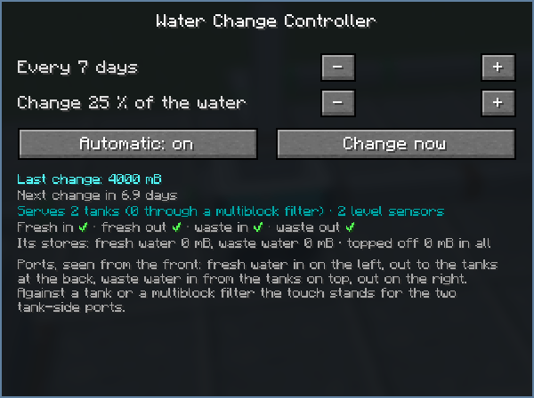
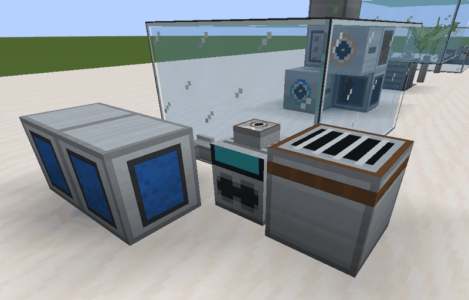
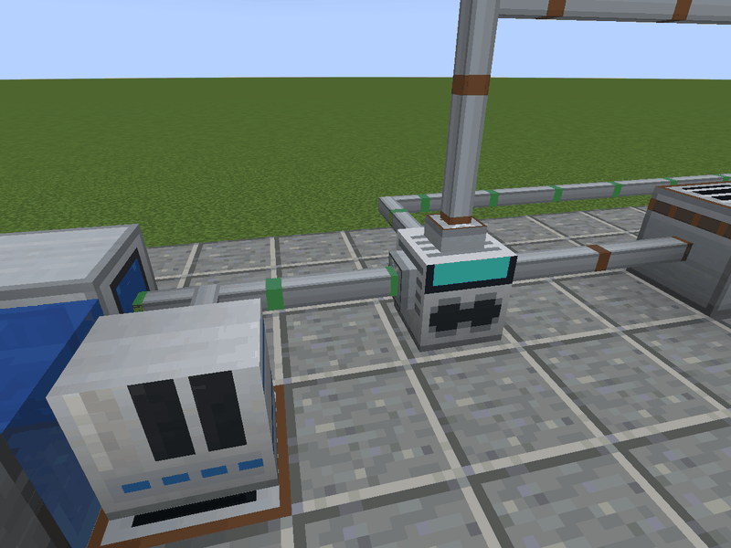

---
navigation:
  title: Water change controller
  icon: bettacraft:water_change_controller
  parent: equipment/water_system.md
  position: 6
item_ids:
  - bettacraft:water_change_controller
---

# Water change controller

<GameScene zoom="4" interactive={true}>
  <Block id="bettacraft:water_change_controller" p:facing="south" />
</GameScene>

Aquariums need **water changes** because [nitrate](../aquarium/nitrate.md) builds up. By hand: take water out with an
empty bucket and pour fresh water in (25 % of a 4-block aquarium is one bucket). Fresh water has the temperature of the
place, so a big change is a cool water change (corydoras love it).

The <ItemLink id="bettacraft:water_change_controller" /> does it by itself, and it also **tops off** evaporated water. Right-click
it:

* **interval** 1 to 60 days (default: what the difficulty asks for, 14 days) and **share** 5 to 50 % (default 25 %);
* **automatic on/off** and **change now**;
* the aquariums it serves (and how many through a multiblock filter), the level sensors it reads, its four ports, its stores
  and warnings.

## The four ports

Seen from the front (the panel faces you when you place it), each port is a stub with its colour and an arrow:

| Port | Where | Joins |
|---|---|---|
| fresh water **in** | left | a [pipe](pipes.md) from a [reservoir](reservoir.md), a water pump at a water source, a reverse osmosis unit or another mod's tank |
| fresh water **out** | back | the line to the aquariums |
| waste water **in** | top | the line from the aquariums |
| waste water **out** | right | a [drain](drain.md), a reservoir or another mod's tank, right at the port or through a pipe |

The front and the bottom have no port. Each line gets its role from its port and shows it with a green (fresh) or brown
(waste) ring. Fresh water in and fresh water out on one line, or any line that also reaches a filter's inlet or outlet, is a
**short circuit**: the controller stops.

**Fresh water always comes through a pipe.** What merely stands next to the controller (a reservoir, a water source, another
mod's tank) gives it nothing. Pumps and other mods' pipes may push water into the fresh water inlet, and other mods' pipes may
pull from the waste water outlet.

## Which aquariums it serves

* **Touching:** placed against an aquarium (look at the aquarium when you place it: its back is on the glass), the touch
  stands for both aquarium-side ports; then two pipes do: fresh water in and waste water out.
* **Through its lines:** standing free, the fresh water out line fills the aquariums it docks on, the waste water in line
  drains them. Both lines may dock on the same aquarium block: as a [bundle](pipe_bundle.md) on one face, on two faces of an
  edge or corner block, or on different blocks of the same aquarium.
* **At a multiblock filter:** touching a filter chamber or the pump head, or with its aquarium-side lines ending at one, it
  serves **all the filter's aquariums** (shared by what each needs; the fresh water goes in over the filter's return).
  Do not join its lines to the filter's inlet or outlet: that is a short circuit.

A water change needs an aquarium that is filled **and** drained; topping off needs only the filling.

## A water change

When the interval has passed (or on "change now"), it works in steps of half a second: each step it takes fresh water from
its line, drains **exactly as much** from the aquariums (never more than it can refill, and never below half full while
animals live there) and puts the fresh water in. A step moves what its lines carry: glass 500 mB, stainless steel 2,500 mB;
touching has no limit. So a big change through glass pipes takes a few steps. The old water goes into its waste water store
(4,000 mB) and on through its waste water outlet; without a drain it waits and says so. The tank log notes every change.

Where it drains an aquarium, an **intake guard** inside keeps the young animals in; without one the change sucks in the
drained share of the fry, young shrimp and tadpoles (see [guards](guards.md)).

## Top-off

Between water changes it tops off every aquarium it fills that has a [level sensor](level_sensor.md): it reads the sensor
without a cable and adds what is missing (from 50 mB on, up to 1,000 mB a step). **Fresh water only:** a salty source is
refused, so the salt of a [reef tank](../saltwater.md) stays where it was. Without a sensor it only changes water; without the
controller a sensor only measures.

With power costs (`power.costs` `EASY` or `HARD`) it needs FE (8 FE per 100 mB). Switches: `features.pipes.autoWaterChange`,
`topOff`, `filterWater` (serving a multiblock filter).

## Obtaining

Crafting:

<RecipesFor id="bettacraft:water_change_controller" />
