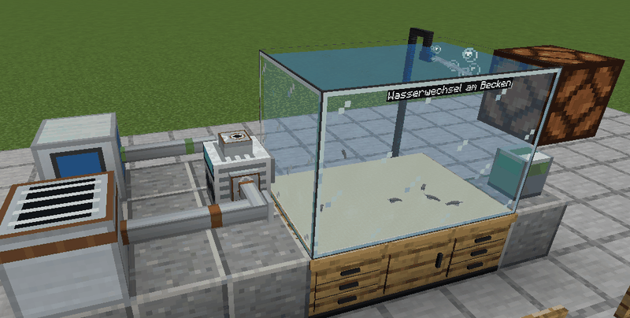
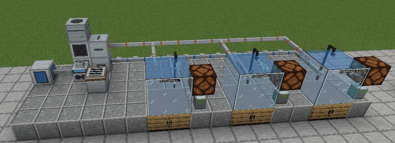
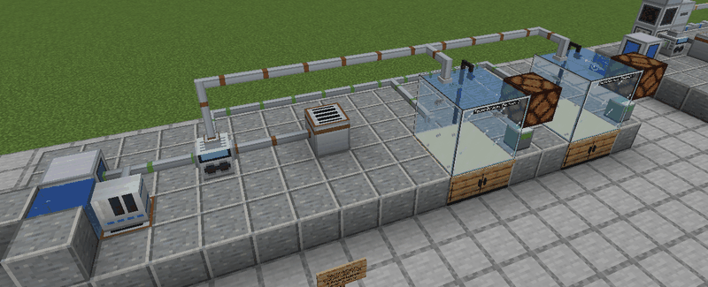

---
navigation:
  title: "Water in the tank: how it all fits together"
  icon: bettacraft:stainless_steel_pipe
  parent: equipment.md
  position: 41
---

# Water in the tank: how it all fits together

<GameScene zoom="3" interactive={true}>
  <Block id="bettacraft:tank" x="0" p:fill="14" />
  <Block id="bettacraft:water_change_controller" x="1" p:facing="east" />
  <Block id="bettacraft:glass_pipe" x="1" z="1" p:north="true" p:south="true" p:ring="fresh" />
  <Block id="bettacraft:reservoir" x="1" z="2" p:fill="6" />
  <Block id="bettacraft:drain" x="1" z="-1" />
  <Block id="bettacraft:level_sensor" x="0" y="1" p:facing="east" />
</GameScene>

Water moves between aquariums, filters and devices through **one kind of pipe system**. There are only two pipes, glass and
stainless steel, and what a pipe does follows from what it is joined to. This page shows how the parts work together; every
part has its own page below.

## The parts

| Part | What it does |
|---|---|
| [Pipes and water pump](pipes.md) | glass (50 mB/t) and stainless steel (250 mB/t) pipes join every neighbour that fits; a pump pushes water |
| [Pipe wrench](pipe_wrench.md) | closes and opens single sides of a pipe, so lines side by side stay apart |
| [Pipe bundles](pipe_bundle.md) | two to four pipes in one block, each its own line |
| [Pipe docks and interior pipes](bulkhead.md) | where a line enters the aquarium, and the pipes and outlets inside it |
| [Guards](guards.md) | an intake guard or an outlet guard at each dock keeps the animals in |
| [Multiblock external filter](multiblock_filter.md) and its [filter lines](filter_lines.md) | one filter for several aquariums: an intake line and a return line |
| [Water change controller](water_change.md) | water changes and top-off through four ports: fresh water in and out, waste water in and out |
| [Level sensor](level_sensor.md) | measures the water level, gives a redstone signal; the controller tops off by it |
| [Drain](drain.md) | the end of a waste water line: discards the water |
| [Reservoir](reservoir.md) | holds 16 buckets: a source of fresh water |
| [Pipe cover and facades](pipe_cover.md) | hides pipes behind any full block |

## Lines and their roles

All pipes that are joined together form one **line**. A line gets its role from the **port** it reaches, and shows it with a
**colour ring** at every block border:

* the **inlet** of a multiblock filter: intake line, **blue**;
* the **outlet** of a multiblock filter: return line, **orange**;
* the fresh water ports of a water change controller (in on its left, out at its back): fresh water line, **green**;
* the waste water ports of a water change controller (in on top, out on its right): waste water line, **brown**;
* no port at all: a plain water line without a ring (it carries what a pump pushes into it).

A line that reaches ports of **two different roles** is a **short circuit** (red rings): the filter or the controller stops and
says why. Keep such lines apart with the [pipe wrench](pipe_wrench.md) or run them through a [bundle](pipe_bundle.md). A line
carries at most what its **weakest pipe** carries.

Fresh water only ever comes **through a pipe**: a reservoir, a water pump at a water source, a reverse osmosis unit or
another mod's tank at the end of the controller's fresh water line. What merely stands next to the controller or the level
sensor does not count.

## Example: a single aquarium

The scene above: a water change controller with its **back against the glass**. Touching the aquarium stands for its two
aquarium-side ports, so it needs only two pipes:

1. a glass pipe from a <ItemLink id="bettacraft:reservoir" /> (or a water pump at a water source) to its **left** port
   (fresh water in, green ring);
2. a <ItemLink id="bettacraft:drain" /> right at its **right** port (waste water out);
3. an **intake guard** inside the aquarium where the controller touches it, so the water change does not suck in young
   animals;
4. a <ItemLink id="bettacraft:level_sensor" /> on the aquarium: the controller reads it and tops off evaporated water.

A filter of your choice keeps the water clean: an internal or external filter, or a multiblock filter.

## Example: one filter, several aquariums

1. Build a [multiblock filter](multiblock_filter.md) and lay a pipe from its **inlet** and one from its **outlet** to every
   aquarium. The pipes branch by themselves; the lines turn blue and orange.
2. Where the lines dock, put an **intake guard** on the blue dock and an **outlet guard** on the orange one in each aquarium
   (from outside on the flange is enough, see [guards](guards.md)).
3. Glass lines carry 50 mB/t, the filter pumps up to 100: use stainless steel, or two lines each way.
4. Place a [water change controller](water_change.md) **against a filter chamber or the pump head** (or lead its fresh water
   out and waste water in lines to a chamber or the pump head). It changes the water of **all the filter's aquariums** and
   tops off those with a level sensor. The fresh water goes in over the filter's return.

Do not join the controller's lines to the filter's inlet or outlet: that is a short circuit.

## Example: a central technical room

Everything stands in one room, the aquariums elsewhere in the house:

* **Fresh water:** one reservoir (or a water pump at a water source, or a reverse osmosis unit) and one green line to the
  fresh water inlet of **several controllers**. Ports of the same role on one line are fine, no short circuit.
* **Each controller stands free** and uses all four ports: fresh water out (back) and waste water in (top) run to its
  aquarium; both lines may dock on the same aquarium block, as a [bundle](pipe_bundle.md) on one face or on two faces of an
  edge block. The waste water outlets (right) share one line to a drain.
* **Filters:** multiblock filters in the room with their intake and return lines to the aquariums. Run the lines side by
  side in bundles through walls and floors; [pipe covers](pipe_cover.md) hide them.
* **Keep lines apart:** where two lines touch, close the side with the [pipe wrench](pipe_wrench.md); a red ring tells you
  where two roles met.
* Jade, The One Probe and WTHIT show the role and the flow of every line you look at.

<SubPages icons={true} />
