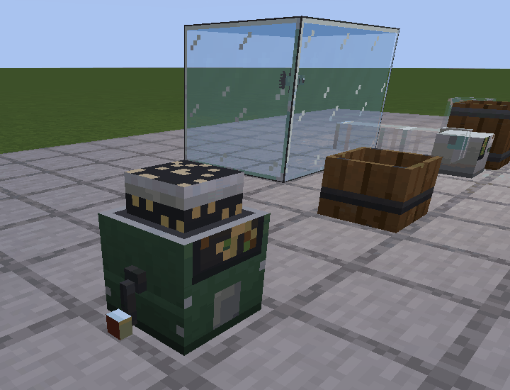
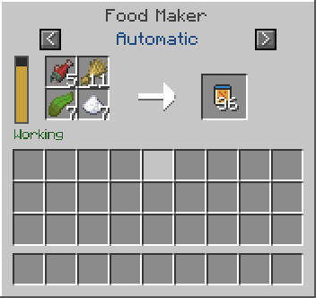

---
navigation:
  title: Food maker
  icon: bettacraft:food_maker
  parent: food.md
  position: 30
item_ids:
  - bettacraft:food_maker
---

# Food maker

<ItemImage id="bettacraft:food_maker" scale="2" />

The food maker makes fish food in **batches** from vanilla ingredients and live food. Put the ingredients into its four
input slots; after a batch (10 seconds) the food lies in the output slot.

* **Product:** choose it with **\<** and **\>**, or leave it on **Automatic**: then it makes the recipe with the most
  ingredients the inputs hold (fish, wheat, kelp and sugar give flakes, not pellets).
* **Spring:** without power it runs on a spring. Right-click it with the [crank](../equipment/crank.md) to wind it (hold
  the button): the crank turns a quarter and the ratchet clicks at every click. About five seconds fill it, and a full
  spring works for **one in-game day** (`foodMaking.springTicks`). The bar on the left shows how much is left.
* **FE:** while power costs are on (`power.costs` `EASY` or `HARD`) it takes
  `foodMaking.makerFePerTick` FE per tick while it works; the bar shows the stored FE. When the FE is short it runs on its
  spring (the brass gauge beside it), so it also works without a generator.
* A redstone signal pauses it. A comparator reads how full the output is.

| Food | Batch | Ingredients |
|---|---|---|
| Betta pellets | 12 | raw fish, wheat, dried kelp |
| [Fish flakes](food_variety.md) | 12 | raw fish, wheat, kelp, sugar |
| [Food granules](food_variety.md) | 12 | spider eye, 2 wheat, dried kelp |
| Algae wafers | 8 | 2 dried kelp, a vegetable (carrot, pumpkin, melon, beetroot), wheat |
| [Shrimp food](food_variety.md) | 8 | kelp, a vegetable, bone meal |
| [Fry powder](fry_food.md) | 8 | egg, wheat |
| [Frozen food](food_variety.md) | 4 | 4 mosquito larvae, artemia nauplii or daphnia, and ice (also packed or blue ice, snow) |

The recipes are data (`bettacraft:food_maker`), so modpacks can add their own; JEI lists them.

## Automation

Hoppers, pipes of other mods and the storage mods use the machine without any special setup: items go into the inputs
from every side and only the food comes out of the output. An **AE2** export bus or interface and an **import bus**, or
the **importer and exporter of Refined Storage**, fill and empty it; with Automatic chosen, a processing pattern only has
to put the ingredients in. The [feeder](../equipment/feeder.md) and the [reservoir](../equipment/top_off.md) work with
these mods the same way.

## Obtaining

Crafting:

<RecipesFor id="bettacraft:food_maker" />
