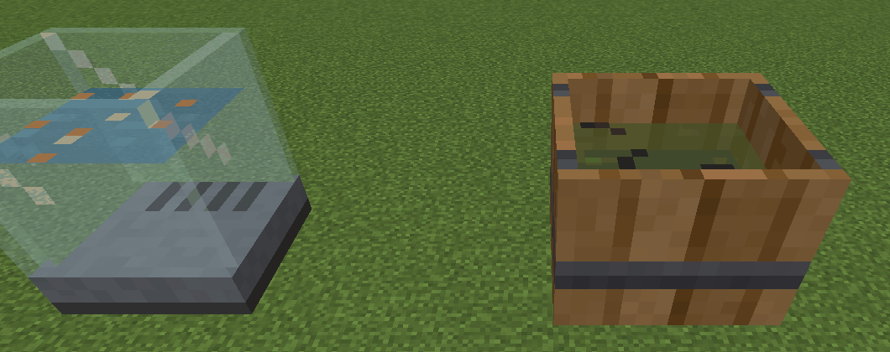

---
navigation:
  title: Breeding live food
  icon: bettacraft:larva_tub
  parent: food.md
  position: 20
feature: liveFood.enabled
---

# Breeding live food

Instead of hatching every portion from a bottle, you can breed live food in blocks: mosquito larvae in the larva tub,
artemia nauplii in the hatchery, tubifex worms in the tubifex dish and daphnia in the daphnia barrel. All work with hoppers
and pipes: ingredients go in from the top or the sides, a hopper below takes the food out, a comparator reads how full it
is. A live food pump next to them feeds the tanks through the pipes on its own.

## In this chapter

<SubPages icons={true} />
